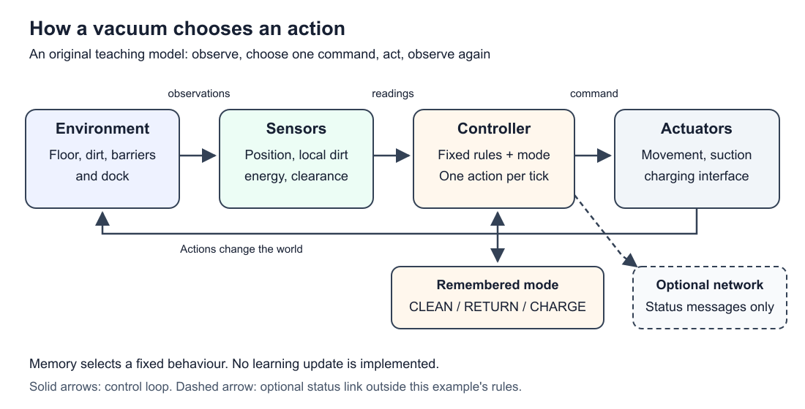

# AI Behaviour: how an agent senses, acts, and learns

**Stage 1 draft — 2026-10-22. Lecturer alignment and teammate review pending.** The lecturer's Chapter 6 download was blocked, so the scope below is a recommendation. See the [source map](research-and-sources.md) for checked claims and access limits.

## 1. Scope and learning sequence

Intended learners: beginners without programming experience. Helpful prior knowledge: an input supplies information, a processor executes instructions, and an output affects something. The Hardware section can introduce sensors and motors before this chapter. Network knowledge is not needed for the paper example.

After this chapter, learners should be able to identify an agent's observations and actions, trace an ordered rule set, explain a conflict between behaviours, follow a finite-state controller, and distinguish fixed control from learning through rewards.

| Step | Beginner question | Learning evidence |
| --- | --- | --- |
| 1. Agent and environment | What receives information and what can it change? | Label a vacuum's sensors and actuators |
| 2. Perception–action loop | Why does the controller read again after acting? | Trace one complete cycle |
| 3. Reactive rules | Which action follows this observation? | Complete a rule table |
| 4. Priorities | What if dirt and low energy occur together? | Explain the first matching rule |
| 5. Finite-state behaviour | Why can the same observation produce another action? | Trace CLEAN, RETURN, and CHARGE |
| 6. Learning comparison | What would have to change for experience to affect choices? | Identify an explicit update mechanism |
| 7. Limits and integration | What does this example fail to solve? | Give a counterexample and connect hardware/network roles |

Fully develop Steps 1–5 for Stage 1, with a substantive introductory comparison for Step 6. Advanced learning algorithms, real docking/navigation, motor-control equations, and physical construction are outside this proposed chapter. This sequence and its depth are teaching choices, not verified lecturer requirements.

## 2. Agent, environment, and observations

An **agent** receives information and acts in an **environment**, the surrounding situation it can affect. **Sensors** supply observations; **actuators** carry out actions. A **controller** chooses commands. A simple reflex controller uses the current observation, while other designs retain information from earlier steps. [S1](research-and-sources.md)

For our vacuum, the agent includes the controller and its physical body. The environment includes the floor, dirt, barriers, and dock. A battery reading is internal information available to the controller. A command to move is distinct from successful movement: real mechanisms and sensors can fail. [S2](research-and-sources.md)

**Our teaching example:** a dirt sensor reports whether the present tile is dirty. It does not report every dirty tile in the corridor. The learner may see the entire paper map, but the controller may only use its defined observations.

## 3. The perception–action loop

Read the observations, select a command, let the action affect the world, then read again. This is feedback: subsequent choices use new observations. The diagram separates information from physical effects. [S1–S2](research-and-sources.md)



**Original figure:** a general agent loop with the teaching controller inside it. Solid arrows show the loop. The dashed optional status link is not part of our action-selection rules. Memory here means an operating mode, not a learned policy.

For example, after SUCK removes dirt, the next observation says the tile is clean. Repeatedly using the old observation would misdescribe the new situation.

## 4. Reactive behaviour and priorities

A **reactive rule** connects an observation to an action. For the first teaching controller, use the following priority order: choose the first matching row and issue exactly one action per tick. A **tick** is one discrete decision-and-action cycle, not a claimed number of seconds.

| Priority | Condition | Action |
| --- | --- | --- |
| 1 | Away from dock with zero energy | WAIT |
| 2 | At dock with energy below 10 | CHARGE |
| 3 | Energy at most 3 and away from dock | LEFT if clear, otherwise WAIT |
| 4 | Current tile dirty | SUCK |
| 5 | A tile to the right exists and is clear | RIGHT |
| 6 | A tile to the left exists and is clear | LEFT |
| 7 | No earlier condition matches | WAIT |

**This rule set is an original teaching design.** Suppose position is tile 2, energy is 3, the tile is dirty, and the left neighbour is clear. Row 3 wins, so the vacuum moves LEFT and leaves the dirt. If rows 3 and 4 were reversed, it would spend energy cleaning first. Rule order therefore expresses a design decision about competing behaviours.

The reactive controller does not have an operating-mode variable. It can still use the battery and location observations. “Reactive” here does not mean that the entire physical device has no memory or that it operates instantaneously.

Brooks studied behaviour layers that couple sensing and action. His subsumption implementation includes asynchronous finite-state modules with suppression and inhibition connections. Our central priority table does not implement that full architecture. [S3–S5](research-and-sources.md)

## 5. Fully specified vacuum world

Everything in this section is an **invented, discrete instructional model**. It is not a commercial product description, experiment, or safety design.

### 5.1 Environment and starting conditions

```text
Tile:        0          1          2          3
           DOCK       dirt     VACUUM+dirt   dirt
Boundary:  |-----------------------------------|
Movement:       LEFT decreases x; RIGHT increases x
```

- Four tiles have positions `x = 0, 1, 2, 3`. Dock contact is exactly `x = 0`. There is no orientation variable.
- Initial position is 2. Energy `b` is the integer 6 on a scale from 0 to 10. This is an invented energy unit, not a percentage or voltage.
- Initially tiles 1, 2, and 3 contain dirt; tile 0 is clean. Dirt does not reappear.
- For the main trace there are no internal barriers or external disturbances. The two corridor ends are blocked boundaries.
- Each tick observes the current state, updates the operating mode if appropriate, selects one action, then applies that action once. The next tick sees the result. Stop the teaching trace after tick 12; the controller itself has no “all clean” termination condition.
- Position, energy, local dirt, left/right clearance, and dock contact are ideal accurate observations. The controller cannot inspect the complete dirt map.

### 5.2 Actions and energy

| Action | Effect in one tick | Energy effect |
| --- | --- | --- |
| LEFT / RIGHT | Move exactly one tile in that direction when the destination exists and is unblocked | Subtract 1 |
| SUCK | Remove dirt from the current tile; position unchanged | Subtract 1, even if already clean |
| CHARGE | At tile 0, remain stationary | Add 2, capped at 10 |
| WAIT | Remain stationary; no cleaning | No change |

Movement and SUCK require at least 1 energy unit. At the dock, CHARGE is possible even at zero energy, using the dock's external supply. The controller chooses WAIT when a requested movement is blocked. WAIT costs zero only in this toy model. Boundaries prevent movement outside the corridor.

### 5.3 Finite-state controller

A **finite-state machine** has a finite set of modes and rules for changing between them. Its current mode can encode previous events. An initial mode and an unambiguous transition convention make traces reproducible. [S6–S7](research-and-sources.md)

Our three modes are **CLEAN**, **RETURN**, and **CHARGE**. Start in CLEAN. Apply the following procedure at each tick:

```text
1. If mode is CHARGE but position is not 0:
       choose WAIT; retain mode; finish this tick (invalid configuration).
   If energy is zero and position is not 0:
       choose WAIT; retain mode; finish this tick.

2. Update mode, in this exact order:
       If mode is CLEAN and energy <= 3: mode = RETURN.
       If mode is RETURN and position == 0: mode = CHARGE.
       If mode is CHARGE and energy == 10: mode = CLEAN.

3. Select one action using the resulting mode:
       CHARGE: CHARGE if position == 0; otherwise WAIT.
       RETURN: LEFT if position > 0 and left is clear; otherwise WAIT.
       CLEAN:  SUCK if the current tile is dirty.
               Otherwise RIGHT if a right neighbour exists and is clear.
               Otherwise LEFT if a left neighbour exists and is clear.
               Otherwise WAIT.

4. Apply the action and its energy effect once.
```

Step 2 uses successive checks. CLEAN with low energy at the dock therefore becomes RETURN, then CHARGE, in the same tick. At full charge, the controller switches to CLEAN and acts immediately. Away from the dock, the zero-energy rule overrides everything. A CHARGE mode away from the dock is an invalid normal configuration; WAIT is the defined defensive outcome.

At position 2, energy 4, and a dirty tile, CLEAN selects SUCK while RETURN selects LEFT. The observations are identical but the remembered mode differs. That demonstrates state-dependent behaviour. It does not demonstrate learning: the mode-transition rules remain unchanged.

### 5.4 Worked trace

Clearance is unobstructed except at corridor boundaries. Position and energy in the middle columns are the values **before** the tick. The last column records the resulting position and energy.

| Tick | Mode before | x | b | Local dirt? | Mode used for action | Action | Result (x, b) |
| --- | --- | --- | --- | --- | --- | --- | --- |
| 0 | CLEAN | 2 | 6 | Yes | CLEAN | SUCK | (2, 5) |
| 1 | CLEAN | 2 | 5 | No | CLEAN | RIGHT | (3, 4) |
| 2 | CLEAN | 3 | 4 | Yes | CLEAN | SUCK | (3, 3) |
| 3 | CLEAN | 3 | 3 | No | RETURN | LEFT | (2, 2) |
| 4 | RETURN | 2 | 2 | No | RETURN | LEFT | (1, 1) |
| 5 | RETURN | 1 | 1 | Yes | RETURN | LEFT | (0, 0) |
| 6 | RETURN | 0 | 0 | No | CHARGE | CHARGE | (0, 2) |
| 7 | CHARGE | 0 | 2 | No | CHARGE | CHARGE | (0, 4) |
| 8 | CHARGE | 0 | 4 | No | CHARGE | CHARGE | (0, 6) |
| 9 | CHARGE | 0 | 6 | No | CHARGE | CHARGE | (0, 8) |
| 10 | CHARGE | 0 | 8 | No | CHARGE | CHARGE | (0, 10) |
| 11 | CHARGE | 0 | 10 | No | CLEAN | RIGHT | (1, 9) |
| 12 | CLEAN | 1 | 9 | Yes | CLEAN | SUCK | (1, 8) |

At tick 5 the vacuum leaves tile 1 dirty because returning has priority. At tick 6 it can charge despite having zero energy. At tick 11 it leaves the dock only after reaching 10. After tick 12 all initially dirty tiles are clean. These are deductions from the stated rules, not observations from a real robot.

### 5.5 Why threshold 3 is enough here

The farthest tile is three moves from the dock. Each LEFT costs 1, so three units cover an unobstructed return from tile 3. CLEAN with energy above 3 can spend at most 1 per tick and therefore reaches the threshold without jumping below it. Once RETURN begins, local dirt does not interrupt the trip.

This argument requires an unobstructed route, exact movement, and a valid starting energy state. An externally initialized robot at tile 3 with energy 1 cannot make the trip. A permanent barrier causes WAIT indefinitely. Real idle energy use, detours, uncertain readings, and reserve requirements invalidate this exact bound.

## 6. Fixed rules and reinforcement learning

**Reinforcement learning (RL)** uses experience from interaction and reward feedback to learn behaviour aimed at accumulated reward. A **policy** describes action selection. **Exploration** tries actions to gather information; **exploitation** uses currently favoured choices. [S8–S11](research-and-sources.md)

| Question | Our fixed controller | Proposed learning extension |
| --- | --- | --- |
| What selects actions? | Written mode/rule procedure | A policy informed by learned estimates |
| What changes during operation? | Position, dirt, energy, and mode | Those quantities plus explicitly updated estimates or policy parameters |
| Does a reward automatically change choices? | No update rule exists | Only if a learning mechanism uses that feedback |
| Is network access essential? | No, in this model | Not inherently; it depends on implementation |

**Original paper activity, not an implemented algorithm:** imagine two route choices during separate trials starting from the same conditions. Route A returns scores 2 and 4, so its observed average is 3. Route B returns 5 and 1, also averaging 3. Based only on these observations, neither has a higher mean. Another trial gathers information, but these four scores do not establish which route is truly better. This illustrates estimation and exploration, not a complete vacuum RL system.

To turn that idea into a learning system, specify observations/states, allowed actions, transitions, rewards, an update method, and a choice strategy. Keep the fixed corridor controller and this proposed extension distinct. A learned policy can also be held fixed during later deployment; the key question is how learning occurred, not whether every deployed action changes the policy.

**Reward-design thought experiment:** if a designer awards a point whenever SUCK is issued, an agent could accumulate points by sucking an already clean tile. Awarding points only for newly removed dirt changes that incentive in our invented example. This is a deduction about the chosen score, not a reported experiment or a guarantee that a revised reward solves cleaning.

## 7. Activities and explained answers

These are original teaching questions, not official BIT test questions. Use the rules above without adding assumptions.

1. **Identify the parts.** Is the wheel motor a sensor or actuator? What is the dirt sensor's role?

   **Answer:** The motor is an actuator because it produces movement. The dirt sensor supplies an observation. The controller selects a command using that observation.

2. **Resolve a conflict.** In the reactive table, x = 2, b = 3, the tile is dirty, and the left neighbour is clear. Which action wins?

   **Answer:** LEFT. Row 3 comes before the dirt rule. SUCK would spend one of the limited return-energy units.

3. **Show memory.** In the finite-state controller, compare CLEAN and RETURN at x = 2, b = 4, with local dirt and a clear left neighbour.

   **Answer:** CLEAN chooses SUCK; RETURN chooses LEFT. Neither energy transition changes the mode here. The difference comes from stored mode, not a different observation or learning.

4. **Continue the trace.** At tick 10, b = 8 and the mode is CHARGE. Does the controller move immediately after adding 2?

   **Answer:** No. Exactly one action occurs in tick 10: CHARGE. The full-charge transition occurs at the start of tick 11, which then selects RIGHT.

5. **Find a failure.** Start CLEAN at x = 3, b = 3. Place a permanent barrier between tiles 2 and 3. What happens?

   **Answer:** The controller enters RETURN and chooses WAIT because LEFT is blocked. Energy stays 3 under this model, so it waits indefinitely. There is no barrier-removal, detour, or help-request rule.

6. **Challenge the threshold.** Is b = 1 sufficient to return from x = 3?

   **Answer:** No. After one LEFT it reaches x = 2, b = 0, then waits. The threshold argument assumes CLEAN reaches b = 3 normally, not arbitrary inadequate initialization.

7. **Distinguish change from learning.** Is entering CHARGE proof that the vacuum has learned? Would adding a numeric score make it learn?

   **Answer:** No to both. The written transition explains the mode change. A score needs an update mechanism that affects estimates or future action selection to contribute to learning.

8. **Find a coverage counterexample.** With all tiles clean, x = 2, and b = 10, trace the next two moves. Does the controller immediately inspect tile 1?

   **Answer:** RIGHT to 3 with b = 9, then LEFT to 2 with b = 8. Right-first movement can shuttle between tiles 2 and 3 until energy triggers RETURN. It lacks a systematic coverage plan. Completing the worked trace once does not prove an efficient cleaning strategy.

## 8. Misconceptions, limitations, and integration

| Misconception | Correction |
| --- | --- |
| Any behaviour change is learning | Our mode and action changes follow fixed rules |
| Reactive control requires no state anywhere | Our reactive policy omits operating-mode memory; sensors and physical mechanisms still have state |
| A priority chain is subsumption | Full Brooks-style subsumption has additional architectural mechanisms |
| A sensor observation is the entire world | Our dirt observation is local even though the learner sees the map |
| A command guarantees its physical result | Our exact movement is an explicit idealization |
| A reward is always the intended goal | Our SUCK-score counterexample shows a mismatch |
| Autonomy necessarily requires Internet access | This toy controller selects all actions locally |

Further limits of our model: no turning or two-dimensional geometry; no localization uncertainty; no moving obstacles; no braking distance or contact physics; no battery degradation; no route planning; no guarantee of complete coverage in changed worlds. It is useful for action tracing, not deployment.

**Hardware connection:** sensors provide readings, a processor executes the controller, memory holds the mode, and motors carry out commands. **Network connection:** an optional link could send status or receive a user request, but those messages are outside this specified controller. Adding remote control would require explicit rules for stale, missing, and conflicting commands.

Before teaching or submitting, complete the [teammate review](review-checklist.md), check the lecturer slides, and confirm that the [diagram](diagram-specification.md) and tables remain readable in the team's rendered PDF. The example's successful trace establishes only its stated discrete outcomes.
