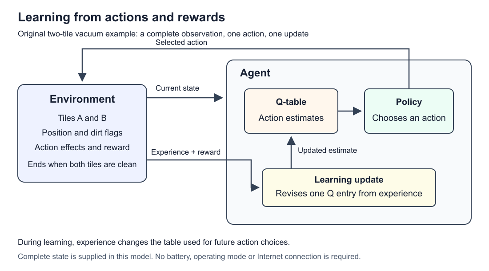

# AI Behaviour

**Stage 1 revision, 28 October 2026. Compared with selected downloaded 2024/2025 materials; teammate review pending.**

Read the [detailed contents and section status](table-of-contents.md) for the organization of this AI Behaviour part. The short navigation below follows the current chapter; the detailed contents describe coverage and remaining review work.

## Contents

1. [Introduction](#1-introduction)
2. [Agents](#2-agents)
3. [Rules](#3-rules)
4. [Learning](#4-learning)
5. [Decision problems](#5-decision-problems)
6. [Q-learning](#6-q-learning)
7. [Applications](#7-applications)
8. [Review questions](#8-review-questions)
9. [Limits](#9-limits)

Supporting material: [references](research-and-sources.md) and the optional [fixed-rule exercise](fixed-rule-vacuum.md).

A robot vacuum reaches a dirty patch of floor. It can clean, move on, or wait. A programmer could write the decision in advance. A learning system could instead use experience to estimate which choices lead to better results. This chapter explains the difference, then works through a small learning example.

## 1. Introduction

The supplied lecturer deck contains two slides. Slide 2 lists an introduction to Behaviorist AI, reinforcement-learning basics, RL algorithms and techniques, Markov Decision Processes (MDPs), robotics and games, applications, and challenges. It gives no definitions or worked examples. The topics below follow that overview; the examples, sequence and choice of Q-learning are our teaching proposals. See the [lecturer scope review](lecturer-scope-review.md).

This chapter is for beginners. No programming is needed, although the worked update uses addition and multiplication. Start with the idea that sensors supply information and actuators carry out actions. The Hardware section can introduce those parts beforehand.

| Step | Main question | What the learner should be able to do |
| --- | --- | --- |
| 1. Agents and their environment | What information can the agent use, and what can it change? | Identify observations and actions |
| 2. Programmed behaviour | How do rules and remembered modes choose actions? | Explain a priority conflict and a state transition |
| 3. Reinforcement learning | How can experience affect later choices? | Distinguish reward, policy and learning |
| 4. MDPs | How do we specify a decision problem precisely? | Identify states, actions, transitions and rewards |
| 5. A learning update | How does one experience change an estimate? | Calculate a small Q-learning update |
| 6. Robotics and games | How does the same framework apply elsewhere? | Describe a new agent and its reward |
| 7. Limitations | What can go wrong with the model or goal? | Identify an assumption and a counterexample |

By the end, learners should be able to follow both a fixed rule and a learning update, explain why they differ, and describe a small MDP. Deep neural networks, full robot navigation and formal convergence proofs are beyond this introductory treatment. The overview does not establish a required algorithm, lesson duration or depth.

### Before you start

You do not need to write code or build a robot. You will use addition, multiplication and negative numbers in Section 6. For example, a reward of −1 means one point is deducted; it does not mean the robot has feelings. Read the words first, then follow the numbers in the tables. The Python files are optional consistency checks for the examples.

### What this chapter means by AI Behaviour

Here we study how artificial agents select actions, with reinforcement learning as a main topic in the lecturer overview. A robot may follow programmed rules, learn from reward, or combine different mechanisms. Describing observable actions does not mean the controller has no internal state or stored estimates. [S1–S2, S8](research-and-sources.md)

The previous-year materials use similar names for several topics, including predicting human behaviour and psychological conditioning. Those are not interchangeable with a robot learning an action policy. To identify the mechanism, ask: **what observations enter, what actions are chosen, what feedback is available, and what changes through experience?** A system that predicts clicks is not established to be an RL agent merely because its input describes human behaviour. The [reference comparison](previous-year-review.md) records these scope decisions.

## 2. Agents

An **agent** receives information and acts in an **environment**. Sensors provide **observations**, while actuators carry out actions. The **controller** selects commands. Some controllers respond to the current observation; others also use information retained from earlier steps. [S1](research-and-sources.md)

For a vacuum, the floor, dirt and dock form part of the environment. A dirt sensor reports something about the floor; a motor changes the vacuum's position. A command to move and the resulting movement are different things. Sensors and mechanisms can be unreliable. [S2](research-and-sources.md)

The loop repeats: observe, choose an action, act, then observe the result. After cleaning a dirty tile, the next reading should reflect the cleaner floor. The agent needs that new reading before making its next choice.



**Original teaching diagram.** During learning, experience supplies a next observation and reward, and an update revises the action estimates used by the policy. This describes the proposed learning example, not a commercial vacuum's architecture.

### Follow one decision

| Step | Vacuum example | Why it matters |
| --- | --- | --- |
| Observe | The dirt sensor reports dirt on tile A | The controller acts on a reading, which may differ from reality |
| Choose | The controller issues SUCK | Selecting a command is the controller's job |
| Act | The suction mechanism attempts to remove dirt | Hardware must carry out the command |
| Observe again | The next reading reports a clean tile | The result supplies information for the next decision |

An automatic door provides another example. Treat the door controller and mechanism as the agent; the doorway and approaching person as the environment; the person-detection signal as the observation; and the opening command and movement as the action process. Opening alone gives no evidence of learning. A fixed rule could produce the same result.

## 3. Rules

Consider these instructions, in order:

1. If energy is too low for cleaning, return to the dock.
2. Otherwise, if the current tile is dirty, clean it.
3. Otherwise, move to another tile.

When energy is low and the tile is dirty, the first instruction takes priority. The controller leaves the dirt for later. That decision is built into the rule order.

A controller can also remember its current **mode**, such as CLEAN, RETURN or CHARGE. A **finite-state machine** describes a finite set of modes and the conditions that switch between them. It needs a starting mode and a clear way to resolve competing transitions. [S6–S7](research-and-sources.md)

For example, a vacuum could remain in RETURN until it reaches the dock, even if it passes dirt on the way. Changing mode does not mean that it has learned: the programmer may have specified every transition. The [fixed-rule exercise](fixed-rule-vacuum.md) defines this controller completely, including energy costs, blocked movements and a 13-tick trace.

Brooks's behaviour-based robotics provides background for connecting sensing with action. His subsumption architecture uses interacting layers of asynchronous finite-state modules, including suppression and inhibition mechanisms. An ordered list of rules alone does not implement the full architecture. [S3–S5](research-and-sources.md)

For simultaneous low battery and dirt, the stated order selects return-to-dock. Swapping the first two rules selects cleaning first. Neither version learns from this decision: the programmer changed the priorities. In a physical system, the consequences would depend on available energy and the hardware design.

## 4. Learning

In **reinforcement learning (RL)**, an agent learns from interaction and reward feedback, aiming for accumulated reward. A **policy** describes how it selects actions. **Exploration** gathers experience by trying choices; **exploitation** uses choices favoured by current estimates. [S8–S11](research-and-sources.md)

Look at what changes. In the fixed controller, position, energy and mode change, but the written rules stay the same. In our learning example, experience also changes a table of action estimates. Those estimates can affect later choices.

| Component | Meaning in the learning example |
| --- | --- |
| Reward | A number returned after an action |
| Policy | The method for choosing an action |
| Q-value | An estimate of the return from an action in a state, followed by continuation under the target policy |
| Learning update | The calculation that revises an estimate using experience |

Displaying a score does not create a learning mechanism. A trained policy can also be held fixed when used later. The important distinction is whether experience was used to learn its behaviour.

### Training and use

During **training**, experience changes the estimates or policy. During **use**, also called inference or execution, the controller selects actions with the policy it has. Whether learning continues during use is a design choice. A policy can be trained in a simulator and then held fixed; a new task or different sensor behaviour may still cause it to fail. Simulation success is not proof of successful deployment. [S8, S18](research-and-sources.md)

Compare two controllers. Controller A switches from CLEAN to RETURN when its battery is low. Controller B revises an action estimate after receiving a reward. B describes an update from experience; A describes a change of mode that could be fully programmed. To assess whether B improves, we would also need to examine later choices and performance, not only whether a number changed.

### Useful words

| Word | Meaning here |
| --- | --- |
| State | A description of the task situation used by the model |
| Observation | Information available to the agent; it may reveal only part of the state |
| Policy | A rule or probability distribution for choosing actions |
| Reward | Numerical feedback after a step; it can be positive, zero or negative |
| Return | Rewards accumulated over later steps, with the chosen discounting convention |
| Episode | One run of the task, ending at the specified terminal condition |
| Q-table | Stored estimates for state–action pairs |

Section 5 makes these words precise in a small world. Reward and return are different: a costly move now may allow useful cleaning later.

## 5. Decision problems

A **Markov Decision Process**, or **MDP**, specifies states, actions, transition probabilities and rewards. It can also include terminal states and a discount factor. The **Markov property** means that the current state contains the information needed to predict the next outcome given the action; earlier history adds no further predictive information. This depends on how the state is defined. [S13](research-and-sources.md)

An MDP describes the problem. A learning algorithm describes how the agent learns to act in it. Known transitions and rewards can also support planning without learning them through trial and error. [S11](research-and-sources.md)

### 5.1 A two-tile vacuum world

This is a new teaching model. It differs from the four-tile fixed-rule exercise: there is no battery, dock or operating-mode variable, and the agent receives the complete dirt state.

```text
Initial world:   [ A: vacuum + dirt ] [ B: dirt ]
Goal for this episode: remove both patches of dirt
```

Everything in this example, including the rewards and initial conditions, is an **original teaching proposal**, not a reported experiment or a commercial robot specification. An **episode** is one run from the initial state until the task ends.

| Part | Exact specification |
| --- | --- |
| State | `(position, dirt_A, dirt_B)`, where position is A or B and each dirt flag is 0 or 1 |
| Initial state | `(A, 1, 1)` at the beginning of each episode |
| Observation | The complete current state, reported without error |
| Actions | LEFT, RIGHT, SUCK and WAIT in each nonterminal state |
| LEFT / RIGHT | Move to the neighbouring tile; a move beyond an end stays on the same tile |
| SUCK | Remove dirt on the current tile, if present |
| WAIT | Leave the state unchanged |
| Transitions | Deterministic: each action has one resulting state with probability 1 |
| Reward | Start at −1 per action; add 5 if the action removes new dirt; add 6 if that action makes both tiles clean |
| Terminal state | Either position with both dirt flags 0; the episode ends immediately on entry |
| Terminal convention | No further actions or rewards; future Q-value contribution is 0 |
| Reset | Restore the initial world for the next episode; retain the learned Q-table |
| Discount factor | `gamma = 0.9` |

There are eight possible state tuples, including two terminal states. Position and both dirt flags fully determine the next result, so this model satisfies the Markov assumption. A sensor that reports only local dirt would not reveal the other tile's condition. The fully observed model used here would then need additional assumptions or state estimation to describe the agent's information.

### 5.2 Reward and return

Removing the first patch earns `−1 + 5 = 4`. Moving earns `−1`. Removing the last patch earns `−1 + 5 + 6 = 10`. Sucking an already clean tile earns only `−1`.

The **discounted return** weights later rewards by successive powers of `gamma`. [S13](research-and-sources.md) For SUCK, RIGHT, SUCK from the initial state, the rewards are 4, −1 and 10:

```text
Return = 4 + 0.9 × (−1) + 0.9² × 10
       = 4 − 0.9 + 8.1
       = 11.2
```

This is the return of one specified sequence. It is not a measured training result or proof that an agent has learned an optimal policy.

### 5.3 Boundary example

Start at `(A, 0, 1)` and choose LEFT, then RIGHT. LEFT attempts to move beyond the boundary, so the state remains `(A, 0, 1)` and the reward is −1. It is not terminal because tile B is dirty. RIGHT then produces `(B, 0, 1)` and reward −1. No dirt has been removed. This uses the action definitions, not a guess about how a real vacuum would turn.

This is a **deterministic** task: the same state and action always produce the same outcome. A more complex MDP could specify several possible next outcomes with probabilities adding to 1. We would need those probabilities before calculating an expected outcome; calling the task an MDP does not supply them automatically. [S13](research-and-sources.md)

## 6. Q-learning

**Q-learning** revises action-value estimates from experience. Each sampled update combines the immediate reward with the highest current action estimate at the next state. The learning rate controls how far the old estimate moves toward that target. [S14](research-and-sources.md)

We chose Q-learning because a small table makes the update visible. The lecturer's overview lists algorithms and techniques but names no particular algorithm.

Read `Q(s, a)` as “the estimate for action a in state s.” It is a stored number, not a probability. `alpha` is the **learning rate**, and `gamma` is the **discount factor**. Taking the maximum means choosing the largest estimate at the next state, not adding all of its estimates together.

### 6.1 Specify the learning procedure

- Start with `Q(s, a) = 0` for every nonterminal state and action.
- Use learning rate `alpha = 0.5` and discount factor `gamma = 0.9`.
- After each transition, update only the entry for the state and action just experienced.
- For a terminal next state, use a future value of 0.
- A proposed policy is epsilon-greedy with `epsilon = 0.2`: with probability 0.2 choose uniformly among all four actions; otherwise choose the highest-Q action. Break equal-Q ties in the order SUCK, RIGHT, LEFT, WAIT.
- The table below uses a **scripted sequence of valid experiences** to make the arithmetic reproducible. It does not show a random training run under that policy.

The update is:

```text
target = reward + gamma × best_next_Q
new_Q = old_Q + alpha × (target − old_Q)
```

This expresses the standard sampled update, using the terminal convention above. [S14](research-and-sources.md)

### 6.2 Follow one episode

Name the nonterminal states in the sequence:

```text
s0 = (A, 1, 1)
s1 = (A, 0, 1)
s2 = (B, 0, 1)
```

| Step | State and action | Next state | Reward | Old Q | Best next Q at this update | New Q |
| --- | --- | --- | --- | --- | --- | --- |
| 1 | s0, SUCK | s1 | 4 | 0 | 0 | 2 |
| 2 | s1, RIGHT | s2 | −1 | 0 | 0 | −0.5 |
| 3 | s2, SUCK | Terminal | 10 | 0 | 0 | 5 |

For Step 1, `new_Q = 0 + 0.5 × (4 + 0.9 × 0 − 0) = 2`. An estimate has changed. That is different from moving into a mode chosen by fixed rules.

RIGHT initially gets a negative estimate because its immediate reward is −1 and the next state's estimates are still zero. Step 3 then raises the estimate for cleaning the final patch.

### 6.3 Revisit the experience

Reset the environment, keep the Q-table, and replay SUCK, RIGHT, SUCK:

| Step | Entry updated | Old Q | Best next Q | Target | New Q |
| --- | --- | --- | --- | --- | --- |
| 4 | Q(s0, SUCK) | 2 | 0 | 4 | 3 |
| 5 | Q(s1, RIGHT) | −0.5 | 5 | 3.5 | 1.5 |
| 6 | Q(s2, SUCK) | 5 | 0, terminal | 10 | 7.5 |

At Step 4, the maximum at s1 is still 0: RIGHT has −0.5 and the untried actions have 0. At Step 5, the target is `−1 + 0.9 × 5 = 3.5`, so:

```text
Q(s1, RIGHT) = −0.5 + 0.5 × (3.5 − (−0.5))
             = 1.5
```

The positive estimate at s2 has now affected the earlier move. RIGHT's 1.5 at s1 exceeds the three untried actions' estimates of 0, so it becomes the greedy choice there. These six updates show how experience can affect earlier choices. They do not establish convergence, adequate exploration or optimal behaviour.

### 6.4 Another update

Consider a separate illustrative entry with `old_Q = 1`, `reward = 2`, `best_next_Q = 4`, `alpha = 0.5` and `gamma = 0.9`. The next state is nonterminal.

The target is `2 + 0.9 × 4 = 5.6`. The difference from the old estimate is `5.6 − 1 = 4.6`. Move halfway toward the target: `new_Q = 1 + 0.5 × 4.6 = 3.3`. If that next state were terminal instead, the future contribution would be zero: the target would be 2 and the new estimate 1.5. These illustrative values are not additional rows from the vacuum replay.

### 6.5 Other approaches

The downloaded 2025 resources name many algorithms. For a beginner, first identify what each method estimates. This comparison is introductory; only tabular Q-learning is worked through here.

| Approach | What it does | Difference to notice |
| --- | --- | --- |
| Planning with a known model | Uses given transition and reward rules to calculate choices | Computing a policy from supplied rules does not itself require learning from interaction [S11] |
| Model-based RL | Learns a model of outcomes and rewards, then uses it to plan | Experience updates the model; the model supports decisions [S15] |
| Tabular Q-learning | Updates a state–action estimate using reward and the largest next-state estimate | It need not learn an explicit transition table [S14] |
| SARSA | Uses the next action actually selected when forming its update target | Its target reflects the policy being followed, including exploration [S16] |
| Deep Q-network (DQN) | Uses a neural network to estimate action values | The representation differs from our small table; this requires additional machinery and is optional context [S17] |

Sources: [S11, S14–S17](research-and-sources.md). “Model-free” does not mean an agent has no memory: a Q-table is stored information. It means the method can learn values without explicitly learning the environment's transition and reward model.

For one comparison, suppose the next state's best estimate is 5, but the policy selects WAIT, whose estimate is 0. Q-learning uses 5 in its next-value term; SARSA uses 0 for that experience. This difference does not prove one algorithm is always better. It shows why the action-selection policy and the learning update need separate explanations. [S16](research-and-sources.md)

## 7. Applications

The overview explicitly includes robotics and games. These are proposed examples for teaching that connection, not claims about deployed products.

| Setting | Possible observation or state | Actions | Reward-design question |
| --- | --- | --- | --- |
| Cleaning robot | Position, dirt and energy | Move, clean, charge | Does the score reward newly cleaned floor or merely running suction? |
| Small grid game | Player position, goals and hazards | Move in allowed directions | Does a high score also require reaching the goal safely? |
| Simulated navigation | Position and nearby obstacles | Move or turn | Could a progress reward encourage shortcuts that cause collisions? |

In a game model, dirt can become collectibles and corridor boundaries can become walls. The ending condition and reward for each action still need explicit definitions. Changing the story is easy; specifying a sensible state and reward takes more care.

The fixed-rule example also shows that a robot can act autonomously without a learning algorithm. A learning component could be combined with programmed control, provided their responsibilities and conflict rules are defined. Neither paper model requires an Internet connection.

### 7.1 A game model

A simulated player starts at `(0, 0)` on a 2 × 2 grid. A collectible is at `(1, 1)`. This is a separate illustrative task with its own rewards.

Use `(x, y)` as the state, since the collectible stays at a fixed location until the episode ends. Actions are UP, DOWN, LEFT and RIGHT; UP increases y, DOWN decreases y, RIGHT increases x and LEFT decreases x. Both coordinates are limited to 0 or 1, and an attempted move outside the grid leaves the position unchanged. Each action costs 1 point. Add 6 points on first reaching `(1, 1)`, then end the episode. RIGHT followed by UP therefore earns −1 followed by 5. No further reward is available after termination. This model assumes exact movement and complete position information.

### 7.2 Connect the system

| Responsibility | Example information flow |
| --- | --- |
| Hardware | Sensor reading → processor and memory → controller command → motor |
| AI control | Observation → action selection → new observation; during training, reward → update |
| Optional network | A status message reports progress, or a remote request asks the local controller to pause |

Suppose a pause request arrives late. An original design proposal is to attach a request identifier and expiry time, reject stale requests under a defined clock convention, and report the result. The local obstacle response still needs its own rule. This demonstrates why receiving a network packet is different from selecting and executing a valid action; it is not a specification of any commercial vacuum or a guarantee of reliable control.

## 8. Review questions

These five introductory questions use simple reasoning. They are a small AI Behaviour contribution to the later test covering the whole module, not a complete test bank or official assessment. The numerical and algorithm details above remain reference explanations; they are not prerequisites for answering these questions.

1. **A vacuum detects dirt and starts cleaning. Which is the input: the dirt reading or the cleaning action?**

   The dirt reading is the input, or observation. Cleaning is the action selected in response.

2. **The rules say “return to the dock if the battery is low; otherwise clean.” The battery is low and the floor is dirty. What should the vacuum do first?**

   Return to the dock, because the low-battery rule has priority. It does not need to learn this rule to follow it.

3. **A controller receives a score after every action, but never changes its rules or action estimates. Does the score alone show that it learns?**

   No. Learning needs an update from experience that can affect later decisions. Displaying a score is not enough.

4. **In the two-tile world, is “the vacuum is at A, A is clean and B is dirty” a state description or an action? Is RIGHT a state or an action?**

   The first describes the state. RIGHT is an action. The state describes the situation, while the action describes a choice available to the agent.

5. **An agent can take a costly step now to reach dirt it can clean next. Should it always reject that step just because its immediate reward is negative?**

   No. Later rewards also matter. A small cost now may enable a better total result. It should consider the consequences, not only the next score.

## 9. Limits

The two-tile model supplies accurate, complete information. A real vacuum has uncertain readings and imperfect movement, and may observe only part of a room. This model also omits batteries, moving obstacles and collision costs. Its small table does not show how to represent a large or continuous task.

An untried action may have a poor estimate because it has not been sampled, yet trying actions on hardware can be costly. Paper tasks and simulations make examples easier to inspect; they do not establish reliable transfer to a robot. Our fixed learning rate and six scripted updates are teaching choices, not a convergence argument.

Reward needs its own check. Removing dirt, reaching a game goal and avoiding damage are different objectives. A score captures only what its designer specified. Learners should be able to give a case where a score encourages an unwanted action and explain what would need to change.

Connect observations and actions to the Hardware chapter's sensors, processor, memory and motors. Use Networks to explain an optional status message or remote request, with explicit handling for missing or stale messages. The local decision loop remains a separate responsibility.

### What would count as evidence?

Checking the scripted arithmetic answers “does this replay follow our equations?” Training asks whether experience leads to useful choices. Evaluation asks how those choices perform under stated conditions. These are separate questions. [S18](research-and-sources.md)

A proposed next evaluation would compare a fixed controller, a random policy and a trained policy on the **same** two-tile task. State the starting conditions, training budget, action-selection settings and step limit; hold the learned table fixed for a separate evaluation. Repeat random runs and report success rate, steps and return, including failures. Do not compare the four-tile battery exercise directly with the two-tile learning task and call their score difference a learning benefit.

No such training comparison has been performed for this chapter. The existing scripts check a finite model and a specified replay. They do not evaluate generalisation to a new room, real sensor noise, privacy-sensitive deployments or a physical robot.

### Recap

Sensors provide observations; a controller chooses actions; actions change the environment. Fixed rules prescribe decisions. In RL, experience updates values or a policy that can affect later decisions. The MDP specifies the task, while Q-learning supplies one update method. A useful score, a correct calculation and a reliable deployed agent each need their own evidence.

Before submission, another member should check the definitions, rewards, traces, arithmetic and sources using the [review checklist](review-checklist.md). The lecturer's overview confirms the topic list, but gives no required algorithm or depth. Further detailed lecturer guidance could still change the scope.
