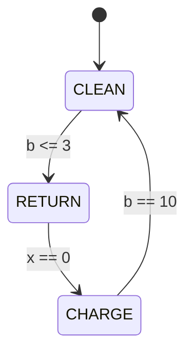

# Original diagram specification

These figures are proposed teaching designs. They do not reproduce the lecturer's slides or Brooks's architecture. See [source concepts](research-and-sources.md), especially S1, S2, and S6.

## Figure 1 — Perception–action loop

Standalone asset: [assets/perception-action-loop.svg](assets/perception-action-loop.svg). Canvas: 1100 × 560, white background, dark text, editable SVG shapes and text. Read left to right across the top and follow the return arrow underneath.

Nodes and labels:

1. Environment: floor, dirt, barriers, dock.
2. Sensors: position, local dirt, energy, clearance.
3. Controller: rules plus current mode; exactly one command each tick.
4. Actuators: wheel movement, suction, dock charging interface.
5. Remembered mode below the controller: CLEAN / RETURN / CHARGE, with a two-way link.
6. Optional network status box below the actuator side, linked by a dashed line from the controller. It is outside the control loop defined in the example.

Edges: Environment → Sensors (“observations”); Sensors → Controller (“readings”); Controller → Actuators (“one command”); Actuators → Environment (“changes the world”). Distinguish the dashed optional link using both stroke style and label. Colour is supplementary, not the sole meaning carrier.

Caption: “The controller reads again after each action. Remembered mode changes which fixed rule applies. The optional network link is outside the specified controller.”

Alt text: “Environment supplies sensor observations to a controller, which commands actuators that change the environment. Controller memory stores CLEAN, RETURN, or CHARGE. A dashed optional status link does not choose actions.”

## Figure 2 — Mode transitions

The [fixed-rule exercise's ordered procedure](fixed-rule-vacuum.md) is authoritative. This Mermaid diagram summarizes mode updates, not physical movement. Modes without a matching guard persist. Labels specify the exact thresholds in invented energy units.

Interpretation: evaluate these guards in the chapter's stated order before selecting one action. CLEAN at x = 0 with low energy can pass through RETURN to CHARGE in the same tick. Reaching full energy during CHARGE changes mode on the following tick. Away from the dock, zero energy pauses action with WAIT. An invalid CHARGE mode away from the dock also produces WAIT before transitions. These are global guards, omitted from the mode-only graphic to avoid suggesting that WAIT is a fourth mode.

Export specification if a standalone version is later needed: three labelled rounded boxes, initial arrow entering CLEAN, arrows carrying the exact guard text, and a footnote explaining transition-before-action and the global WAIT guards. Use SVG or a high-resolution image in the submission PDF if the renderer cannot handle Mermaid. The complete transition logic is also available as plain text in the chapter, so this optional figure is not the only explanation.

## Figure 3 — Corridor and trace

Four equal cells labelled 0–3, dock at 0, vacuum initially at 2, dirt at 1–3. Add text labels alongside symbols, a LEFT/RIGHT direction key, and initial energy 6/10. No compass heading is implied. Keep this original map visually separate from the generic loop diagram.

The chapter provides a plain-text corridor and a complete trace table so the example remains readable without an image renderer. For a slide animation, show observations before the tick, then the chosen mode/action, then the resulting world. Animate only one action per tick.

## Figure 4 — Learning loop in the main chapter

Original assets: [SVG](assets/learning-loop.svg) and [PNG](assets/learning-loop.png). The environment receives an action and returns a next state and reward. The agent holds a Q-table, chooses an action through its policy, and updates one Q entry from experience. The arrow from the update back to the Q-table makes the learning mechanism explicit. This is distinct from the remembered operating mode in Figure 1. The two-tile task supplies complete state observations; no battery or mode is implied.
