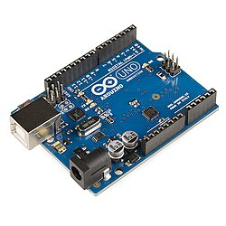

# Hardware, Networks and Behaviorist AI
## Module Plan and Learning Content V1.0

## About this module

This module brings together three parts of a computing system: hardware, networks, and AI that responds to its environment.

- **Hardware** is the physical equipment that lets a system receive information and do something in the real world.
- **Networks** let devices send information to one another.
- **Behaviorist AI** is the term used in this assignment for the AI topic. The exact meaning needs to be confirmed with the instructor before that section is developed in detail.

A smart-room example can connect the ideas. A light sensor measures the brightness in a room, a controller reads the measurement, and a network could send it to another device. A program or agent then decides whether a light should be switched on. The light is the physical output.

This version develops the hardware material in more detail. The Networks and Behaviorist AI sections are included in the overall plan so the team can see how the full module fits together, but those sections still need their own content and review.

## Prerequisites

Learners do not need previous electronics experience. It helps to be comfortable with:

- basic arithmetic, fractions, and rearranging a simple equation;
- the difference between hardware and software;
- basic programming ideas, such as variables, `if` statements, and loops; and
- the idea that information can be represented as numbers and sent between devices.

Voltage, current, resistance, power, and ground are introduced before they are used in calculations.

## Intended learning outcomes

By the end of the full module, a beginner should be able to:

1. Describe the roles of a microcontroller or processor, a power supply, inputs, outputs, and communication interfaces.
2. Choose physical components and explain the choice using voltage, current, power, interface, performance, environment, cost, and availability.
3. Use Ohm's law and the voltage-divider equation to work through simple circuit calculations.
4. Trace information from a physical measurement, through a sensor and controller, to an output device.
5. Explain how devices communicate over a network and describe the basic roles of interfaces, switches, routers, and protocols.
6. Explain the approach to Behaviorist AI taught in the course and trace how an agent maps inputs or feedback to actions.
7. Identify compatibility, reliability, safety, and testing issues in a small integrated system.

## Module structure and development status

Use these status labels honestly. **Drafted** means a first version exists; it does not mean the content has been checked. Mark a section **Checked** only after someone has reviewed it or a documented test has been carried out.

| Order | Topic and subtopics | What learners should be able to do | Planned example or activity | Current status |
|---|---|---|---|---|
| 1 | Module overview: hardware, networks, and agent behaviour | Describe how the parts of a connected system work together | Trace a smart-room system from sensor reading to light output | **Drafted; needs team review** |
| 2 | Hardware foundations: voltage, current, resistance, power, series and parallel circuits, basic safety | Define the main electrical quantities and use Ohm's law | Calculate current through a resistor | **Drafted; needs technical review** |
| 3 | Physical component selection: microcontrollers, single-board computers, sensors, resistors, drivers, power supplies, datasheets, trade-offs | Choose components and justify the choices | Choose a controller and light sensor for an automatic lamp | **Drafted; needs technical review** |
| 4 | Circuit design: schematics, voltage dividers, current-limiting resistors, logic levels, power budget, grounding, protection | Explain and check a simple circuit | Calculate a voltage-divider output and an LED resistor | **Drafted; needs circuit review** |
| 5 | Sensor integration: analog and digital sensors, ADC, accuracy, resolution, signal conditioning, sampling, calibration | Explain how a measurement becomes a value that software can use | Read an LDR through an analog input | **Drafted; needs technical review** |
| 6 | Actuator integration: LEDs, buzzers, relays, motors, GPIO limits, transistor/MOSFET drivers, PWM, protection | Explain when a load needs a driver circuit | Compare an LED output with a motor output | **Partly covered; add examples and review** |
| 7 | Network foundations: links, packets, addresses, Ethernet, Wi-Fi, switches, routers, access points, latency, reliability | Describe a basic device-to-device communication path | Draw how a sensor sends a reading to a computer | **Outline only; coordinate with Networks contributor** |
| 8 | Networked and IoT systems: device communication, data formats, connectivity, privacy, security | Identify what a connected device needs beyond a sensor and controller | Plan how a room sensor could share readings with another device | **Outline only; content still needed** |
| 9 | Behaviorist AI or behaviour-based agents: inputs, state or feedback, rules, action selection | Explain the approach used in this course and trace an input-to-action example | Describe how a robot might respond to an obstacle | **Outline only; clarify the course meaning of “Behaviorist AI”** |
| 10 | Integration and evaluation: hardware, networks, agent behaviour, reliability, testing, trade-offs, documentation | Explain how the pieces work together and identify likely failure points | Review a connected smart-room design | **Outline only; depends on agreement across sections** |
| 11 | Glossary, questions, and references | Use terms consistently and check understanding | Answer short questions with explanations | **Hardware terms drafted; full-module glossary incomplete** |

### Gaps to resolve

- The assignment instructions do not define exactly what the course means by **“Behaviorist AI.”** The team should confirm this with the instructor before writing that part in depth.
- Networks and Behaviorist AI are only outlines in this version. They should not be described as completed sections.
- The circuit values below are worked examples, not final specifications for a production design.
- The circuit example assumes a classic 5 V Arduino Uno R3. Other development boards may use different logic voltages or ADC settings, so check the exact board's documentation before adapting the circuit.

---

# Learning Content V1.0: Hardware

## Topic: Choosing components and connecting a sensor to an output

### What you should learn

By the end of this topic, you should be able to:

- explain what component selection involves;
- describe the jobs of a microcontroller, sensor, resistor, and output device;
- calculate an approximate sensor voltage using a voltage divider;
- explain how an analog-to-digital converter (ADC) turns a voltage into a number;
- follow the path from a sensor reading to an output; and
- identify electrical ratings that need checking before building a circuit.

## 1. Start with the task

Before choosing parts, decide what the system needs to do. For this lesson, the task is simple:

> Turn an indicator light on when the room is dark, and turn it off when the room is bright.

The system needs a few things:

- a **sensor** to respond to the light level;
- a **controller** to read the sensor and make a decision;
- an **output device** to show the result; and
- suitable resistors, wires, and a power source.

A **sensor** measures a physical quantity and produces a signal that the system can use. A **microcontroller** is an integrated circuit that runs a program and communicates with connected hardware. An **actuator** turns a control signal and energy into a physical effect. An LED is a useful output for this example because it produces light. In other projects, actuators might include motors, relays, or solenoids.

### Photo: microcontroller board



*The Arduino Uno R3 is a microcontroller development board. It has digital pins, analog inputs, a USB connection, and supporting circuitry. Image credit: Shoot stufz, [Wikimedia Commons file page](https://commons.wikimedia.org/wiki/File:Arduino_Uno_R3_development_board_03.jpg), CC BY-SA 4.0.*

### Photo: light sensor


*A light-dependent resistor (LDR), also called a photoresistor, changes its resistance as the light falling on it changes. Image credit: Suyash Dwivedi, [Wikimedia Commons file page](https://commons.wikimedia.org/wiki/File:25mm_light-dependent_resistor_(LDR)_(2).jpg), CC BY-SA 4.0.*

**Image note:** These image links are relative paths. Upload `arduino-uno.jpg` and `ldr.jpg` to the same GitHub folder as this Markdown file, or change the paths to match where you stored the images.

## 2. How to choose components

A component should fit the task, the electrical design, and the environment in which it will be used. Price matters, but it is not the only thing to consider.

| Check | Question to ask | Why it matters |
|---|---|---|
| Operating voltage | What voltage does the part need? | The wrong voltage can stop the circuit working or damage a component. |
| Input and output levels | Can the controller safely read the sensor signal? | A board's allowed input voltage may be different from another board's. |
| Current and power | How much current will the part draw? Can it safely handle the power? | Pins, wires, components, and supplies all have limits. |
| Performance | Are the range, response time, accuracy, or speed suitable? | A part can be electrically compatible but still not do the job well enough. |
| Interface | Does it use an analog voltage, digital pin, I²C, SPI, UART, or another interface? | The controller has to support the interface or use a suitable adapter. |
| Environment | Will it work at the expected temperature and humidity, and under the expected light or vibration conditions? | The environment can affect both readings and reliability. |
| Cost and availability | Is the part affordable and easy to source? Is there a reliable datasheet? | It is difficult to maintain a design if parts or documentation are unavailable. |

A **datasheet** is the manufacturer's technical document for a component. It lists its pins, electrical characteristics, operating conditions, and limits. Read it before settling on a part. Pay special attention to the difference between *recommended operating conditions* and *absolute maximum ratings*. The latter are limits that should not be exceeded, not targets for normal operation.

### Microcontroller or single-board computer?

A microcontroller is usually a good choice for a small control task, such as reading a sensor and switching an output. A single-board computer is more useful when a project needs a full operating system or heavier processing. Neither is best for every situation; the choice depends on what the system must do.

For the example in this guide, the classic Arduino Uno R3 is convenient because it has analog inputs and a 10-bit ADC. Those details are specific to this board and should not be assumed for every Arduino-compatible board. See the [Arduino Uno R3 documentation](https://docs.arduino.cc/hardware/uno-rev3/).

## 3. Example bill of materials (BOM)

A **bill of materials (BOM)** is the list of physical parts needed to build a system. A useful BOM records the quantity, key specifications, and purpose of each item. It also helps the designer spot missing parts before starting assembly.

This proposed BOM is for the simple automatic-light indicator used in this lesson.

| Component | Quantity | Specification or selection requirement | Purpose |
|---|---:|---|---|
| Arduino Uno R3 | 1 | 5 V board with analog inputs | Reads the sensor voltage and runs the control program |
| Light-dependent resistor (LDR) | 1 | Resistance changes with light level | Senses brightness |
| Fixed resistor | 1 | 10 kΩ | Forms a voltage divider with the LDR |
| LED | 1 | Check the forward voltage and current rating | Shows whether the output is on |
| LED resistor | 1 | 330 Ω, with a suitable power rating | Limits the current through the LED |
| USB power source or connection | 1 | Compatible with the selected board | Powers the controller and low-power sensing circuit |
| Breadboard | 1 | Suitable for the chosen components | Lets the circuit be assembled without soldering |
| Jumper wires | As needed | Compatible with the board and breadboard | Connect the circuit together |

### Why use these parts?

The **Arduino Uno R3** can read an analog input and control a digital output. That is enough for this introductory example.

The **LDR** is easy to use for a brightness demonstration. Its resistance changes with light, although the actual values depend on the specific LDR and the lighting conditions.

The **10 kΩ resistor** and LDR form a voltage divider. This turns the changing resistance into a voltage the board can measure.

The **LED** gives a visible result. The **330 Ω resistor** limits the LED current for the assumed 5 V circuit and an LED with an approximately 2 V forward voltage. The actual LED datasheet and board limits still need to be checked.

The **power source, breadboard, and jumper wires** let the circuit run and make it easy to change during testing.

### Checks before assembly

Before building the circuit:

1. Check the board's voltage and input specifications.
2. Find or measure the LDR's resistance in bright and dark conditions.
3. Calculate the voltage-divider output for those readings.
4. Check the LED's forward voltage, current, and the resistor's power rating.
5. Make sure the power source can supply enough current.
6. Test the readings and wiring before treating the design as complete.

**Status:** The proposed BOM has been drafted. The exact part specifications and compatibility checks still need to be verified before the BOM can be marked as checked.

## 4. Electrical terms used in this example

- **Voltage (V):** the electrical potential difference between two points, measured in volts.
- **Current (I):** the rate at which electric charge flows, measured in amperes (A).
- **Resistance (R):** how strongly a component opposes current, measured in ohms (Ω).
- **Power (P):** the rate at which electrical energy is transferred, measured in watts (W).
- **Ground (GND):** the circuit's reference node. In many simple low-voltage circuits, it is connected to the supply's negative terminal.
- **Analog signal:** a signal that can vary continuously over a range.
- **Analog-to-digital converter (ADC):** circuitry that represents an analog input voltage as a digital number.

Ohm's law links voltage, current, and resistance:

$$
V = IR
$$

Rearrange it to calculate current or resistance:

$$
I = \frac{V}{R} \qquad R = \frac{V}{I}
$$

Electrical power can be calculated with:

$$
P = VI
$$

These formulas are useful for checking simple circuits and choosing suitable component values.

## 5. Circuit design: use the LDR in a voltage divider

An LDR usually has a higher resistance in the dark and a lower resistance in brighter light. The controller cannot read resistance directly through a basic analog input, so the circuit uses a voltage divider to turn the resistance change into a changing voltage.

A **voltage divider** has two resistors connected in series across a supply. The output is measured at the point between the resistors. If the output is measured across the lower resistor, called $R_2$, the ideal no-load equation is:

$$
V_{out} = V_{in}\frac{R_2}{R_1 + R_2}
$$

Here, $V_{in}$ is the supply voltage, $R_1$ is the upper resistor, and $R_2$ is the lower resistor connected to ground. The equation assumes that the device measuring the voltage does not significantly affect the divider.

### Simple wiring diagram

In this arrangement, the 10 kΩ fixed resistor is connected to +5 V, the LDR is connected between the midpoint and ground, and the midpoint connects to analog input A0.

```text
        +5 V (Arduino Uno R3 example)
                  |
             [ R1 = 10 kΩ ]
                  |
                  +---------- A0 (analog input)
                  |
              [ LDR = R2 ]
                  |
                 GND
```

As the light changes, the LDR's resistance changes and so does the midpoint voltage. With the LDR in the lower position shown here, the voltage generally rises in the dark and falls in brighter conditions. If the two resistors are swapped, the voltage change goes in the opposite direction.

A voltage divider is useful for measuring a changing resistance. It is not a general-purpose power supply for other loads. Use a suitable voltage regulator or power converter when a circuit needs a different supply voltage.

### Worked example: estimate the sensor voltage

Assume the supply is 5 V and the fixed resistor is $R_1 = 10\,\text{kΩ}$. For the example, use these hypothetical LDR readings:

- In the dark, $R_2 = 100\,\text{kΩ}$.
- In bright light, $R_2 = 2\,\text{kΩ}$.

These are example values, not guaranteed readings for every LDR. A real design should use the part's datasheet or measurements taken under the intended conditions.

**Case A: dark condition**

Substitute the values into the voltage-divider equation:

$$
V_{out} = 5\frac{100}{10 + 100}
$$

$$
V_{out} = \frac{500}{110} \approx 4.55\,\text{V}
$$

The analog input is about 4.55 V.

**Case B: bright condition**

$$
V_{out} = 5\frac{2}{10 + 2}
$$

$$
V_{out} = \frac{10}{12} \approx 0.83\,\text{V}
$$

The analog input is about 0.83 V.

In this arrangement, the dark example produces the higher voltage. The controller can use that difference to decide whether the light should be on. The threshold must be chosen from actual readings, not copied blindly from this example.

## 6. From voltage to a number: the ADC

Software works with digital values, so the board needs a way to convert the input voltage into a number. That is the job of the **analog-to-digital converter (ADC)**.

On a classic Arduino Uno R3, `analogRead()` returns values from 0 to 1023. This is a 10-bit result, which gives 1024 possible codes. Assuming an ideal 0–5 V input range, a rough estimate is:

$$
\text{ADC code} \approx \frac{V_{in}}{5\,\text{V}} \times 1023
$$

Using the sensor voltages from the previous example:

- Dark: $\frac{4.545}{5} \times 1023 \approx 930$.
- Bright: $\frac{0.833}{5} \times 1023 \approx 170$.

These are estimates, not guaranteed readings. The result can change because of the actual LDR resistance, the board's reference voltage, resistor tolerances, and electrical noise. Also, **resolution and accuracy are not the same thing**. Resolution describes the size of the digital steps; accuracy describes how close a measurement is to the true value.

For more detail, see [Arduino's Analog Input tutorial](https://docs.arduino.cc/built-in-examples/analog/AnalogInput/) and [SparkFun's Voltage Divider guide](https://learn.sparkfun.com/tutorials/voltage-dividers/introduction).

## 7. Add an output: the LED

An LED converts electrical energy into light. It is a convenient output device for this demonstration because its state is easy to see.

An LED normally needs a series resistor to limit the current. Suppose a 5 V output drives an LED with an assumed forward voltage of 2 V, and the target current is 10 mA.

First, find the voltage across the resistor:

$$
V_R = 5 - 2 = 3\,\text{V}
$$

Convert the current to amperes: $10\,\text{mA} = 0.010\,\text{A}$.

Then use Ohm's law:

$$
R = \frac{3}{0.010} = 300\,\Omega
$$

A nearby standard value, such as 330 Ω, would give an approximate current of:

$$
I = \frac{3}{330} \approx 0.0091\,\text{A} = 9.1\,\text{mA}
$$

The resistor would dissipate about 0.027 W under these assumptions, so a typical 0.25 W resistor has plenty of power-rating margin for this example. Still, check the actual LED specifications, the resistor rating, and the output limits of the board before building the circuit.

For a classic Uno-style setup, the external LED can be connected to digital pin 9 through the 330 Ω resistor, with the LED's cathode connected to GND. Check the pinout for the exact board you use.

### What if the output is a motor?

A microcontroller pin is intended to send a control signal; it should not be treated as a motor power supply. A motor may draw more current than a GPIO pin can safely provide, and switching an inductive load can cause voltage spikes. Use a suitably rated transistor or MOSFET circuit, or a motor-driver module, and follow its documentation for protection and wiring. Do not connect a motor directly to a GPIO pin.

## 8. Put the sensor and output together

The program below reads the sensor voltage through A0 and turns an external LED on when the reading suggests darkness. The value `500` is only a starting threshold. The correct value depends on the parts, room lighting, wiring, and board, so take real readings and adjust it during testing.

```cpp
const int sensorPin = A0;
const int ledPin = 9;
const int darkThreshold = 500;

void setup() {
  pinMode(ledPin, OUTPUT);
  Serial.begin(9600);
}

void loop() {
  int lightValue = analogRead(sensorPin);
  Serial.println(lightValue);

  // With the LDR connected as the lower resistor,
  // darker conditions usually produce a higher reading.
  if (lightValue > darkThreshold) {
    digitalWrite(ledPin, HIGH);
  } else {
    digitalWrite(ledPin, LOW);
  }

  delay(100);
}
```

This is an Arduino-style example for the circuit described above. The LED needs its series resistor, and the circuit must be wired according to the board's pinout and electrical specifications.

### System overview

```text
Room light
    |
    v
LDR + fixed resistor
(light level becomes a voltage)
    |
    v
Analog input / ADC
(voltage becomes a number)
    |
    v
Microcontroller program
(compares the reading with a threshold)
    |
    v
Digital output pin
    |
    v
330 Ω resistor + LED
(the output produces light)
```

The parts form one chain. If the sensor is wired incorrectly, the reading may be wrong. If the threshold is unsuitable, the decision may be wrong. If the LED is connected backwards or without a current-limiting resistor, the output may not work as expected or a component could be damaged.

## 9. Learner activity

Try the questions before reading the answers. Show your calculations for Question B.

### Question A: component selection

You are building the automatic-light indicator above. Name four things you would check before choosing the controller, LDR, fixed resistor, and LED. For each one, say briefly why it matters.

### Question B: voltage divider

The supply is 5 V, the fixed resistor is 10 kΩ, and the LDR is also 10 kΩ. Calculate the midpoint voltage using the voltage-divider equation.

### Question C: interpret a sensor reading

For the circuit shown in this guide, one reading is about 900 and another is about 180. Which reading is more consistent with darkness? Explain your reasoning.

### Question D: actuator safety

A teammate suggests connecting a small DC motor directly to a microcontroller GPIO pin. Explain why that is not suitable and identify an alternative to investigate.

## 10. Answers and explanations

### Answer A

Possible checks include supply and logic voltage, current and power limits, the LDR's resistance range, ADC compatibility, the LED's forward voltage and current, environmental conditions, price and availability. A good answer explains why each check matters instead of just listing terms.

### Answer B

Use the voltage-divider equation:

$$
V_{out} = 5\frac{10}{10 + 10} = 2.5\,\text{V}
$$

The two resistances are equal, so the midpoint is half the supply voltage.

### Answer C

A reading near 900 is more consistent with darkness in this particular arrangement. In the dark, the LDR is assumed to have a higher resistance. That raises the midpoint voltage and gives a higher ADC reading. A real circuit must be tested because the exact readings depend on its components and lighting.

### Answer D

A GPIO pin is designed for a limited control signal and may not be able to supply the current the motor needs. Motors can also produce voltage spikes when switched. Investigate a suitably rated motor driver or a transistor/MOSFET circuit with the protection recommended for the selected components.

## 11. Troubleshooting checklist

If the circuit does not behave as expected, check one thing at a time:

1. Check the board's pinout and supply voltage in the official documentation.
2. Make sure the fixed resistor and LDR are in series and A0 is connected to their junction.
3. Check that the circuit has a suitable ground connection.
4. Print the readings to the Serial Monitor and compare bright and dark conditions.
5. Adjust the threshold only after you have seen actual readings.
6. Check the LED direction and make sure the series resistor is installed.
7. If you use another board, check its analog input range and output limits before connecting the circuit.

---

# Further work for the team

Before describing the whole module as complete, the team should:

- [ ] Confirm the module's scope and terminology with the instructor or team.
- [ ] Clarify what “Behaviorist AI” means in this course.
- [ ] Write and reference the substantive Networks section.
- [ ] Write and reference the substantive Behaviorist AI section.
- [ ] Add an example that connects hardware, network communication, and an agent's behaviour.
- [ ] Ask a teammate to check the hardware calculations and wiring diagram.
- [ ] Confirm the image credits, component assumptions, references, and code.
- [ ] Update the status table after reviews have actually taken place.

# References

## Hardware references

1. Arduino. [UNO R3: board documentation and specifications](https://docs.arduino.cc/hardware/uno-rev3/).
2. Arduino. [Analog Input: reading an analog signal](https://docs.arduino.cc/built-in-examples/analog/AnalogInput/).
3. SparkFun Learn. [Voltage Dividers: principle, equation, and applications](https://learn.sparkfun.com/tutorials/voltage-dividers/introduction).
4. Shoot stufz. [Arduino Uno R3 development board 03](https://commons.wikimedia.org/wiki/File:Arduino_Uno_R3_development_board_03.jpg). Wikimedia Commons, CC BY-SA 4.0.
5. Suyash Dwivedi. [25mm light-dependent resistor (LDR) (2)](https://commons.wikimedia.org/wiki/File:25mm_light-dependent_resistor_(LDR)_(2).jpg). Wikimedia Commons, CC BY-SA 4.0.

