# Hardware, Networks & AI Behaviour

## A beginner's study book

**Team Doom · Consolidated reading edition · 4 November 2026**

A computer receives information, follows instructions and produces an output. A network lets it exchange information with other devices. An agent's controller decides which action to take. This book follows those three ideas from the parts inside a computer to a connected robot vacuum and a practical light indicator.

### How to read this book

Start with Chapters 1–6. These form the beginner course: hardware, networks, reactive behaviour and learning. Each chapter has worked examples, misconceptions and questions with answers. Try the questions before revealing the answers.

Chapters 7–10 are the practical hardware companion: architecture, laboratory skills, the automatic light indicator, interfaces and datasheets. Read Chapter 8 before attempting the Chapter 9 circuit. Chapters 11–12 provide extra networking diagrams and explanations. Chapters 13–15 extend the AI material with a precisely specified decision problem, Q-learning calculations and evaluation limits. Chapter 16 brings the subjects together in one design activity. The practical and numerical extensions can be read after the beginner course; they are not prerequisites for the introductory test bank.

No previous programming is needed for the core chapters. Practical extensions introduce code and circuit calculations. Values are teaching examples unless stated otherwise; the existing hardware qualifications and source limitations remain applicable. The book is a consolidated draft: source checking, teammate review and actual laboratory trials still need their recorded evidence.

“Behaviourist AI” is the course label. Here we distinguish reactive control, feedback and reinforcement learning: reacting or changing a programmed mode does not by itself demonstrate learning. Different examples specify different priorities; apply the rules stated in the example you are solving.

### Study tools and references

The appendices collect glossaries, sources and image credits. Bracketed numerical citations in Chapters 1–2 refer to Appendix D; Chapters 3–4 to Appendix E; Chapters 5–6 to Appendix F. S1–S18 citations in Chapters 13–15 refer to Appendix I. Practical hardware chapters retain their named-source citations and original section labels such as A5, B6 and C4; these correspond, in order, to subchapters in Chapters 7, 9 and 10. Laboratory L1–L8 correspond to Chapter 8.

Use the [46-question practice bank](../Test%20Bank/Questions.md), then consult its [explained answers](../Test%20Bank/AnswerKey.md). It remains a draft awaiting teammate and learner review. Ready-to-open [Arduino sketches](Hardware/arduino/README.md) and the optional [AI arithmetic check](AIBehaviour/checks/rl_vacuum_model.py) accompany the relevant chapters.

### Contents

- [Chapter 1 — Inside a computer](#chapter-1)
  - [1.1 The big picture: input → process → output, plus storage](#11-the-big-picture-input--process--output-plus-storage)
  - [1.2 The main components](#12-the-main-components)
  - [1.3 The memory hierarchy: fast-and-small vs slow-and-big](#13-the-memory-hierarchy-fast-and-small-vs-slow-and-big)
  - [1.4 Worked example: opening a photo](#14-worked-example-opening-a-photo)
  - [1.5 Hardware inside the robot vacuum](#15-hardware-inside-the-robot-vacuum)
  - [1.6 Common misconceptions](#16-common-misconceptions)
  - [1.7 Check your understanding](#17-check-your-understanding)
- [Chapter 2 — From bits to actions](#chapter-2)
  - [2.1 Why computers use binary](#21-why-computers-use-binary)
  - [2.2 Counting in binary with bit cards](#22-counting-in-binary-with-bit-cards)
  - [2.3 Bits, bytes, and bigger units](#23-bits-bytes-and-bigger-units)
  - [2.4 How bits represent different things](#24-how-bits-represent-different-things)
  - [2.5 Logic gates: how switches make decisions](#25-logic-gates-how-switches-make-decisions)
  - [2.6 Programs, instructions, and the fetch–decode–execute cycle](#26-programs-instructions-and-the-fetchdecodeexecute-cycle)
  - [2.7 Common misconceptions](#27-common-misconceptions)
  - [2.8 Check your understanding](#28-check-your-understanding)
- [Chapter 3 — Connecting devices](#chapter-3)
  - [3.1 What is a network?](#31-what-is-a-network)
  - [3.2 Wired vs wireless links](#32-wired-vs-wireless-links)
  - [3.3 The devices that make a network](#33-the-devices-that-make-a-network)
  - [3.4 Packets: why messages are cut into pieces](#34-packets-why-messages-are-cut-into-pieces)
  - [3.5 Layers: splitting the job into simpler jobs](#35-layers-splitting-the-job-into-simpler-jobs)
  - [3.6 Getting connected: DHCP and private addresses](#36-getting-connected-dhcp-and-private-addresses)
  - [3.7 Local network vs Internet access](#37-local-network-vs-internet-access)
  - [3.8 The robot vacuum's network](#38-the-robot-vacuums-network)
  - [3.9 Common misconceptions](#39-common-misconceptions)
  - [3.10 Check your understanding](#310-check-your-understanding)
- [Chapter 4 — A message's journey](#chapter-4)
  - [4.1 IP addresses: the address on the envelope](#41-ip-addresses-the-address-on-the-envelope)
  - [4.2 Ports: which program gets the message?](#42-ports-which-program-gets-the-message)
  - [4.3 DNS: turning names into addresses](#43-dns-turning-names-into-addresses)
  - [4.4 Latency vs bandwidth](#44-latency-vs-bandwidth)
  - [4.5 TCP and UDP: two ways to deliver](#45-tcp-and-udp-two-ways-to-deliver)
  - [4.6 Putting it together: what happens when you visit a website](#46-putting-it-together-what-happens-when-you-visit-a-website)
  - [4.7 Basic troubleshooting, using the layers](#47-basic-troubleshooting-using-the-layers)
  - [4.8 The robot vacuum's message journey](#48-the-robot-vacuums-message-journey)
  - [4.9 Common misconceptions](#49-common-misconceptions)
  - [4.10 Check your understanding](#410-check-your-understanding)
- [Chapter 5 — Reactive behaviour](#chapter-5)
  - [5.1 Agents and environments](#51-agents-and-environments)
  - [5.2 The sense–think–act loop](#52-the-sensethinkact-loop)
  - [5.3 Simple reflex agents and condition–action rules](#53-simple-reflex-agents-and-conditionaction-rules)
  - [5.4 Worked example: the three-rule vacuum](#54-worked-example-the-three-rule-vacuum)
  - [5.5 Improving the rules](#55-improving-the-rules)
  - [5.6 Subsumption architecture: layers of behaviour](#56-subsumption-architecture-layers-of-behaviour)
  - [5.7 Braitenberg vehicles: simple wiring, "emotional" behaviour](#57-braitenberg-vehicles-simple-wiring-emotional-behaviour)
  - [5.8 Adding memory: finite-state machines](#58-adding-memory-finite-state-machines)
  - [5.9 Feedback control: the thermostat](#59-feedback-control-the-thermostat)
  - [5.10 Strengths and limits of reactive behaviour](#510-strengths-and-limits-of-reactive-behaviour)
  - [5.11 Common misconceptions](#511-common-misconceptions)
  - [5.12 Check your understanding](#512-check-your-understanding)
- [Chapter 6 — Learning and integration](#chapter-6)
  - [6.1 From fixed rules to learning](#61-from-fixed-rules-to-learning)
  - [6.2 The reinforcement learning loop](#62-the-reinforcement-learning-loop)
  - [6.3 Worked example: the route-choice game](#63-worked-example-the-route-choice-game)
  - [6.4 Exploration vs exploitation](#64-exploration-vs-exploitation)
  - [6.5 When rewards go wrong: reward hacking](#65-when-rewards-go-wrong-reward-hacking)
  - [6.6 Fixed rules vs reinforcement learning](#66-fixed-rules-vs-reinforcement-learning)
  - [6.7 Real-world examples of behaviorist AI](#67-real-world-examples-of-behaviorist-ai)
  - [6.8 Integration: the whole robot vacuum](#68-integration-the-whole-robot-vacuum)
  - [6.9 Common misconceptions](#69-common-misconceptions)
  - [6.10 Check your understanding](#610-check-your-understanding)
- [Chapter 7 — Computer architecture in practice](#chapter-7)
  - [7.1 The main parts and their jobs](#71-the-main-parts-and-their-jobs)
  - [7.2 RAM vs storage — a common confusion](#72-ram-vs-storage--a-common-confusion)
  - [7.3 Bits and bytes](#73-bits-and-bytes)
  - [7.4 Logic gates](#74-logic-gates)
  - [7.5 How the CPU follows instructions: fetch–decode–execute](#75-how-the-cpu-follows-instructions-fetchdecodeexecute)
  - [7.6 The bridge to Part B: a microcontroller is a small computer on one chip](#76-the-bridge-to-part-b-a-microcontroller-is-a-small-computer-on-one-chip)
- [Chapter 8 — First laboratory skills](#chapter-8)
  - [8.1 Breadboards: which holes are connected](#81-breadboards-which-holes-are-connected)
  - [8.2 Using a multimeter](#82-using-a-multimeter)
  - [8.3 Reading resistor values](#83-reading-resistor-values)
  - [8.4 Uploading code with the Arduino IDE](#84-uploading-code-with-the-arduino-ide)
  - [8.5 Schematic symbols](#85-schematic-symbols)
  - [8.6 Digital inputs: buttons, pull-up resistors and debouncing](#86-digital-inputs-buttons-pull-up-resistors-and-debouncing)
  - [8.7 Glossary](#87-glossary)
  - [8.8 Practice questions](#88-practice-questions)
- [Chapter 9 — Building an automatic light indicator](#chapter-9)
  - [9.1 Start with the system requirement, not the parts list](#91-start-with-the-system-requirement-not-the-parts-list)
  - [9.2 The electrical terms used in the circuit](#92-the-electrical-terms-used-in-the-circuit)
  - [9.3 Series and parallel circuits](#93-series-and-parallel-circuits)
  - [9.4 Basic electrical safety](#94-basic-electrical-safety)
  - [9.5 Choose components using measurable criteria](#95-choose-components-using-measurable-criteria)
  - [9.6 Circuit design: an LDR in a voltage divider](#96-circuit-design-an-ldr-in-a-voltage-divider)
  - [9.7 From voltage to a number: the ADC](#97-from-voltage-to-a-number-the-adc)
  - [9.8 Add an output: an LED indicator](#98-add-an-output-an-led-indicator)
  - [9.9 Actuators: when a pin is not enough](#99-actuators-when-a-pin-is-not-enough)
  - [9.10 Power budget](#910-power-budget)
  - [9.11 Connect the sensor reading to the output](#911-connect-the-sensor-reading-to-the-output)
  - [9.12 Overall system diagram](#912-overall-system-diagram)
  - [9.13 Learner activity](#913-learner-activity)
  - [9.14 Answers and expected outcomes](#914-answers-and-expected-outcomes)
  - [9.15 Troubleshooting checklist](#915-troubleshooting-checklist)
- [Chapter 10 — Interfaces, datasheets and sustainability](#chapter-10)
  - [10.1 Serial communication: UART, I²C and SPI](#101-serial-communication-uart-i²c-and-spi)
  - [10.2 Sending readings to another device: CSV over serial](#102-sending-readings-to-another-device-csv-over-serial)
  - [10.3 Capacitors](#103-capacitors)
  - [10.4 Reading a real datasheet: the GL5528 LDR and a red LED](#104-reading-a-real-datasheet-the-gl5528-ldr-and-a-red-led)
  - [10.5 Sustainability: e-waste and responsible parts](#105-sustainability-e-waste-and-responsible-parts)
  - [10.6 Practice questions](#106-practice-questions)
- [Chapter 11 — Networking diagrams and practice](#chapter-11)
  - [11.1 Understanding Computer Networks](#111-understanding-computer-networks)
  - [11.2 Types of Networks](#112-types-of-networks)
  - [11.3 LAN — Local Area Network](#113-lan--local-area-network)
  - [11.4 WAN — Wide Area Network](#114-wan--wide-area-network)
  - [11.5 Network Topologies: How are devices arranged?](#115-network-topologies-how-are-devices-arranged)
  - [11.6 Meet the Network Devices](#116-meet-the-network-devices)
  - [11.7 IP Addresses vs. MAC Addresses](#117-ip-addresses-vs-mac-addresses)
  - [11.8 Follow the Data! 🚀](#118-follow-the-data-)
  - [11.9 The Rules Behind Communication](#119-the-rules-behind-communication)
  - [11.10 A First Look at Network Security 🔒](#1110-a-first-look-at-network-security-)
  - [11.11 Knowledge Check 🧠](#1111-knowledge-check-)
  - [11.12 Key Takeaways](#1112-key-takeaways)
- [Chapter 12 — Network layers, performance and privacy](#chapter-12)
  - [12.1 The OSI Model: The 7 Layers of Networking](#121-the-osi-model-the-7-layers-of-networking)
  - [12.2 DHCP and NAT: The Magic of Home Wi-Fi](#122-dhcp-and-nat-the-magic-of-home-wi-fi)
  - [12.3 Bandwidth vs. Latency: What is "Speed"?](#123-bandwidth-vs-latency-what-is-speed)
  - [12.4 Privacy: VPNs and Proxies 🛡️](#124-privacy-vpns-and-proxies-)
- [Chapter 13 — Modelling an agent's decisions](#chapter-13)
  - [13.1 A two-tile vacuum world](#131-a-two-tile-vacuum-world)
  - [13.2 Reward and return](#132-reward-and-return)
  - [13.3 Boundary example](#133-boundary-example)
- [Chapter 14 — A worked Q-learning example](#chapter-14)
  - [14.1 Specify the learning procedure](#141-specify-the-learning-procedure)
  - [14.2 Follow one episode](#142-follow-one-episode)
  - [14.3 Revisit the experience](#143-revisit-the-experience)
  - [14.4 Another update](#144-another-update)
  - [14.5 Other approaches](#145-other-approaches)
- [Chapter 15 — Applications, review and limits](#chapter-15)
  - [15.1 A game model](#151-a-game-model)
  - [15.2 Connect the system](#152-connect-the-system)
  - [15.3 Review questions](#153-review-questions)
  - [15.4 Limits](#154-limits)
  - [15.5 What would count as evidence?](#155-what-would-count-as-evidence)
  - [15.6 Recap](#156-recap)
- [Chapter 16 — Design a connected system](#chapter-16)
  - [16.1 Follow one sensor reading](#161-follow-one-sensor-reading)
  - [16.2 Add an optional network message](#162-add-an-optional-network-message)
  - [16.3 Compare rules with learning](#163-compare-rules-with-learning)
  - [16.4 Final activity](#164-final-activity)
  - [16.5 Answer guide](#165-answer-guide)
- [Appendix A — Hardware glossary](#appendix-A)
- [Appendix B — Networks glossary](#appendix-B)
- [Appendix C — AI glossary](#appendix-C)
- [Appendix D — Hardware lesson references](#appendix-D)
  - [D.1 Further reading](#d1-further-reading)
- [Appendix E — Networks lesson references](#appendix-E)
  - [E.1 Further reading](#e1-further-reading)
- [Appendix F — AI lesson references](#appendix-F)
- [Appendix G — Practical hardware references and image credits](#appendix-G)
  - [G.1 Computer hardware (Part A)](#g1-computer-hardware-part-a)
  - [G.2 Circuits, sensors and actuators (Part B)](#g2-circuits-sensors-and-actuators-part-b)
  - [G.3 Images](#g3-images)
  - [G.4 Starter references for the other units (moved from the earlier draft)](#g4-starter-references-for-the-other-units-moved-from-the-earlier-draft)
  - [G.5 Hex, buses, clock and architecture (A3, A5, A6 additions)](#g5-hex-buses-clock-and-architecture-a3-a5-a6-additions)
  - [G.6 Serial communication, capacitors, datasheets and sustainability (Part C)](#g6-serial-communication-capacitors-datasheets-and-sustainability-part-c)
  - [G.7 Status note](#g7-status-note)
- [Appendix H — Laboratory references](#appendix-H)
- [Appendix I — Detailed AI references and source limits](#appendix-I)
  - [I.1 Technical sources](#i1-technical-sources)
  - [I.2 Background reference materials](#i2-background-reference-materials)
  - [I.3 Attribution and limits](#i3-attribution-and-limits)
- [Appendix J — Networking companion references](#appendix-J)

---

<a id="chapter-1"></a>
## Chapter 1 — Inside a computer

<a id="1-11-the-big-picture-input--process--output-plus-storage"></a>
### 1.1 The big picture: input → process → output, plus storage

Almost every computer, from a phone to a robot vacuum, follows the same pattern:

```
 INPUT  ──►  PROCESSING  ──►  OUTPUT
 (keyboard,   (CPU working      (screen,
  camera,      with RAM)         speaker,
  sensors)        ▲  │           motors)
                  │  ▼
               STORAGE
          (keeps files when
           power is off)
```

- **Input** brings information *in* from the outside world.
- **Processing** is where the computer follows instructions to change that information.
- **Output** sends the result back *out* to people or the world.
- **Storage** keeps information for later, even when the power is off.

**Try it with something you already do — sending a voice message on your phone:**

1. **Input:** the microphone picks up your voice.
2. **Processing:** the phone's chip turns the sound into data and compresses it.
3. **Storage:** the recording is saved, so it still exists if the phone restarts.
4. **Output:** when your friend presses play, their phone's speaker turns the data back into sound.

<a id="1-12-the-main-components"></a>
### 1.2 The main components

Now let's name the parts that do each of those jobs. You don't need to memorise the whole table. Focus on the first two columns.

| Component | Plain-language job | Everyday analogy | Example |
| --- | --- | --- | --- |
| **Input devices** | Turn actions or the world into data | Your eyes and ears | Keyboard, mouse, touchscreen, microphone, camera, sensors |
| **CPU** (Central Processing Unit) | Follows instructions one step at a time, very fast | A chef following a recipe | Intel Core, AMD Ryzen, Apple M-series, phone chips |
| **RAM** (Random Access Memory) | Holds what the CPU is working on *right now* | The kitchen counter | 8 GB or 16 GB in a typical laptop |
| **Storage** (SSD or hard drive) | Keeps files and programs long-term | The pantry and fridge | 256 GB–2 TB SSD |
| **Output devices** | Present results | Your voice and hands | Screen, speaker, printer, motors |
| **Motherboard** | Connects every part so they can exchange data | The roads in a city | The large main circuit board |
| **Power supply / battery** | Provides electricity to every part | Gas or electricity for the kitchen | Laptop charger, phone battery |
| **GPU** (Graphics Processing Unit) | Does many simple calculations at once, mainly for images, games, and AI | A team of helpers doing one task in parallel | Built-in graphics, NVIDIA/AMD graphics cards |

<a id="1-the-cpu-in-a-bit-more-detail"></a>
#### The CPU in a bit more detail

- A **core** is one independent worker inside the CPU. A "quad-core" CPU has four workers that can run tasks at the same time.
- **Clock speed** is how many times per second the CPU's internal clock "ticks." Each tick is a chance for the CPU to do a small piece of work. It is measured in **GHz** (gigahertz): *hertz* means "per second" and *giga* means "billion," so 3 GHz means about 3 billion ticks per second. A higher number does **not** automatically mean a faster computer — the design of the CPU, the number of cores, and the amount of cache also matter.
- **Cache** is a very small, very fast memory built *inside* the CPU. It holds the data the CPU is most likely to need next, so it doesn't have to wait for RAM.

<a id="1-ram-vs-storage--the-most-common-beginner-confusion"></a>
#### RAM vs storage — the most common beginner confusion

| | RAM | Storage (SSD/HDD) |
| --- | --- | --- |
| What it holds | Programs and files currently open | Everything installed or saved |
| When power is lost | **Erased** (it is *volatile*) | **Kept** (it is *non-volatile*) |
| Speed | Much faster | Slower |
| Typical size | 8–32 GB | 256 GB–2 TB+ |
| Cost per GB | Higher | Lower |
| Analogy | Kitchen counter: small, close, cleared at night | Pantry: large, further away, keeps food |

> **Key idea:** "My phone has 128 GB" usually describes *storage*. "My laptop has 16 GB" usually describes *RAM*. They are different jobs, so you cannot add them together.

*(GB means gigabyte, a unit for an amount of data. Lesson 2 explains exactly what it means. For now, just know that a bigger number means more space.)*

**What happens when RAM is full?** The computer moves some of the least-used data from RAM onto storage temporarily (called *virtual memory* or *swap*). Storage is much slower than RAM, so the computer feels sluggish. This is why adding RAM often helps a computer that slows down when many apps are open.

<a id="1-ssd-vs-hard-drive-hdd"></a>
#### SSD vs hard drive (HDD)

| | HDD (hard disk drive) | SSD (solid-state drive) |
| --- | --- | --- |
| How it stores data | Magnetic spinning disk with a moving arm | Electronic memory chips, no moving parts |
| Speed | Slower — the arm must physically move | Much faster |
| Durability | Can be damaged if dropped while running | Handles knocks better |
| Price per GB | Cheaper | More expensive |
| Common use today | Large backups, cheap bulk storage | Laptops, phones, most new computers |

<a id="1-13-the-memory-hierarchy-fast-and-small-vs-slow-and-big"></a>
### 1.3 The memory hierarchy: fast-and-small vs slow-and-big

Computers use several layers of memory because no single kind is both fast and cheap. The closer a memory is to the CPU, the faster and smaller it is.

- **Registers** are a handful of tiny storage slots *inside* the CPU, holding the exact numbers it is working on this instant.
- **Cache** is slightly bigger and slightly slower, also inside the CPU.
- Then come RAM and storage, which you met above.

The times below are rough, widely quoted estimates. Real values vary from computer to computer [1].

| Layer | Roughly how long one access takes | Typical size | Keeps data without power? |
| --- | --- | --- | --- |
| CPU registers | Less than 1 nanosecond | A few hundred bytes | No |
| CPU cache | About 1–10 nanoseconds | A few MB | No |
| RAM | About 100 nanoseconds | 8–32 GB | No |
| SSD | About 0.1 milliseconds (100,000 ns) | 256 GB–2 TB | Yes |
| Hard drive | About 10 milliseconds (10,000,000 ns) | 1–20 TB | Yes |

**Make it human-sized:** if reading from cache took 1 second, reading from RAM would take about a minute and a half, an SSD would take more than a day, and a hard drive would take months. That is why the CPU tries hard to keep needed data close.

*(1 nanosecond = one billionth of a second. 1 millisecond = one thousandth of a second.)*

<a id="1-14-worked-example-opening-a-photo"></a>
### 1.4 Worked example: opening a photo

1. **Input:** you double-click the photo with the mouse. The mouse sends a signal to the computer.
2. **Processing:** the **operating system** works out which program opens photos. The operating system is the main program that manages the computer and all the other programs on it, for example Windows, macOS or Android. The CPU starts that program.
3. **Storage → RAM:** the photo app and the photo file are copied from the SSD into RAM, because the CPU works far faster with RAM.
4. **Processing:** the CPU (often helped by the GPU) decodes the compressed photo into a grid of coloured dots (pixels).
5. **Output:** the picture data is sent to the screen, which lights up each pixel.
6. **If you edit and don't save:** your changes exist only in RAM. Pull the plug and they are gone. When you press *Save*, the changed photo is written back to storage.

<a id="1-15-hardware-inside-the-robot-vacuum"></a>
### 1.5 Hardware inside the robot vacuum

| Role | Robot vacuum part |
| --- | --- |
| Input (**sensors**, devices that measure something in the surroundings) | Bump sensor (a switch in the front bumper that detects hitting something); cliff sensors (shine invisible **infrared** light at the floor and detect stairs when no light bounces back); wheel sensors (count how far each wheel has turned); battery level sensor; on some models, a camera or a spinning laser that measures distances (**LiDAR**) |
| Processing | A small computer chip — often a **microcontroller** (a CPU, a little RAM, and storage all on one cheap, low-power chip) |
| RAM | Holds current sensor readings and the current map |
| Storage | Holds the control program and saved room maps |
| Output (**actuators** — parts that move or act) | Wheel motors, brush motor, suction fan, speaker beeps, status lights |
| Power | Rechargeable battery |
| Network hardware (optional) | Wi-Fi chip — see [Unit B](#chapter-3) |

<a id="1-16-common-misconceptions"></a>
### 1.6 Common misconceptions

| Misconception | Correction |
| --- | --- |
| "More storage makes my computer faster." | Storage holds more files. Speed problems with many open apps are usually about RAM or the CPU. (An SSD *is* faster than an HDD, though, so switching type can help.) |
| "The CPU is the whole box." | The CPU is one chip inside. The box (case) holds all the components. |
| "RAM and storage are both 'memory,' so they're the same." | RAM is temporary working space; storage is long-term keeping. |
| "Higher GHz always wins." | Two CPUs at the same GHz can perform very differently because of cores, cache, and design. |

<a id="1-17-check-your-understanding"></a>
### 1.7 Check your understanding

1. Sort these into input, processing, output, or storage: microphone, SSD, CPU, speaker, touchscreen.
2. You wrote an essay for 2 hours and didn't save. The power goes out. Why is the essay lost, while yesterday's saved essay is fine?
3. A friend says, "My phone has 8 GB and 256 GB — so 264 GB total memory." What is wrong with this?
4. Name one input and one output of a robot vacuum.

<details>
<summary>Answers</summary>

1. Microphone → input. SSD → storage. CPU → processing. Speaker → output. Touchscreen → **both** input (touch) and output (display).
2. Unsaved work exists only in RAM, which is erased when power is lost. The saved essay was written to storage, which keeps data without power.
3. 8 GB is RAM (working space) and 256 GB is storage (long-term). They do different jobs, so adding them together is meaningless.
4. Input: bump sensor, cliff sensor, battery sensor, camera. Output: wheel motors, brush, suction fan, beeps, lights.

</details>

---

---

<a id="chapter-2"></a>
## Chapter 2 — From bits to actions

<a id="2-21-why-computers-use-binary"></a>
### 2.1 Why computers use binary

Inside a computer chip are billions of tiny electronic switches called **transistors**. Each switch is either **off** or **on**. It is reliable to tell those two states apart, so computers write everything using just two symbols:

- **0** = off (low voltage)
- **1** = on (high voltage)

A single 0 or 1 is called a **bit** (short for *binary digit*). Everything — numbers, letters, photos, music, the robot's instructions — is stored as long patterns of bits.

> Binary is a way to **represent** information, like writing. A computer storing the bits for the word "cat" does not know what a cat is.

<a id="2-22-counting-in-binary-with-bit-cards"></a>
### 2.2 Counting in binary with bit cards

In everyday (decimal) numbers each place is worth 10× the one to its right: 1, 10, 100, 1000.
In binary each place is worth **2×** the one to its right: 1, 2, 4, 8, 16 …

Make four cards. Each card is either face-up (1) or face-down (0):

| Card value | 8 | 4 | 2 | 1 |
| --- | --- | --- | --- | --- |

**Worked example — what number is `1101`?**

| Card value | 8 | 4 | 2 | 1 |
| --- | --- | --- | --- | --- |
| Bit | 1 | 1 | 0 | 1 |
| Counts? | 8 | 4 | — | 1 |

8 + 4 + 1 = **13**. So `1101` in binary = 13 in decimal.

**How to read a binary number, step by step:**

1. Write the card values 8, 4, 2, 1 above the bits.
2. Cross out every card whose bit is 0.
3. Add up the cards that are left.

**Worked example — how do you write 6 in binary?** Go from the biggest card to the smallest. At each card, ask: "Does this card fit into what I still need?"

| Step | Card | Still need | Does it fit? | Bit | Now still need |
| --- | --- | --- | --- | --- | --- |
| 1 | 8 | 6 | No, 8 is bigger than 6 | 0 | 6 |
| 2 | 4 | 6 | Yes | 1 | 6 − 4 = 2 |
| 3 | 2 | 2 | Yes | 1 | 2 − 2 = 0 |
| 4 | 1 | 0 | No, nothing left | 0 | 0 |

Read the bits from top to bottom: **`0110`**. Check: 4 + 2 = 6 ✓

With 4 bits the smallest number is `0000` = 0 and the biggest is `1111` = 8+4+2+1 = 15. So 4 bits can represent **16 different values** (0–15).

**Why does each extra bit double the number of values?** Adding a 5th card worth 16 gives you every old pattern with the new card down (0–15), plus every old pattern again with the new card up (16–31). That's twice as many.

| Number of bits | Different values | Range |
| --- | --- | --- |
| 1 | 2 | 0–1 |
| 4 | 16 | 0–15 |
| 8 (one byte) | 256 | 0–255 |
| 16 | 65,536 | 0–65,535 |
| 32 | About 4.3 billion | 0–4,294,967,295 |

<a id="2-23-bits-bytes-and-bigger-units"></a>
### 2.3 Bits, bytes, and bigger units

- **8 bits = 1 byte.** A byte is the basic unit for measuring file sizes and memory.
- **Kilobyte (KB)** ≈ 1,000 bytes · **Megabyte (MB)** ≈ 1 million bytes · **Gigabyte (GB)** ≈ 1 billion bytes · **Terabyte (TB)** ≈ 1 trillion bytes.

> **Why does my 1 TB drive show only about 931 GB?** Drive makers count 1 TB = 1,000,000,000,000 bytes. Some operating systems (such as Windows) divide by 1,024 at each step instead of 1,000 — strictly, those units are named *GiB* (gibibytes). Same bytes, different counting.

> **Bits vs bytes:** internet speeds are usually given in **bits** per second (Mbps, lowercase b). File sizes are usually given in **bytes** (MB, uppercase B). Divide Mbps by 8 to get MB per second. More in [Unit B](#4-44-latency-vs-bandwidth).

<a id="2-24-how-bits-represent-different-things"></a>
### 2.4 How bits represent different things

The same bits mean different things depending on the agreed **encoding** (the rule for reading them).

**Text.** People agreed on a table that gives every character a number. The oldest common table is called **ASCII** [2]. Here is how the letter `A` is stored, step by step:

1. Look up `A` in the table: it is number **65** (`B` is 66, `C` is 67, and so on).
2. Write 65 using 8 bit cards (128, 64, 32, 16, 8, 4, 2, 1): 65 = 64 + 1.
3. So `A` is stored as **`01000001`**: one byte.

ASCII only covers English letters, digits and symbols. A larger table, **Unicode**, gives a number to characters from every writing system, including Chinese and emoji [3]. In the most common way of storing Unicode, called UTF-8, one Chinese character such as 中 takes 3 bytes [4].

**Colours and images.** A picture is a grid of dots called **pixels**. Each pixel's colour is often stored as three numbers — red, green, and blue — each from 0 to 255 (one byte each).

| Colour | Red | Green | Blue |
| --- | --- | --- | --- |
| Black | 0 | 0 | 0 |
| White | 255 | 255 | 255 |
| Pure red | 255 | 0 | 0 |
| Yellow (red + green light) | 255 | 255 | 0 |

**Worked example — how big is one uncompressed Full-HD image?**

1. A Full-HD screen is 1920 pixels wide and 1080 pixels tall.
2. Number of pixels: 1920 × 1080 = 2,073,600 pixels.
3. Each pixel needs 3 bytes (red, green, blue): 2,073,600 × 3 = 6,220,800 bytes.
4. 1 MB is about 1 million bytes, so that's about **6.2 MB**.
A JPEG of the same photo is often under 1 MB because **compression** finds patterns and stores them more cleverly.

**Sound.** Sound is a wave. To store it, the computer measures the height of the wave thousands of times per second. Each measurement is called a **sample** and is stored as a number. CD audio takes 44,100 samples every second [5]. Playing those numbers back quickly, in order, rebuilds the wave.

**Sensors.** A robot vacuum's cliff sensor might report a number from 0 to 255 for how much infrared light bounces back. A low number can mean "no floor below — stairs!"

<a id="2-25-logic-gates-how-switches-make-decisions"></a>
### 2.5 Logic gates: how switches make decisions

Transistors are combined into **logic gates**. A gate takes one or more bits in and produces one bit out according to a simple rule.

**How to read a truth table:** each row is one possible situation. The left columns are the inputs, and the last column is what the gate outputs in that situation. Read one row at a time.

**AND** — output is 1 only if **both** inputs are 1.
*Example:* the vacuum moves forward only if (path is clear) AND (battery is OK).

| A | B | A AND B |
| --- | --- | --- |
| 0 | 0 | 0 |
| 0 | 1 | 0 |
| 1 | 0 | 0 |
| 1 | 1 | 1 |

**OR** — output is 1 if **at least one** input is 1.
*Example:* the vacuum stops if (bumper pressed) OR (cliff detected).

| A | B | A OR B |
| --- | --- | --- |
| 0 | 0 | 0 |
| 0 | 1 | 1 |
| 1 | 0 | 1 |
| 1 | 1 | 1 |

**NOT** — flips the input.

| A | NOT A |
| --- | --- |
| 0 | 1 |
| 1 | 0 |

**From gates to arithmetic — adding two bits.** Think of normal addition: 1 + 1 = 2, which in binary is `10`. You write down 0 and **carry** 1 to the next column, just like carrying in 9 + 1 = 10.

| A | B | A + B in binary | Sum bit (write down) | Carry bit |
| --- | --- | --- | --- | --- |
| 0 | 0 | `00` | 0 | 0 |
| 0 | 1 | `01` | 1 | 0 |
| 1 | 0 | `01` | 1 | 0 |
| 1 | 1 | `10` | 0 | 1 |

- The **carry** column matches **AND**: it is 1 only when both inputs are 1.
- The **sum** column matches a gate called **XOR** ("exclusive or"): it is 1 when the inputs are *different*.

So two gates are enough to add two bits. Chain many of these together and you can add big numbers. Build further and you get circuits that compare values and remember bits. *Nand to Tetris* follows this whole path, from single gates to a working computer [6].

<a id="2-26-programs-instructions-and-the-fetchdecodeexecute-cycle"></a>
### 2.6 Programs, instructions, and the fetch–decode–execute cycle

A **program** is a list of instructions stored in memory, just like data. The CPU runs a program by repeating three steps, billions of times per second:

1. **Fetch** — get the next instruction from memory.
2. **Decode** — work out what the instruction means.
3. **Execute** — do it (add, compare, copy, jump to another instruction, etc.).

Then it moves on to the next instruction and repeats.

Three small parts inside the CPU help:

| Part | Job | Analogy |
| --- | --- | --- |
| **Program counter (PC)** | Remembers the memory address of the *next* instruction | A bookmark in the recipe |
| **Instruction register** | Holds the instruction currently being decoded | The recipe line you're reading |
| **Accumulator / registers** | Holds numbers currently being worked on | The bowl in your hand |

<a id="2-worked-example-a-three-instruction-paper-machine"></a>
#### Worked example: a three-instruction paper machine

Memory contents before the program runs:

| Address | Contents |
| --- | --- |
| 0 | `LOAD 10` (copy the number at address 10 into the accumulator) |
| 1 | `ADD 11` (add the number at address 11 to the accumulator) |
| 2 | `STORE 12` (copy the accumulator into address 12) |
| 3 | `HALT` (stop) |
| 10 | 5 |
| 11 | 3 |
| 12 | 0 |

**How to trace it yourself.** Repeat these steps until you reach `HALT`:

1. Look at the program counter (PC) to find which address to read.
2. **Fetch:** read the instruction at that address.
3. Move the PC on by one.
4. **Decode:** say in words what the instruction asks for.
5. **Execute:** do it, and update the accumulator or memory.
6. Write a new row in the trace table.

Trace:

| Step | PC | Fetched instruction | What happens | Accumulator | Address 12 |
| --- | --- | --- | --- | --- | --- |
| Start | 0 | — | — | 0 | 0 |
| 1 | 0 → 1 | `LOAD 10` | Read address 10 (5) into the accumulator | 5 | 0 |
| 2 | 1 → 2 | `ADD 11` | Read address 11 (3) and add | 8 | 0 |
| 3 | 2 → 3 | `STORE 12` | Write the accumulator into address 12 | 8 | **8** |
| 4 | 3 | `HALT` | Stop | 8 | 8 |

The program calculated 5 + 3 = 8 and saved the result. Real programs are this, scaled up: millions of tiny steps.

**Classroom version:** one learner is the **CPU** (holds the accumulator on a mini whiteboard), one is **memory** (holds numbered cards), and one is the **program counter** (points at the next card). The CPU must ask memory for every card — it cannot "see" memory directly.

<a id="2-why-it-matters-for-the-robot-vacuum"></a>
#### Why it matters for the robot vacuum

The vacuum's program is a loop of instructions such as: *read the bump sensor → compare with 1 → if equal, jump to the "stop and turn" instructions → otherwise, jump to "drive forward."* Its microcontroller runs the fetch–decode–execute cycle millions of times per second, so it reacts to a bump in a tiny fraction of a second. The *behaviour* those instructions describe is the subject of [Unit C](#chapter-5).

<a id="2-27-common-misconceptions"></a>
### 2.7 Common misconceptions

| Misconception | Correction |
| --- | --- |
| "Binary means the computer understands 0s and 1s like words." | Bits are just on/off states. Meaning comes from the encoding rules people designed. |
| "1 GHz means 1 billion instructions per second." | It means 1 billion clock ticks. Some instructions take several ticks; modern CPUs can also handle several instructions per tick. |
| "Programs are something different from data." | Both are stored as bits in memory. The CPU treats bits as instructions when the program counter points at them. |
| "Mb and MB are the same." | Mb = megabits, MB = megabytes. 1 MB = 8 Mb. |

<a id="2-28-check-your-understanding"></a>
### 2.8 Check your understanding

1. What decimal number is `1010`? What is 9 in 4-bit binary?
2. How many different values can 3 bits represent?
3. What is the output of `1 AND 0`? Of `1 OR 0`? Of `NOT 1`?
4. A vacuum should drive forward only when the bumper is **not** pressed **and** the battery is OK. Write this using NOT and AND.
5. In the paper machine, change address 11 from 3 to 7. What ends up in address 12?
6. Put the three steps of the instruction cycle in order and describe each in one sentence.

<details>
<summary>Answers</summary>

1. `1010` = 8 + 2 = **10**. 9 = 8 + 1 = **`1001`**.
2. 2 × 2 × 2 = **8** values (0–7).
3. `1 AND 0` = 0. `1 OR 0` = 1. `NOT 1` = 0.
4. Drive = (NOT bumper) AND battery_ok.
5. 5 + 7 = **12**.
6. Fetch (get the next instruction from memory) → Decode (work out what it means) → Execute (carry it out). Then repeat.

</details>

---

---

<a id="chapter-3"></a>
## Chapter 3 — Connecting devices

<a id="3-31-what-is-a-network"></a>
### 3.1 What is a network?

A **network** is two or more devices connected so they can exchange information. The connection can be a cable, radio waves (Wi-Fi, Bluetooth, mobile data), or light in an optical fibre.

| Type | Size | Example |
| --- | --- | --- |
| **PAN** (personal area network) | A few metres around one person | Phone ↔ wireless earbuds over Bluetooth |
| **LAN** (local area network) | One home, classroom, or office | Laptop, phone, printer, and robot vacuum on home Wi-Fi |
| **WAN** (wide area network) | Cities, countries | A company linking offices in different cities |
| **The Internet** | The whole world | Millions of separate networks connected to each other |

> **The Internet is a network of networks.** Your home LAN is one small network. Your internet service provider (ISP) connects it to the ISP's network, which connects to other ISPs, and so on around the world.

<a id="3-32-wired-vs-wireless-links"></a>
### 3.2 Wired vs wireless links

| | Ethernet (wired) | Wi-Fi (wireless) |
| --- | --- | --- |
| How data travels | Electrical signals in a cable | Radio waves |
| Speed and stability | Usually faster and more stable | Can be slowed by distance, walls, and interference |
| Convenience | Needs a cable to each device | Devices can move around freely |
| Typical devices | Desktop PCs, game consoles, smart TVs | Phones, laptops, robot vacuums |

**Wi-Fi bands:** many routers offer **2.4 GHz** (travels further and through walls better, but slower and more crowded) and **5 GHz** (faster, but shorter range). Some newer routers also use **6 GHz**. Many smart-home devices, including many robot vacuum models, can only join a 2.4 GHz network, so check the device's manual when setting one up.

<a id="3-33-the-devices-that-make-a-network"></a>
### 3.3 The devices that make a network

| Device | Job | Analogy |
| --- | --- | --- |
| **Network interface (NIC)** | The hardware in each device that sends and receives network signals (Ethernet port or Wi-Fi chip) | A house's mailbox |
| **Switch** | Connects devices *within* one local network and forwards each message only to the device it's meant for | The mail-sorting room inside one apartment building |
| **Wireless access point** | Lets Wi-Fi devices join the local network | A mailbox you can reach without walking to the building |
| **Router** | Connects *different* networks together and chooses where to send messages next — e.g., between your home LAN and the Internet | The post office that sends letters to other cities |
| **Modem** | Converts signals between your home network and the ISP's line (phone line, cable, or fibre) | The truck that carries mail out of town on the right kind of road |

> **One box, many jobs:** the "Wi-Fi router" in most homes is really a router + switch + wireless access point (and sometimes a modem) inside one case.

<a id="3-mac-addresses"></a>
#### MAC addresses

Every network interface has a **MAC address** set by the manufacturer [1]. It is written as six pairs of characters such as `3C:22:FB:7A:10:9E`. The letters A–F are not a mistake: this is **hexadecimal**, a way of writing numbers that uses 0–9 and then A–F for the values 10–15.

Switches use MAC addresses to deliver messages *inside* a local network. Think of it as the name on an apartment door: useful inside the building, but not enough to send mail across the world.

(Many phones now use a different, made-up MAC address on each Wi-Fi network, so they are harder to track [2].)

<a id="3-34-packets-why-messages-are-cut-into-pieces"></a>
### 3.4 Packets: why messages are cut into pieces

Data is not sent as one big lump. It is cut into small pieces called **packets**. On Ethernet, a packet normally carries at most 1,500 bytes [3]. A photo of a few MB is therefore split into thousands of packets.

Each packet has two parts:

```
┌──────────────────────────────┬───────────────────────────────┐
│ HEADER                       │ PAYLOAD                       │
│ from-address, to-address,    │ a slice of the actual data    │
│ packet number, other info    │ (part of a photo, a message…) │
└──────────────────────────────┴───────────────────────────────┘
```

Like an envelope (header) holding one page of a letter (payload).

**Why use packets?**

1. **Sharing.** Many people's packets can take turns on the same cables, so one big download doesn't block everyone else.
2. **Fixing errors cheaply.** If one packet is damaged or lost, only that small piece needs resending, not the whole file.
3. **Flexible routes.** Packets can travel by different paths and be put back in order at the destination.

**Worked example — the paper packet activity.**
Message: `MEET AT NOON` (12 characters including spaces). Split into 3 packets of 4 characters:

| Packet | Header | Payload |
| --- | --- | --- |
| 1 of 3 | From: Ana · To: Ben · #1 | `MEET` |
| 2 of 3 | From: Ana · To: Ben · #2 | ` AT ` |
| 3 of 3 | From: Ana · To: Ben · #3 | `NOON` |

Pass them through classmates acting as routers. If packet 3 arrives before packet 2, Ben uses the numbers to rebuild the message in the right order. If packet 2 never arrives, Ben asks Ana to resend only packet 2.

<a id="3-35-layers-splitting-the-job-into-simpler-jobs"></a>
### 3.5 Layers: splitting the job into simpler jobs

Networking is organized in **layers**. Each layer does one job and relies on the layer below it. The Internet's design, the TCP/IP model, uses four layers [18]:

| Layer | Job | Examples | Post analogy |
| --- | --- | --- | --- |
| 4. **Application** | What the program actually wants to say | Web (HTTP/HTTPS), email, DNS, video calls | The letter you write |
| 3. **Transport** | Deliver data to the right *program* on a device; optionally make it reliable | TCP, UDP | Registered mail vs a postcard |
| 2. **Internet** | Move packets between networks to the right *device* using IP addresses | IP | The address on the envelope and post offices routing it |
| 1. **Link** | Move bits across one physical link | Ethernet, Wi-Fi | The van or bicycle carrying it on one road |

**Step by step: sending the message "Hi" from a phone to a friend's chat app**

Each layer adds its own label to the outside, like putting a letter in an envelope and then that envelope in a bigger one:

1. **Application layer:** the chat app writes the message: `Hi`.
2. **Transport layer:** adds a label saying which *program* on the other end should get it (its port number, see 4.2) → `[port | Hi]`.
3. **Internet layer:** adds a label with the *device* addresses (from-IP and to-IP, see 4.1) → `[IP | port | Hi]`.
4. **Link layer:** adds a label for the next hop on this one Wi-Fi link (MAC addresses), then sends the bits as radio waves → `[MAC | IP | port | Hi]`.
5. **At the other end the steps run backwards.** Each layer removes its own label and passes the rest up, until the chat app shows `Hi`.

The benefit of layers is that the chat app doesn't need to know whether the message travels over Wi-Fi, cable or fibre. Each layer only has to talk to the layers next to it.

(You may also meet the 7-layer *OSI model*. It splits the same jobs into smaller pieces.)

<a id="3-36-getting-connected-dhcp-and-private-addresses"></a>
### 3.6 Getting connected: DHCP and private addresses

When your phone joins home Wi-Fi, it needs an IP address (see [Lesson 4](#4-41-ip-addresses-the-address-on-the-envelope)). It usually gets one automatically:

1. Phone: "I'm new here — can someone give me an address?"
2. Home router (acting as a **DHCP server**, the job of handing out addresses): "Use `192.168.1.23`. The router is at `192.168.1.1`. Ask `192.168.1.1` for DNS too."
3. Phone saves this and can now talk on the network.

This exchange is defined by the **DHCP** standard [4]. The address is usually "rented" for a limited time and renewed automatically.

Addresses starting `192.168.`, `10.`, or `172.16.`–`172.31.` are **private addresses** [5]. They are reused inside millions of homes and only work locally. So how does a private address reach the Internet? Your router does **NAT** (network address translation) [6]:

1. Your phone (`192.168.1.23`) sends a request to a website.
2. The router swaps the private "from" address for the household's one **public** address, and writes down in a table: "this conversation belongs to the phone."
3. The website replies to the public address.
4. The router looks up its table, swaps the address back, and passes the reply to the phone.

The whole household shares one public address, but each reply still reaches the right device.

<a id="3-37-local-network-vs-internet-access"></a>
### 3.7 Local network vs Internet access

These are two different things:

| Situation | Can the phone print to the home printer? | Can the phone load a website? |
| --- | --- | --- |
| Wi-Fi on, ISP line working | Yes | Yes |
| Wi-Fi on, **ISP line down** | **Yes** — the LAN still works | No |
| Wi-Fi off, mobile data on | No (different network) | Yes, through the mobile network |

> **"Connected to Wi-Fi" only means connected to the local network.** Internet access also needs the router's link to the ISP to work. Phones often warn "Connected, no internet" in exactly this case.

<a id="3-38-the-robot-vacuums-network"></a>
### 3.8 The robot vacuum's network

```
 [Phone app] ──Wi-Fi──► [Home router] ──ISP──► Internet ──► [Vacuum maker's cloud server]
                              ▲                                        │
                              └──────────Wi-Fi──── [Robot vacuum] ◄────┘
```

- The vacuum joins the home Wi-Fi like any other device and gets a private IP address from DHCP.
- Many vacuum apps work through the **manufacturer's cloud server**: the phone sends "start cleaning" to the server, and the server passes it to the vacuum. With this design, the app can stop working when the Internet is down, even though the phone and vacuum are on the same Wi-Fi. (Details vary by brand and model.)
- The vacuum's basic cleaning does **not** need any network. Its sensors, processor, and behaviour rules are all on board ([Unit C](#chapter-5)).

<a id="3-39-common-misconceptions"></a>
### 3.9 Common misconceptions

| Misconception | Correction |
| --- | --- |
| "Wi-Fi and the Internet are the same thing." | Wi-Fi is one way to connect to a local network. The Internet is the worldwide network beyond it. |
| "Data travels as one continuous stream like water in a pipe." | Data is cut into packets that are forwarded separately. |
| "A switch and a router do the same thing." | A switch connects devices within one network; a router connects different networks. |
| "The cloud is somewhere in the sky." | "The cloud" means other organizations' computers in data centres, reached over the Internet. |

<a id="3-310-check-your-understanding"></a>
### 3.10 Check your understanding

1. Is a home with one laptop, one phone, and one printer on Wi-Fi a LAN or a WAN?
2. Name two reasons data is sent in packets.
3. Your internet line is broken. Can your laptop still send a file to a printer on the same Wi-Fi? Why?
4. Which device connects your home network to the ISP's network: a switch or a router?
5. Draw your home network. Include at least: two devices, the access point, the router, and the Internet.

<details>
<summary>Answers</summary>

1. A **LAN** — one home.
2. Any two of: sharing the links fairly; only resending damaged/lost pieces; packets can take flexible routes.
3. **Yes.** Both are on the same local network, which works without the Internet link.
4. A **router**.
5. Check that devices connect to the access point, the access point connects to the router (often the same box), and the router connects to the ISP/Internet.

</details>

---

---

<a id="chapter-4"></a>
## Chapter 4 — A message's journey

<a id="4-41-ip-addresses-the-address-on-the-envelope"></a>
### 4.1 IP addresses: the address on the envelope

Every device on the Internet needs an **IP address** so packets can find it — like a street address.

- **IPv4** addresses look like four numbers from 0 to 255 separated by dots, such as `203.0.113.14` [7]. Here's where the 4.3 billion comes from, step by step:
  1. Each of the four numbers is one byte, which is 8 bits (see [Unit A](#2-22-counting-in-binary-with-bit-cards)), so it can be 0–255.
  2. 4 numbers × 8 bits = 32 bits in the whole address.
  3. 32 bits give 2 × 2 × … (32 times) ≈ **4.3 billion** possible addresses.
  4. There are more devices in the world than that, which is one reason NAT (Section 3.6) exists.
- **IPv6** addresses are 128 bits long and written in hexadecimal, such as `2001:db8::8a2e:370:7334` [8]. There are enough for every device many times over.

**Routers** read the destination IP address on each packet and pass it one step (one "hop") closer to its destination — like post offices forwarding a letter from city to city. A packet across the world may pass through 10–20 routers.

<a id="4-42-ports-which-program-gets-the-message"></a>
### 4.2 Ports: which program gets the message?

One device runs many programs at once. A **port number** on each packet says which program it is for, like an apartment number added to a street address. Well-known services have standard port numbers, recorded in a public list [9]:

| Port | Usually used for |
| --- | --- |
| 53 | DNS (name lookups) |
| 80 | Web pages (HTTP, unencrypted) |
| 443 | Secure web pages (HTTPS) |

<a id="4-43-dns-turning-names-into-addresses"></a>
### 4.3 DNS: turning names into addresses

People remember names like `www.example.com`. Packets need numbers like `203.0.113.14`. The **Domain Name System (DNS)** is the Internet's phone book that converts one to the other [10].

Names are read **right to left**, from general to specific:

```
www . example . com .
 │       │       │   └── root (the invisible starting point)
 │       │       └────── top-level domain (TLD): .com, .org, .cn, .uk …
 │       └────────────── the domain the owner registered
 └────────────────────── a specific computer/service in that domain
```

**Worked example — looking up `www.example.com` for the first time:**

1. Your device checks its own memory (**cache**). Not found.
2. It asks the **DNS resolver** — usually run by your ISP or a public service — "What is the address of `www.example.com`?"
3. The resolver asks a **root server**: "Who knows about `.com`?" → "Ask the `.com` servers."
4. The resolver asks a **`.com` server**: "Who knows about `example.com`?" → "Ask example.com's own name servers."
5. The resolver asks **example.com's authoritative server** (the server that holds the official answer for that domain): "What is `www.example.com`?" → "`203.0.113.14`."
6. The resolver tells your device and both **cache** the answer for a while, so next time steps 2–5 are skipped.

> DNS only finds the address. It does **not** deliver the webpage — that happens next, directly between your device and the web server.

<a id="4-44-latency-vs-bandwidth"></a>
### 4.4 Latency vs bandwidth

Two different ways a connection can be "slow":

| | **Latency** | **Bandwidth** |
| --- | --- | --- |
| Meaning | How long one piece of data takes to arrive | How much data can arrive per second |
| Unit | Milliseconds (ms) | Megabits per second (Mbps) |
| Highway analogy | How long the drive takes | How many lanes the highway has |
| Matters most for | Online games, video calls, clicking a button | Downloading big files, streaming 4K video |
| Measured by | `ping`, a tool that sends a tiny test message and times how long the reply takes (the "round trip") | A speed test website or app |

> **High bandwidth does not mean low latency.** A satellite link far above Earth may offer plenty of bandwidth but long delays because the signal travels so far. A wide highway doesn't make a 1,000 km trip short.

**Why distance adds latency, step by step:**

1. Light in empty space travels about 300,000 km per second.
2. Inside the glass of an optical fibre it is slowed down by about 1.5 times (the glass's *refractive index*), so it travels about 300,000 ÷ 1.5 = **200,000 km per second** [11].
3. Beijing to New York is roughly 11,000 km in a straight line.
4. One way: 11,000 ÷ 200,000 = 0.055 seconds = **55 ms**.
5. A round trip (there and back) is about **110 ms**, and that is before any delay from routers or waiting in queues.
6. Real cables don't run in straight lines, so the real figure is higher. No internet plan can beat the speed of light.

**Worked example — download time (watch bits vs bytes!):**

1. File size: 100 MB (mega**bytes**). Connection: 100 Mbps (mega**bits** per second).
2. Make the units match. 1 byte = 8 bits, so 100 MB × 8 = 800 megabits.
3. Divide by the speed: 800 Mb ÷ 100 Mbps = **8 seconds** (in ideal conditions).
A common mistake is to answer "1 second" by forgetting that the file is in **bytes** and the speed is in **bits**.

<a id="4-45-tcp-and-udp-two-ways-to-deliver"></a>
### 4.5 TCP and UDP: two ways to deliver

A **protocol** is an agreed set of rules for communicating, like the rules of a phone call: say hello, take turns, say goodbye. TCP [12] and UDP [14] are both **transport-layer** protocols that carry application data between programs.

| | **TCP** (Transmission Control Protocol) | **UDP** (User Datagram Protocol) |
| --- | --- | --- |
| Starts with a set-up step? | Yes — a "handshake" | No — just sends |
| Guarantees delivery? | Yes — lost packets are resent | No |
| Keeps order? | Yes — rebuilds the original order | No |
| Extra work and waiting | More | Less |
| Analogy | Registered mail with tracking and signatures | Shouting across a room — quick, but you might be missed |
| Typical uses | Web pages, email, file downloads, messaging | Live video calls, online games, live streaming, DNS lookups |

**The TCP three-way handshake:**

```
Your device                        Server
     │ ── SYN  ("Can we talk?") ──────► │
     │ ◄─ SYN-ACK ("Yes, can you?") ─── │
     │ ── ACK  ("Yes, let's go") ─────► │
     │        …data flows…              │
```

*SYN is short for "synchronise" and ACK for "acknowledge." After these three messages, both sides know the other is ready and listening.*

**Why would anyone want UDP?** In a live video call, a packet that arrives late is useless — the moment has passed. It is better to skip it and keep going than to pause the whole call to resend it. The application itself decides how to cope with gaps.

> Neither protocol is simply "always faster." UDP avoids TCP's setup and resending, but on a good connection the difference for most tasks is small. Some newer protocols, such as QUIC, which is used by the newest version of the web protocol, build their own reliability on top of UDP [15].

<a id="4-46-putting-it-together-what-happens-when-you-visit-a-website"></a>
### 4.6 Putting it together: what happens when you visit a website

Simplified journey for typing `https://www.example.com` and pressing Enter:

| Step | What happens | Layer/protocol |
| --- | --- | --- |
| 0 | Your device already has an IP address from DHCP | — |
| 1 | The browser asks DNS for the IP address of `www.example.com` (unless it's cached) | DNS (application) over UDP, port 53 |
| 2 | The browser opens a connection to that IP on port 443 with the TCP handshake | TCP (transport) |
| 3 | The browser and server agree on secret codes (**encryption** keys) so no one in between can read the data | TLS [16], the "S" (secure) in HTTPS |
| 4 | The browser sends a request: `GET /` ("send me the home page") | HTTP [17] (application) |
| 5 | The request is split into packets, each with source and destination IP addresses; routers forward them hop by hop | IP (internet) |
| 6 | Each hop's physical link carries the bits — Wi-Fi to your router, fibre across the city, etc. | Ethernet/Wi-Fi (link) |
| 7 | The server sends back the page as packets. TCP on your device puts them in order and asks for any missing ones | TCP, IP |
| 8 | The browser reads the page, discovers it also needs images and styles, and requests those too | HTTP |
| 9 | The browser draws the page on screen | Back to hardware: CPU, GPU, display ([Unit A](#chapter-1)) |

All of this usually takes well under a second.

**The padlock icon** means HTTPS is in use: the content is encrypted between your browser and the website. It does **not** mean the website itself is trustworthy — scam sites can use HTTPS too.

<a id="4-47-basic-troubleshooting-using-the-layers"></a>
### 4.7 Basic troubleshooting, using the layers

When "the Internet doesn't work," check from the bottom up:

1. **Link:** Is Wi-Fi connected, or the cable plugged in? Is the signal strong?
2. **Local network:** Can you reach the router (e.g., open its settings page or ping it)?
3. **Internet:** Can you reach a known public IP address? For example, `ping 1.1.1.1`, a public DNS service run by Cloudflare.
4. **DNS:** Do names work? If `ping 1.1.1.1` works but websites by name don't load, DNS is the likely problem.
5. **Application:** Does one website fail while others work? The problem may be that site, not your connection.

<a id="4-48-the-robot-vacuums-message-journey"></a>
### 4.8 The robot vacuum's message journey

**Scenario:** at work, you press "Start cleaning" in the app.

1. The app looks up the manufacturer's server name with **DNS**.
2. It opens a secure **TCP + TLS** connection to the server and sends the command.
3. The vacuum keeps a connection open from home to the same server. The server forwards the command down that connection, through your home router (NAT knows the connection belongs to the vacuum).
4. The vacuum's processor receives the message and switches its behaviour controller into "cleaning" mode.
5. While cleaning, the vacuum sends status updates ("battery 60%", "map updated") back up to the server, which the app displays.

If the home Internet fails halfway, step 5 stops — but the vacuum keeps cleaning, because its sense–act loop runs on board.

<a id="4-49-common-misconceptions"></a>
### 4.9 Common misconceptions

| Misconception | Correction |
| --- | --- |
| "DNS sends me the website." | DNS only turns the name into an IP address. The website comes from the web server. |
| "100 Mbps means 100 MB per second." | Divide by 8: about 12.5 MB per second at best. |
| "Faster internet plan = lower ping." | A bigger plan raises bandwidth; latency depends mostly on distance and network path. |
| "UDP is bad because it's unreliable." | It's a trade-off. For live audio/video, waiting for resends is worse than a small gap. |
| "HTTPS padlock = safe website." | HTTPS protects the connection, not the honesty of the site. |

<a id="4-410-check-your-understanding"></a>
### 4.10 Check your understanding

1. What is the job of DNS? What is it *not* responsible for?
2. Is `192.168.0.5` a private or public address? How do you know?
3. A video call keeps freezing, but big downloads are fast. Is the problem more likely latency or bandwidth?
4. How long would a 50 MB file take to download at 20 Mbps (ideal conditions)?
5. For each, choose TCP or UDP and explain: (a) downloading a PDF, (b) a live online game, (c) sending an email.
6. Put in order: TCP handshake, DNS lookup, page displayed, HTTP request.

<details>
<summary>Answers</summary>

1. DNS converts names (like `www.example.com`) into IP addresses. It does not carry the webpage contents.
2. **Private** — addresses beginning `192.168.` are reserved for local networks.
3. **Latency** (or unstable delay, called *jitter*). Real-time calls need small, steady delays; bandwidth is clearly fine.
4. 50 MB × 8 = 400 Mb. 400 ÷ 20 = **20 seconds**.
5. (a) **TCP** — every byte of the file must arrive correctly. (b) **UDP** — late updates are useless; speed matters more. (c) **TCP** — the message must arrive complete and in order.
6. DNS lookup → TCP handshake → HTTP request → page displayed.

</details>

---

---

<a id="chapter-5"></a>
## Chapter 5 — Reactive behaviour

<a id="5-51-agents-and-environments"></a>
### 5.1 Agents and environments

An **agent** is anything that **perceives** its environment through **sensors** and **acts** on it through **actuators**.

| Agent | Sensors (input) | Actuators (output) | Environment |
| --- | --- | --- | --- |
| Robot vacuum | Bump sensor, cliff sensors, battery sensor, wheel sensors | Wheels, brushes, suction fan | A room with furniture and stairs |
| Thermostat | Temperature sensor | Heater switch | A house |
| Human | Eyes, ears, skin | Hands, legs, voice | The world |
| Game character | Game data: player position, health | Move, jump, attack | The game level |

<a id="5-describing-an-agent-with-peas"></a>
#### Describing an agent with PEAS

A simple checklist for designing any agent, taken from the most widely used AI textbook [9]. Answer the four questions in order:

| Letter | Question | Robot vacuum |
| --- | --- | --- |
| **P**erformance measure | How do we judge success? | Clean floor area, time taken, no falls, no collisions with pets, battery never fully empty |
| **E**nvironment | Where does it work? | Rooms, furniture, rugs, stairs, pets, people |
| **A**ctuators | How does it act? | Left/right wheel motors, brush, suction, beeper |
| **S**ensors | How does it perceive? | Bumper, cliff sensors, battery level, wheel sensors, dirt sensor |

<a id="5-52-the-sensethinkact-loop"></a>
### 5.2 The sense–think–act loop

An agent runs a loop that never stops while it's switched on:

```
        ┌──────────────────────────────────────────┐
        │                                          │
        ▼                                          │
   1. SENSE ──────► 2. DECIDE ──────► 3. ACT ──────┘
   read sensors     choose an action   send commands
                    using rules        to motors
                              │
                              ▼
                  the environment changes
               (robot moved, bumped something)
                  → new sensor readings
```

A robot vacuum repeats this loop many times per second. Because the world keeps changing, the robot keeps re-checking it.

<a id="5-53-simple-reflex-agents-and-conditionaction-rules"></a>
### 5.3 Simple reflex agents and condition–action rules

The simplest agent is a **simple reflex agent**. It looks only at the **current** sensor readings and picks an action using **condition–action rules** (also called *if–then rules*):

> **IF** *condition* **THEN** *action*

Just like a human reflex: IF a hand touches something hot, THEN pull it away — no thinking required.

<a id="5-54-worked-example-the-three-rule-vacuum"></a>
### 5.4 Worked example: the three-rule vacuum

**How the robot uses the rules, every time round the loop:**

1. Read all the sensors.
2. Look at rule 1. Is its condition true? If yes, do its action and **stop checking**.
3. If not, look at rule 2, and so on down the list.
4. The last rule has no condition ("otherwise"), so the robot always does *something*.
5. Go back to step 1.

| Priority | Rule |
| --- | --- |
| 1 (highest) | IF obstacle directly ahead THEN **stop** |
| 2 | IF battery low THEN **request charging** |
| 3 (default) | OTHERWISE **clean forward** |

**Trace table:**

| Case | Obstacle ahead? | Battery low? | First rule that matches | Action |
| --- | --- | --- | --- | --- |
| A | No | No | Rule 3 | Clean forward |
| B | Yes | No | Rule 1 | Stop |
| C | No | Yes | Rule 2 | Request charging |
| D | Yes | Yes | Rule 1 (checked first) | Stop |

**Why does order matter?** In case D two rules match. Putting safety first means the robot never drives into a wall or a pet just because it wants to charge.

**What goes wrong?** In case B the robot stops… and stays stopped forever, because the obstacle is still there on the next loop. We need a better rule set.

<a id="5-55-improving-the-rules"></a>
### 5.5 Improving the rules

| Priority | Rule |
| --- | --- |
| 1 | IF cliff detected THEN **back up** and **turn 90°** |
| 2 | IF bumper pressed THEN **back up** and **turn a random angle** |
| 3 | IF battery low THEN **follow the dock's infrared beacon** |
| 4 | OTHERWISE **drive forward and clean** |

Changes:
- **Cliff first** — falling down stairs is worse than bumping into a chair.
- **Turn instead of stop** — the robot can now escape obstacles.
- **Random turn** — if it always turned exactly 90°, it could get stuck bouncing in the same pattern forever. Randomness helps it cover the whole room over time.
- **A charging action that moves** — "request charging" did nothing physical; now it heads home.

> The first Roomba (2002) cleaned in a similar way. It had no map: it spiralled outward until its bumper touched something, followed walls, and changed direction after bumps [10][11]. With enough time this covers most of a room, not efficiently but reliably. Many newer models add maps and route planning.

<a id="5-56-subsumption-architecture-layers-of-behaviour"></a>
### 5.6 Subsumption architecture: layers of behaviour

Brooks's **subsumption architecture** (1986) [5] organises behaviours in **layers**. *Subsume* means "to take over and include," which is what higher layers do to lower ones. Each layer is a complete simple behaviour. Higher-priority layers can **suppress** (override) lower ones when needed.

```
  Sensors                                          Motors
     │                                               ▲
     ├──► [ Layer 3: Avoid cliffs    ] ──overrides──►│
     │                                               │
     ├──► [ Layer 2: Avoid obstacles ] ──overrides──►│
     │                                               │
     ├──► [ Layer 1: Go to dock      ] ──overrides──►│
     │                                               │
     └──► [ Layer 0: Wander & clean  ] ─────────────►┘
```

- All layers run at the same time, each watching the sensors.
- Layer 0 (wander and clean) works on its own — this is the robot's normal state.
- When a higher layer is triggered (a cliff, a bump), it takes control of the motors until the danger has passed, then hands control back.
- New abilities are added by stacking new layers on top **without rewriting** the old ones.

**Emergence:** no single layer contains a plan to "clean the whole room," yet the combination does it. Behaviour that appears from simple parts interacting is called **emergent behaviour** — like an ant colony building complex nests with no ant in charge.

<a id="5-57-braitenberg-vehicles-simple-wiring-emotional-behaviour"></a>
### 5.7 Braitenberg vehicles: simple wiring, "emotional" behaviour

Neuroscientist Valentino Braitenberg imagined tiny cars with two light sensors (front left and front right) and two wheel motors [12]. Each sensor is wired to one motor: more light on a sensor means that motor spins faster.

**First, one fact about steering:** if the left wheel spins faster than the right, the car turns **right**, and the other way round. (Try it with a toy car, or picture a tank.)

**Now follow the "fear" vehicle step by step**, with a lamp on its left:

1. The left sensor is closer to the lamp, so it gets more light.
2. It is wired to the **left** wheel, so the left wheel spins faster.
3. Left wheel faster → the car turns **right**, away from the lamp.
4. As it turns away, both sensors get less light, so it slows down and stops far from the lamp.

| Wiring | Behaviour near a light | It looks like… |
| --- | --- | --- |
| Left sensor → left wheel, right sensor → right wheel | The wheel on the light side spins faster, so the vehicle turns **away** from the light | **Fear** — it runs away |
| Left sensor → **right** wheel, right sensor → **left** wheel (crossed) | The wheel on the far side spins faster, so the vehicle turns **toward** the light and speeds up | **Aggression** — it charges at the light |

**The lesson:** observers easily read feelings or intentions into very simple machines. A behaviour that *looks* intelligent does not prove the machine understands anything.

<a id="5-58-adding-memory-finite-state-machines"></a>
### 5.8 Adding memory: finite-state machines

A pure reflex agent forgets everything between loops. Many robots add a small amount of memory called a **state** — "what mode am I in?" — and switch between states when events happen. This is a **finite-state machine (FSM)**.

```
           battery < 20%                    reached dock
 ┌──────────┐ ─────────────► ┌────────────┐ ─────────────► ┌───────────┐
 │ CLEANING │                │ RETURNING  │                │ CHARGING  │
 └──────────┘ ◄───────────── └────────────┘                └───────────┘
      ▲          (no change)                                     │
      └──────────────────────── battery = 100% ──────────────────┘
```

| Current state | Event | Next state | What the robot does in the new state |
| --- | --- | --- | --- |
| Cleaning | Battery below 20% | Returning | Follows the dock signal; still avoids obstacles |
| Returning | Reached the dock | Charging | Stops motors, charges |
| Charging | Battery full | Cleaning | Leaves the dock and resumes cleaning |

Inside each state, the reactive rules (avoid cliffs, avoid obstacles) still run. FSMs are also used for most enemy characters in video games (e.g., *patrol → chase when the player is seen → return when the player is lost*).

<a id="5-59-feedback-control-the-thermostat"></a>
### 5.9 Feedback control: the thermostat

The simplest "behaviour" is **feedback control**:

1. Measure: room is 18 °C.
2. Compare with the goal: target is 21 °C → too cold.
3. Act: turn the heater on.
4. Measure again: room is 21.5 °C → too warm → heater off.

The vacuum uses the same idea to drive straight: the wheel sensors measure whether one wheel is turning faster than the other, and the controller corrects the motor speeds — just as you make small steering corrections on a bicycle.

<a id="5-510-strengths-and-limits-of-reactive-behaviour"></a>
### 5.10 Strengths and limits of reactive behaviour

| Strengths | Limits |
| --- | --- |
| **Fast** — no long planning, so it reacts in milliseconds | **No foresight** — can't plan the shortest route |
| **Robust** — keeps working when the world changes unexpectedly | **Can get stuck** in loops (e.g., trapped under a chair) |
| **Cheap** — runs on a small, low-power processor | **Doesn't improve** — makes the same mistake forever |
| **Easy to test** — each rule can be checked separately | **Rules must be written by people**, who can't foresee every situation |

<a id="5-511-common-misconceptions"></a>
### 5.11 Common misconceptions

| Misconception | Correction |
| --- | --- |
| "If a robot behaves cleverly, it must be learning." | A reactive controller follows fixed rules. It behaves the same way every time in the same situation. |
| "If–then rules are human-like intelligence." | They produce useful behaviour, but the robot has no understanding of *why* it turns away from stairs. |
| "Behaviour-based robots have no program." | They do — the rules *are* the program. The difference is that there is no detailed world model or long-term plan. |
| "More rules always make it better." | Rules can conflict. Priorities and testing matter more than the number of rules. |

<a id="5-512-check-your-understanding"></a>
### 5.12 Check your understanding

1. List the sensors and actuators of a robot vacuum.
2. Using the three-rule vacuum (5.4), what does the robot do when there is an obstacle and the battery is low? Why?
3. Describe one situation the improved rules (5.5) handle poorly. Suggest a new rule.
4. In a subsumption architecture, what happens when the "avoid cliffs" layer is triggered while the robot is wandering?
5. A Braitenberg vehicle has crossed wiring. A lamp is switched on to its left. Which way does it turn?
6. Draw a finite-state machine for a game enemy with states *Patrol*, *Chase*, and *Search*.

<details>
<summary>Answers</summary>

1. Sensors: bumper, cliff sensors, battery sensor, wheel sensors (dirt sensor, camera on some models). Actuators: wheel motors, brush, suction fan, beeper/lights.
2. **Stop.** Rule 1 is checked first and its condition is true, so rules 2 and 3 are never reached.
3. Example: the robot under a low chair keeps bumping and turning without escaping. New rule: *IF bumped more than 5 times in 10 seconds THEN reverse further and drive along the nearest wall.* Other good answers: dark carpets confusing cliff sensors; a cable tangling the brush; the dock is in another room and its signal can't be seen.
4. It **overrides** (suppresses) the wander layer and takes control of the motors to back away; once safe, control returns to wandering.
5. **Left, toward the lamp.** The left sensor gets more light and drives the right wheel faster, turning the vehicle left.
6. Example: Patrol → (sees player) → Chase → (loses player) → Search → (finds player) → Chase; Search → (time runs out) → Patrol.

</details>

---

---

<a id="chapter-6"></a>
## Chapter 6 — Learning and integration

<a id="6-61-from-fixed-rules-to-learning"></a>
### 6.1 From fixed rules to learning

A fixed-rule robot behaves the same way forever. A **learning agent** changes its behaviour based on experience. In behaviorist AI the main learning method is **reinforcement learning (RL)**: learning by **trial and error** from **rewards** [13].

**Link to psychology:** Skinner's animals learned to press a lever because pressing it was followed by food. An RL agent learns to choose actions because they have been followed by high rewards.

<a id="6-62-the-reinforcement-learning-loop"></a>
### 6.2 The reinforcement learning loop

```
            ┌─────────────── action ───────────────┐
            │                                      ▼
       ┌─────────┐                          ┌─────────────┐
       │  AGENT  │                          │ ENVIRONMENT │
       └─────────┘                          └─────────────┘
            ▲                                      │
            └──────── new state + reward ──────────┘
```

| Term | Meaning | Vacuum example |
| --- | --- | --- |
| **State** | The situation the agent is in | "In the kitchen, battery 70%, bumper not pressed" |
| **Action** | A choice the agent can make | Go left, go right, go forward, return to dock |
| **Reward** | A number telling how good the result was | +1 for each new patch of floor cleaned, −10 for bumping hard, −100 for running out of battery away from the dock |
| **Policy** | The agent's current strategy: which action it picks in each state | "In the kitchen, usually go left" |
| **Value** | The agent's *estimate* of how much reward an action will bring | "Going left has paid about 6 points on average" |

The goal is not the biggest reward right now, but the **most total reward over time**. Sometimes a small cost now (driving to the dock) prevents a big penalty later (dying in the middle of the room).

<a id="6-63-worked-example-the-route-choice-game"></a>
### 6.3 Worked example: the route-choice game

*A paper analogy, not a real learning algorithm.*

A robot can clean three areas. Each time it picks an area, it gets a reward (how much dirt it collected). Rewards vary from day to day. The robot keeps an **average score** for each area and updates it after every try.

**Update rule (just a running average)** [13, ch. 2]:

> new average = old average + (reward − old average) ÷ number of tries

**What the rule means in words:** "How surprised am I?" is the gap (reward − old average). Move the average part of the way toward the new reward. The more tries you've had, the smaller the move, because you already know a lot.

**One update, step by step (round 4 in the table below):**

1. Area B's average so far is 8, from 1 try.
2. The robot tries B again and gets reward 6. That makes 2 tries.
3. Surprise: 6 − 8 = −2 (worse than expected).
4. Share the surprise over the tries: −2 ÷ 2 = −1.
5. New average: 8 + (−1) = **7**.
6. Check: the plain average of 8 and 6 is (8 + 6) ÷ 2 = 7 ✓

| Round | Area chosen | Why | Reward | Average A | Average B | Average C |
| --- | --- | --- | --- | --- | --- | --- |
| Start | — | — | — | 0 (0 tries) | 0 (0 tries) | 0 (0 tries) |
| 1 | A | Try everything once | 4 | **4** | 0 | 0 |
| 2 | B | Try everything once | 8 | 4 | **8** | 0 |
| 3 | C | Try everything once | 2 | 4 | 8 | **2** |
| 4 | B | Best average (exploit) | 6 | 4 | 8 + (6−8)÷2 = **7** | 2 |
| 5 | B | Best average (exploit) | 7 | 4 | 7 + (7−7)÷3 = **7** | 2 |
| 6 | A | Random check (explore) | 9 | 4 + (9−4)÷2 = **6.5** | 7 | 2 |
| 7 | B | Best average (exploit) | 8 | 6.5 | 7 + (8−7)÷4 = **7.25** | 2 |

After a few rounds the robot prefers area B — not because a person wrote "go to B," but because experience pushed its estimate up. If area B stops being dirty (someone starts cleaning it by hand), B's average will fall and the robot will gradually shift elsewhere.

**Classroom version:** hide reward cards (points) in three envelopes. Groups pick envelopes, record rewards, update averages on the board, and see which group earns the most points over 10 rounds.

<a id="6-64-exploration-vs-exploitation"></a>
### 6.4 Exploration vs exploitation

- **Exploit:** choose the action with the best estimate so far — collect known rewards.
- **Explore:** try something else — maybe it's even better, and you'll never know if you don't try.

Too much exploiting → stuck with a "good enough" choice forever (in round 6 above, area A turned out better than it first looked).
Too much exploring → waste time on bad choices.

**A simple strategy, called ε-greedy ("epsilon-greedy") [13, ch. 2]:** roll a 10-sided die each round. (ε, the Greek letter epsilon, just stands for "the small chance of exploring.") On a 1, pick a random action (explore). Otherwise pick the best-known action (exploit). So the agent explores about 10% of the time.

**Everyday example:** at your favourite restaurant, do you order your usual dish (exploit) or try something new (explore)?

<a id="6-65-when-rewards-go-wrong-reward-hacking"></a>
### 6.5 When rewards go wrong: reward hacking

The agent learns whatever earns reward — not what the designer *meant*.

| Designer's reward | What the agent might learn | Why |
| --- | --- | --- |
| +1 for every piece of dirt collected | Spill dirt, then collect it again | More dirt collected = more reward |
| −10 for every bump | Never move at all | No movement = no bumps |
| +1 for each minute spent cleaning | Clean very slowly | More minutes = more reward |

**A real case [14]:** in 2016 OpenAI researchers trained an agent on the boat-racing game *CoastRunners*, using the game's score as the reward. In that game you score points by hitting targets along the course, not by finishing. The agent found a lagoon where targets kept reappearing and circled it again and again. It caught fire, crashed into other boats and went the wrong way, yet still scored more than players who finished the race.

The table above shows *made-up* examples of the same problem.

> Designing the reward is designing the goal. A good reward measures the actual result you want (clean floor, safely, efficiently), not an easy-to-count stand-in.

<a id="6-66-fixed-rules-vs-reinforcement-learning"></a>
### 6.6 Fixed rules vs reinforcement learning

| | Fixed-rule (reactive) controller | Reinforcement learning agent |
| --- | --- | --- |
| Who decides the behaviour? | A person writes the rules | The agent discovers it from rewards |
| Changes with experience? | **No** | **Yes**, through an update mechanism |
| Same situation, same action? | Always | Not necessarily — it may explore |
| Needs training time? | No | Yes, often many thousands of tries (often in simulation) |
| Predictability | High — easy to check | Lower — can find surprising strategies |
| Handles new situations | Only those the rules cover | Can adapt, if rewards guide it well |
| Typical use | Safety reflexes, simple appliances | Game-playing AI, robot walking, recommendation systems |

> **A reward alone changes nothing.** If a fixed-rule vacuum received a "+1" signal, nothing would happen — nothing in its program reads the reward or changes the rules. Learning requires an **update mechanism** like the averaging in 6.3.

**In practice, real robots combine both:** reactive safety rules that are *never* overridden (always avoid cliffs), with learning used to improve things like cleaning routes.

<a id="6-67-real-world-examples-of-behaviorist-ai"></a>
### 6.7 Real-world examples of behaviorist AI

| Example | Approach |
| --- | --- |
| Robot vacuums | Reactive bump/cliff behaviours + state machines; newer models add mapping and route planning [10] |
| Brooks's *Genghis* walking robot (1989) | Subsumption architecture — simple behaviours per leg [7] |
| Video-game enemies | Finite-state machines and behaviour rules |
| AlphaGo (2016), the first program to beat a professional Go player | Learned partly from human games, then improved by playing against itself with reinforcement learning [15] |
| Four-legged robots learning to walk and get up | Reinforcement learning in a computer simulation, then transferred to the real robot [16] |
| Industrial robot safety systems | Reactive rules, e.g., slow down or stop if a person comes too close |

<a id="6-68-integration-the-whole-robot-vacuum"></a>
### 6.8 Integration: the whole robot vacuum

This brings all three units together.

```
 ┌─────────────────────────── ROBOT VACUUM ───────────────────────────┐
 │                                                                     │
 │  SENSORS (input)        PROCESSOR (microcontroller)      ACTUATORS │
 │  bumper ─────────┐     ┌──────────────────────────┐   ┌─► wheels   │
 │  cliff sensors ──┼────►│ behaviour controller:    │───┼─► brush    │
 │  battery ────────┤     │ rules + state machine    │   └─► fan      │
 │  wheel sensors ──┘     │ (program in storage,     │                │
 │                        │  readings in RAM)        │                │
 │                        └────────────┬─────────────┘                │
 │                                     │ optional                     │
 │                              Wi-Fi chip                            │
 └─────────────────────────────────────┼──────────────────────────────┘
                                       ▼
                     home router → Internet → cloud server → phone app
```

**Trace one event from start to finish — the robot reaches the top of the stairs:**

| Step | What happens | Unit |
| --- | --- | --- |
| 1 | The cliff sensor shines infrared light down; almost none bounces back. It reports a low value, e.g. `12` (out of 255) | Hardware — input, bits |
| 2 | The value is stored in RAM; the microcontroller's fetch–decode–execute cycle runs the instruction "compare cliff value with 50" | Hardware — CPU, RAM |
| 3 | 12 < 50, so the cliff layer triggers and overrides the wander behaviour | Behaviorist AI — subsumption |
| 4 | The controller sends "reverse, then turn" to the wheel motors | Hardware — output/actuators |
| 5 | The robot backs away safely. **No network was needed** | Behaviorist AI — reactive loop |
| 6 | *Optional:* the vacuum sends a status packet ("cliff avoided near stairs") via Wi-Fi to the cloud server, so the app can mark the map | Networks — packets, TCP, DNS |

**What works offline vs what needs the network:**

| Works with no network | Needs the network |
| --- | --- |
| Sensing, avoiding cliffs and obstacles, cleaning, returning to the dock, charging | Starting/stopping from the app when away from home, live map in the app, software updates, voice-assistant control |

<a id="6-69-common-misconceptions"></a>
### 6.9 Common misconceptions

| Misconception | Correction |
| --- | --- |
| "Behaviour-based robotics and reinforcement learning are the same thing." | Both are part of the behaviorist school and focus on behaviour, but behaviour-based robotics usually uses hand-written behaviours; RL learns behaviour from rewards. |
| "Reward = the robot feels happy." | A reward is just a number used in a calculation. |
| "A learning agent always gets better." | Only if rewards measure the right thing — otherwise it gets better at the wrong thing (reward hacking). |
| "The robot vacuum needs the Internet to think." | Its sense–act loop runs entirely on board. |

<a id="6-610-check-your-understanding"></a>
### 6.10 Check your understanding

1. Name the three schools of AI and give one example of each.
2. Define *state*, *action*, *reward*, and *policy* in your own words.
3. In the route-choice game, area A has an average of 5 after 4 tries. The next try gives a reward of 10. What is the new average?
4. Why should a learning agent sometimes choose an action that *isn't* its current best?
5. A designer gives a vacuum +1 for each second its brush is spinning. What unintended behaviour might it learn? Suggest a better reward.
6. Does receiving a reward change a fixed-rule program automatically? What would need to be added?
7. Trace what happens, step by step, when the vacuum's bumper hits a chair leg. Name the unit (hardware, network, behaviour) for each step.

<details>
<summary>Answers</summary>

1. Symbolism (expert systems, Deep Blue); connectionism (neural networks, image recognition, language models); behaviorism (Brooks's robots, robot vacuums, RL agents).
2. State: the current situation. Action: a choice the agent can make. Reward: a number saying how good the result was. Policy: the agent's strategy for choosing actions in each state.
3. 5 + (10 − 5) ÷ 5 = 5 + 1 = **6**. (It's the 5th try, so divide by 5.)
4. To **explore**: its estimates may be wrong, and another action may actually be better. Without exploring it can never find out.
5. It might spin its brush while sitting still, or drive in circles over the same clean patch. Better: reward newly cleaned floor area (or dirt removed for the first time), with penalties for collisions and an empty battery.
6. **No.** A fixed-rule program never reads the reward. An update mechanism is needed: somewhere to store estimates (memory) and a rule that changes them after each reward (like the running average).
7. Bumper switch closes → sensor bit becomes 1 (hardware, input) → microcontroller reads it in its instruction loop (hardware, CPU/RAM) → avoid-obstacles layer overrides wandering (behaviour) → motors reverse and turn (hardware, actuators) → robot continues cleaning (behaviour) → optionally a status update is sent to the app (network).

</details>

---

---

<a id="chapter-7"></a>
## Chapter 7 — Computer architecture in practice

<a id="7-71-the-main-parts-and-their-jobs"></a>
### 7.1 The main parts and their jobs

A **computer** is a machine that takes in data, processes it by following instructions, and produces results. Every computer — laptop, phone, games console, or the small board in Part B — has the same basic jobs:

| Part | Job | Everyday example |
|---|---|---|
| **Input device** | Brings data in from the outside world | Keyboard, mouse, camera, microphone, light sensor |
| **CPU (central processing unit)** | Follows instructions: does calculations and makes decisions | The "brain" chip in a laptop |
| **RAM (random-access memory)** | Holds the programs and data being used *right now* | Your open documents and browser tabs |
| **Storage** | Keeps programs and files when the power is off | SSD, hard disk, USB drive, memory card |
| **Output device** | Sends results back to the outside world | Screen, speaker, printer, LED, motor |

```text
 Input  --->  CPU  <--->  RAM
                ^
                |
             Storage
                |
                v
             Output
```

**Demonstration — opening a photo:** the photo file sits in *storage*. When you open it, a copy is loaded into *RAM*. The *CPU* runs the photo-viewer program's instructions to decode the image, and the result is sent to the *screen* (output). The mouse click that started it all was an *input*.

<a id="7-72-ram-vs-storage--a-common-confusion"></a>
### 7.2 RAM vs storage — a common confusion

- **RAM is volatile:** it needs power to keep its contents. When the power goes off, everything in RAM is lost. RAM is fast, so the CPU works from it.
- **Storage is non-volatile:** it keeps data without power. It is slower than RAM but holds much more.

So unsaved work (only in RAM) is lost in a power cut; a saved file (in storage) is not. A laptop with "16 GB RAM, 512 GB SSD" has 16 GB of working space and 512 GB of long-term space — the two numbers describe different jobs. [Corsair, volatile vs non-volatile memory]

<a id="7-73-bits-and-bytes"></a>
### 7.3 Bits and bytes

A **bit** (binary digit) is the smallest unit of data: it is either **0** or **1**. Hardware stores a bit as one of two physical states, such as low or high voltage.

A **byte** is a group of **8 bits**.

Groups of bits can represent numbers. Each position is worth double the one to its right:

| Position value | 8 | 4 | 2 | 1 |
|---|---|---|---|---|
| Bits | 1 | 0 | 1 | 1 |

$1011 = 8 + 0 + 2 + 1 = 11$

- 4 bits can show $2^4 = 16$ values: 0 to 15.
- 8 bits (one byte) can show $2^8 = 256$ values: 0 to 255.

**Misconception:** binary is a way of *representing* information. It does not mean the computer *understands* the information as a person does.

**Units note:** officially, 1 kB (kilobyte) = 1000 bytes and 1 KiB (kibibyte) = 1024 bytes. Many product pages use "KB" loosely for 1024. Also watch the letter case: **b** = bit, **B** = byte. [NIST, prefixes for binary multiples]

<a id="7-hexadecimal-a-shorthand-for-binary"></a>
#### Hexadecimal: a shorthand for binary

**Hexadecimal** (hex) is base 16. It uses the digits 0–9 and then the letters A–F for the values 10–15. Its value to people is that **one hex digit stands for exactly 4 bits** (a *nibble*), so a byte is always **two** hex digits (0x00 to 0xFF = 0 to 255). Hex is shorter than binary and easier to copy without mistakes. The computer still stores binary — hex is only a way of *writing* it. [Save My Exams, hexadecimal (secondary source)]

| Denary | 0–9 | 10 | 11 | 12 | 13 | 14 | 15 |
|---|---|---|---|---|---|---|---|
| Hex | 0–9 | A | B | C | D | E | F |
| Binary | 0000–1001 | 1010 | 1011 | 1100 | 1101 | 1110 | 1111 |

**Converting:** split the binary into groups of 4 from the right, and convert each group.

- $1011\ 0110 \rightarrow$ B, 6 $\rightarrow$ 0xB6 $= 11 \times 16 + 6 = 182$
- $200 = 12 \times 16 + 8 \rightarrow$ 0xC8 $= 1100\ 1000$
- 0x23 $= 0010\ 0011 = 2 \times 16 + 3 = 35$ — **not** twenty-three.

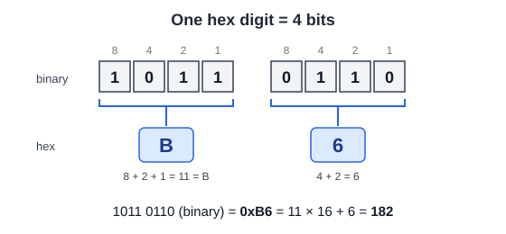

*Each group of 4 bits becomes one hex digit.*

**In Arduino code** a hex number starts with `0x` (for example `0x7B`); upper- or lower-case letters both work. Binary numbers start with `0b` (older sketches use `B`). A number with no prefix is denary. [Arduino, integer constants]

**Where learners will meet hex:** I²C device addresses (C1 — a BH1750 light sensor is at `0x23`), memory addresses (a 16-bit address bus spans 0x0000–0xFFFF, see A5), web colours (`#66FF33` = 24 bits), MAC addresses (12 hex digits = 48 bits — useful in the Networks unit) and error codes. [Save My Exams, uses of hexadecimal (secondary source)]

**Misconception:** "A is a letter, so it can't be a number." In hex, A is simply the single digit for ten.

<a id="7-74-logic-gates"></a>
### 7.4 Logic gates

A **logic gate** is a tiny circuit that takes one or more bits in and gives one bit out according to a fixed rule. CPUs are built from millions or billions of them. A **truth table** lists every input combination and the output.

| A | B | A AND B | A OR B | NOT A |
|---|---|---|---|---|
| 0 | 0 | 0 | 0 | 1 |
| 0 | 1 | 0 | 1 | 1 |
| 1 | 0 | 0 | 1 | 0 |
| 1 | 1 | 1 | 1 | 0 |

- **AND** outputs 1 only if *both* inputs are 1. ("The door opens if you have a key AND you know the code.")
- **OR** outputs 1 if *at least one* input is 1.
- **NOT** flips its single input.

<a id="7-75-how-the-cpu-follows-instructions-fetchdecodeexecute"></a>
### 7.5 How the CPU follows instructions: fetch–decode–execute

A **program** is a list of instructions stored in memory, alongside the data it uses. The CPU repeats the same three-step cycle for every instruction, billions of times a second in a laptop.

Key parts inside the CPU:

- **Program counter (PC):** holds the memory address of the *next* instruction.
- **Instruction register (IR, sometimes CIR):** holds the instruction currently being worked on.
- **Control unit (CU):** decodes the instruction and sends signals to the other parts.
- **ALU (arithmetic logic unit):** does the arithmetic (add, subtract) and logic (AND, OR, compare).
- **Accumulator (ACC):** a small working register that holds a result.

The cycle:

1. **Fetch:** the address in the PC is sent to memory; the instruction at that address is copied into the IR. The PC is then increased so it points to the next instruction.
2. **Decode:** the control unit works out what the instruction means — the *operation* (for example ADD) and the *operand* (what to use, for example memory address 5).
3. **Execute:** the control unit makes it happen — for example the ALU adds a number to the accumulator. A "jump" instruction can change the PC, which is how programs repeat and make decisions.

Some syllabuses list a fourth step, **store** (writing a result back), which this guide treats as part of *execute*. [Save My Exams; Computer Science Wiki]

<a id="7-worked-example-a-paper-cpu"></a>
#### Worked example: a paper CPU

This is a **made-up teaching machine**, not a real processor, but the idea is the same.

| Address | Contents | Meaning |
|---|---|---|
| 0 | `LOAD 4` | Copy the value at address 4 into ACC |
| 1 | `ADD 5` | Add the value at address 5 to ACC |
| 2 | `STORE 6` | Copy ACC into address 6 |
| 3 | `HALT` | Stop |
| 4 | `7` | data |
| 5 | `5` | data |
| 6 | `0` | data (result goes here) |

| Cycle | PC at fetch | IR after fetch | Execute | ACC after | Address 6 after |
|---|---|---|---|---|---|
| 1 | 0 | `LOAD 4` | ACC ← 7 | 7 | 0 |
| 2 | 1 | `ADD 5` | ACC ← 7 + 5 | 12 | 0 |
| 3 | 2 | `STORE 6` | address 6 ← 12 | 12 | 12 |
| 4 | 3 | `HALT` | stop | 12 | 12 |

Notice that **instructions and data sit in the same memory** — only the PC decides which addresses are treated as instructions.

**Classroom activity:** one learner is the CPU (holding PC, IR and ACC cards), one is memory (holding the address cards). The CPU must ask memory for each address — it cannot "see" ahead.

<a id="7-how-the-cpu-talks-to-memory-buses-mar-and-mdr"></a>
#### How the CPU talks to memory: buses, MAR and MDR

The trace above says the address is "sent to memory". It travels on **buses** — groups of parallel wires that connect the CPU to memory and input/output.

| Bus | Carries | Direction |
|---|---|---|
| **Address bus** | The memory *location* to read or write | One way: CPU → memory / I/O |
| **Data bus** | The data or instruction itself | Two way |
| **Control bus** | Signals such as *read*, *write*, *clock*, *interrupt*, *reset* | Two way (each individual line has its own direction) |

[Save My Exams, von Neumann architecture (secondary source); Toshiba, types of bus lines]

**Width matters.** An address bus with $n$ wires can name $2^n$ locations — the same $2^n$ rule as A3. A 16-bit address bus reaches $2^{16} = 65\,536$ locations (0x0000–0xFFFF); each extra wire doubles that. [University of Cambridge Engineering, microprocessor notes]

Two more registers sit at the CPU's edge, where it meets the buses:

- **Memory address register (MAR):** holds the address about to be read or written. Its contents go out on the address bus.
- **Memory data register (MDR):** holds the data or instruction just read from memory, or about to be written to it. It connects to the data bus.

**The fetch step in full:** the PC is copied into the MAR → the address goes out on the address bus → the control unit sends *read* on the control bus → the instruction comes back on the data bus into the MDR → it is copied into the IR (CIR) → the PC is increased. [Seneca, Cambridge IGCSE fetch–decode–execute (secondary source); Save My Exams (secondary source)]

**The paper CPU, re-traced with buses:**

| Instruction | What goes in MAR (address bus) | Control signal | What travels on the data bus |
|---|---|---|---|
| Fetch `LOAD 4` | 0 | read | `LOAD 4` → MDR → IR |
| Execute `LOAD 4` | 4 | read | 7 → MDR → ACC |
| Execute `ADD 5` | 5 | read | 5 → MDR → ALU adds to ACC |
| Execute `STORE 6` | 6 | **write** | 12 from ACC → MDR → memory |

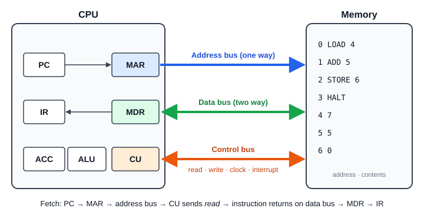

*The paper CPU and its memory, joined by the three buses.*

The `STORE` row is why the data bus must be two-way: for a *write*, data travels **out** of the CPU. (This write sequence is worked out from the definitions above; check the wording against your exam board's specification.)

**Exam habit:** when describing a bus, say both *what it carries* and *which way it goes*. A common mistake is to say the address bus carries data — it carries only the location.

<a id="7-the-clock-the-cpus-metronome"></a>
#### The clock: the CPU's metronome

The **clock** is a signal that ticks at a steady rate; each tick lets the CPU move one step further. Clock speed is ticks (cycles) per second: 1 MHz = $10^6$ per second, 1 GHz = $10^9$. The clock signal is one of the control-bus lines. [Emory University CS255 notes; TutorChase (secondary source)]

On the Uno's 16 MHz clock, one tick lasts $1 / 16\,000\,000\ \text{s} = 62.5\ \text{ns}$. The ATmega328P completes most simple instructions in a single tick, so it reaches *about* 1 million instructions per second (MIPS) per MHz — roughly 16 MIPS at best. Some instructions take two or more ticks. [Microchip, AVR CPU core — instruction execution timing; ATmega328P datasheet (secondary source — check against the Microchip PDF)]

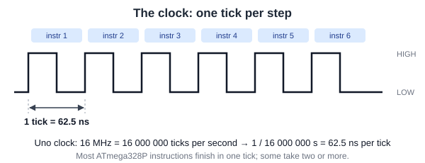

**Speed misconception:** a higher clock speed (GHz) does not automatically mean a faster computer. Speed also depends on how much work the CPU does per clock tick, how many cores the program can use, and whether the chip slows down when hot. [Tom's Hardware; Wikipedia, instructions per cycle]

<a id="7-76-the-bridge-to-part-b-a-microcontroller-is-a-small-computer-on-one-chip"></a>
### 7.6 The bridge to Part B: a microcontroller is a small computer on one chip

A **microcontroller** is an integrated circuit that contains a CPU, program memory, RAM and input/output pins on a *single chip*. It runs one program, starts instantly, and is designed to interact directly with sensors and outputs.

The Arduino Uno R3 uses the **ATmega328P** microcontroller: [Arduino Uno R3 docs; Arduino Store]

| Computer idea (Part A) | On the ATmega328P |
|---|---|
| CPU | 8-bit processor, 16 MHz clock on the Uno |
| Storage (program kept without power) | 32 KB flash memory (0.5 KB used by the bootloader) |
| RAM (working memory, lost without power) | 2 KB SRAM |
| Extra non-volatile data | 1 KB EEPROM |
| Input/output | 14 digital pins (6 can do PWM), 6 analog inputs |

Compare a laptop with gigabytes of RAM: a microcontroller is tiny but enough to read a sensor and switch a light.

<a id="7-real-chips-differ-from-the-model-von-neumann-vs-harvard"></a>
#### Real chips differ from the model: von Neumann vs Harvard

The paper CPU in A5 keeps instructions and data in **one shared memory** on one set of buses. This design is called **von Neumann architecture**, and it is how most laptops and desktops are described in introductory courses.

The ATmega328P is different. Microchip describes the AVR as a **Harvard architecture**, "with separate memories and buses for program and data". The program sits in **flash**; variables sit in **SRAM**; each has its own bus. Because the two do not compete for the same bus, the chip can **fetch the next instruction while it executes the current one** — which is why it manages about one instruction per clock tick. [Microchip, AVR CPU core overview]

| | von Neumann (paper CPU) | Harvard (ATmega328P) |
|---|---|---|
| Memory for program and data | One shared memory | Separate: flash for program, SRAM for data |
| Buses | One set, shared | Separate sets |
| Fetch and data access at the same time? | No — they take turns | Yes |

*(Some sources call the AVR "modified Harvard", because its program memory can also be read as data. [Wikipedia, ATmega328 (secondary source)])*

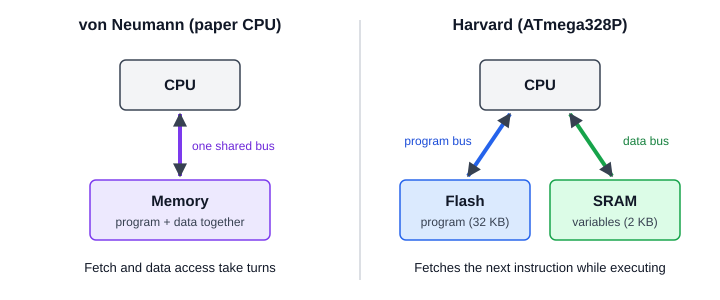

<a id="7-microcontroller-or-single-board-computer"></a>
#### Microcontroller or single-board computer?

A **single-board computer** such as a Raspberry Pi 5 is a full computer on one board: a multi-core processor at about 2.4 GHz, gigabytes of RAM, a full operating system, and a memory card or SSD for storage. [Raspberry Pi 5 product page]

| Need | Usually better choice |
|---|---|
| Read sensors and switch outputs, low power, instant start | Microcontroller (e.g. Arduino Uno) |
| Run an operating system, a web server, a camera with image processing, or heavy computation | Single-board computer (e.g. Raspberry Pi) |

Neither is "better" in general — the requirement decides. For the light indicator below, a microcontroller is the simpler fit.

---

---

<a id="chapter-8"></a>
## Chapter 8 — First laboratory skills

### 8.1 Breadboards: which holes are connected

A **breadboard** (solderless breadboard) lets you build a circuit by pushing component legs and wires into holes. Inside, metal strips connect some holes together.

```text
  + ─────────────────────────────  (power rail: whole row connected)
  − ─────────────────────────────  (ground rail: whole row connected)

     1   2   3   4   5  ...
  a  o   o   o   o   o
  b  o   o   o   o   o     each numbered COLUMN of a–e
  c  o   o   o   o   o     is one connected strip of 5 holes
  d  o   o   o   o   o
  e  o   o   o   o   o
     ═══════ centre gap ═══════   (no connection across it)
  f  o   o   o   o   o
  g  o   o   o   o   o     f–j is a separate strip of 5
  h  o   o   o   o   o
  i  o   o   o   o   o
  j  o   o   o   o   o

  + ─────────────────────────────
  − ─────────────────────────────
```

Rules:

- Holes **a–e in the same column** are connected. So are **f–j**. The two halves are **not** connected across the centre gap.
- The long **power rails** along the edges run the length of the board. Use red/+ for 5 V and blue/− for GND.
- **Many full-size breadboards split the rails halfway along.** If parts at one end get no power, add a short jumper across the break, or check with a multimeter's continuity mode (L2).
- A component with **both legs in the same strip is shorted out** — current goes through the strip, not the part. A resistor must bridge **two different** columns.
- Chips and push buttons sit **across the centre gap**, so each pin gets its own strip.

**Common mistake:** putting the LED's two legs in the same column. It will never light.

<a id="8-82-using-a-multimeter"></a>
### 8.2 Using a multimeter

A **multimeter** measures voltage, resistance, continuity and (carefully) current. It is the main tool for finding faults.

| Measurement | Dial setting | How to connect | Power on? |
|---|---|---|---|
| DC voltage | V⎓ (or DCV), range 20 V | **Across** the part (in parallel): black on GND, red on the point to test | Yes |
| Resistance | Ω | Across the part. Take it out of the circuit, or lift one leg | **No** — power off |
| Continuity | 🔊 / diode symbol | Across the two points. A beep means they are connected | **No** — power off |
| Current | A or mA, red lead in the **mA socket** | **In series**: break the circuit and let the current flow through the meter | Yes |

Safety and accuracy:

- **Voltage is measured across, current is measured in series.** If the meter is set to current and you put it across a supply, you have made a short circuit. This can blow the meter's fuse or damage the board.
- **After measuring current, move the red lead back to the V/Ω socket.** Forgetting this is the most common way meters get damaged.
- **Measure resistance with the power off.** A powered circuit gives wrong readings and can damage the meter.
- Start on a higher range if your meter is not auto-ranging.

**Lab activity — measure your LDR:** with the LDR out of the circuit, measure its resistance (1) under room light, (2) covered by your hand, (3) under a phone torch. Record the three values in the project log. This replaces the "illustrative" values in B6 with real ones for *your* part.

**Lab activity — check the divider:** with the circuit built and powered, measure the voltage between A0 and GND. Calculate the ADC code you expect ($V / 5 \times 1024$) and compare it with the Serial Monitor reading.

<a id="8-83-reading-resistor-values"></a>
### 8.3 Reading resistor values

Most through-hole resistors show their value as **colour bands**. On a 4-band resistor, the first two bands are digits, the third is a multiplier, and the fourth (usually gold or silver, a little apart) is the tolerance.

| Colour | Digit | Multiplier |
|---|---|---|
| Black | 0 | ×1 |
| Brown | 1 | ×10 |
| Red | 2 | ×100 |
| Orange | 3 | ×1 000 |
| Yellow | 4 | ×10 000 |
| Green | 5 | ×100 000 |
| Blue | 6 | ×1 000 000 |
| Violet | 7 | — |
| Grey | 8 | — |
| White | 9 | — |
| Gold | — | ×0.1 (as 4th band: **±5 %** tolerance) |
| Silver | — | ×0.01 (as 4th band: **±10 %** tolerance) |

Examples from the BOM:

- **10 kΩ** = brown (1), black (0), orange (×1000), gold (±5 %) → $10 \times 1000 = 10\,000\ \Omega$
- **330 Ω** = orange (3), orange (3), brown (×10), gold (±5 %) → $33 \times 10 = 330\ \Omega$

**Tolerance** is how far the real value may be from the printed value. A 10 kΩ ±5 % resistor can be anywhere from 9.5 kΩ to 10.5 kΩ. This is one reason real ADC readings differ from the worked examples (B7).

**Standard values (E12 series):** resistors are sold in fixed steps, not every value. Each decade uses these numbers:

> 10, 12, 15, 18, 22, 27, 33, 39, 47, 56, 68, 82

…then 100, 120, 150 … 1 k, 1.2 k, 1.5 k … and so on. That is why B8 calculates 300 Ω but uses **330 Ω**: it is the next standard value above, so the current stays below the target.

**Accessibility note:** colour bands are hard to read for colour-blind learners and in poor light. Always confirm the value with a multimeter (L2) — that is good practice for everyone.

<a id="8-84-uploading-code-with-the-arduino-ide"></a>
### 8.4 Uploading code with the Arduino IDE

1. **Install** the Arduino IDE (version 2.x) from <https://www.arduino.cc/en/software>.
2. **Connect** the Uno R3 with a USB cable. The green ON light should come on.
3. **Open** a sketch, e.g. [`arduino/01_light_indicator_basic`](Hardware/arduino/01_light_indicator_basic/01_light_indicator_basic.ino).
4. **Choose the board:** Tools → Board → Arduino AVR Boards → **Arduino Uno**.
5. **Choose the port:** Tools → Port. On Windows it looks like `COM3`; on macOS like `/dev/cu.usbmodem…`. If you are unsure, unplug the board and see which port disappears.
6. **Verify** (✓) to check the code compiles, then **Upload** (→). The TX/RX lights flash, then the IDE says "Done uploading".
7. **Open the Serial Monitor** (magnifying-glass icon, top right) and set it to **9600 baud** — the same number as `Serial.begin(9600)`. The **Serial Plotter** draws the same numbers as a live graph.

| Problem | Likely cause | Fix |
|---|---|---|
| No port appears | Charge-only USB cable, or driver missing | Try a different cable; for clone boards with a CH340 chip, install the CH340 driver |
| "Port busy" / "Access denied" | Another program (or a second Serial Monitor) has the port open | Close the other program and try again |
| `avrdude: stk500_recv(): programmer is not responding` | Wrong board or port, or something connected to pins 0/1 | Re-check Tools → Board and Port; disconnect wires on pins 0 and 1 (they are used for USB serial) |
| Serial Monitor shows random symbols | Baud rate mismatch | Set the monitor to 9600 to match `Serial.begin(9600)` |
| `'xyz' was not declared in this scope` | Typo, or wrong capital letters (C++ is case-sensitive) | Check spelling: `digitalWrite`, not `digitalwrite` |

<a id="8-85-schematic-symbols"></a>
### 8.5 Schematic symbols

A **schematic** is a diagram that shows *how parts are connected*, not where they physically sit. The ASCII drawings in hardware.md are simplified schematics. Standard symbols:

| Part | Symbol (described) | Notes |
|---|---|---|
| Resistor | Zig-zag line (US) or small rectangle (IEC/UK/EU) | No polarity |
| LDR | Resistor symbol with two arrows pointing **in** (light arriving) | No polarity |
| LED | Triangle pointing at a bar, with two arrows pointing **out** | Triangle side = anode (+), bar = cathode (−) |
| Diode | Triangle pointing at a bar | Current flows in the direction of the triangle |
| NPN transistor | Circle with three leads; arrow on the emitter pointing **out** | Leads: collector, base, emitter |
| Push button | Two contacts with a lifted bar above them | No polarity |
| Ground (GND) | Three horizontal lines getting shorter, or a downward triangle | 0 V reference |
| Supply (VCC / 5V) | Upward arrow or short bar labelled with the voltage | — |
| Capacitor | Two parallel lines (one curved or marked + if polarised) | Electrolytic capacitors have polarity |

**Activity:** draw the light-indicator circuit (B6 + B8) using these symbols, then compare it with a classmate's. Two correct schematics can look different on the page and still show the same connections.

Free tools for drawing schematics: [KiCad](https://www.kicad.org/) (full electronics design), [Fritzing](https://fritzing.org/) (breadboard view), or [Wokwi](https://wokwi.com/) (online Arduino simulator — useful for testing the sketches before the lab).

<a id="8-86-digital-inputs-buttons-pull-up-resistors-and-debouncing"></a>
### 8.6 Digital inputs: buttons, pull-up resistors and debouncing

Part B only uses an **analog** input (the LDR on A0). Many sensors and switches are **digital**: the pin reads either HIGH or LOW. The simplest example is a push button.

<a id="8-floating-inputs"></a>
#### Floating inputs

If a pin is connected to a button and nothing else, then while the button is released the pin is connected to **nothing**. It is **floating**: it picks up electrical noise and reads random HIGH and LOW values. Touching the wire can change the reading.

<a id="8-pull-up-and-pull-down-resistors"></a>
#### Pull-up and pull-down resistors

A **pull-up resistor** (often 10 kΩ) connects the pin weakly to 5 V, so it reads **HIGH** when the button is released. The button connects the pin to GND, so pressing it reads **LOW**. A **pull-down resistor** does the opposite: connects weakly to GND, and the button connects to 5 V.

```text
     5V                          Pin 2 ──[button]── GND
      │
   [10 kΩ]   pull-up             With INPUT_PULLUP, the 10 kΩ
      │                          is inside the chip, so only
  Pin 2 ──[button]── GND         the button is needed.
```

The ATmega328P has **built-in pull-up resistors** (about 20–50 kΩ (secondary source)). Turn one on with:

```cpp
pinMode(2, INPUT_PULLUP);   // released = HIGH, pressed = LOW
```

Beginners often expect "pressed = HIGH". With a pull-up it is the other way round — point this out, as with the LDR direction in B6.

<a id="8-debouncing"></a>
#### Debouncing

The metal contacts inside a button **bounce** for a few milliseconds when pressed, so the pin can flip HIGH/LOW several times in one press. A program that counts presses will count too many. **Debouncing** means ignoring changes until the signal has been steady for about 20–50 ms. Sketch [05_button_override](Hardware/arduino/05_button_override/05_button_override.ino) shows how, using `millis()` instead of `delay()` so the program never stops reading.

<a id="8-analog-vs-digital-sensors"></a>
#### Analog vs digital sensors

| | Analog sensor | Digital sensor |
|---|---|---|
| Output | A voltage anywhere in a range | HIGH/LOW, or data sent over a bus |
| Uno input | A0–A5 with `analogRead()` | Any digital pin with `digitalRead()`, or I²C/SPI/UART |
| Examples | LDR, potentiometer, thermistor | Button, PIR motion sensor, DHT22, BME280 |

<a id="8-87-glossary"></a>
### 8.7 Glossary

| Term | Meaning |
|---|---|
| Actuator | Converts a control signal and energy into a physical effect (motion, sound, heat) |
| ADC | Analog-to-digital converter: turns a voltage into a number |
| Anode / cathode | The + and − terminals of a diode or LED |
| Breadboard | Board with connected strips of holes for building circuits without soldering |
| BOM | Bill of Materials: list of parts, quantities and specifications |
| Bit / byte | One binary digit (0 or 1) / a group of 8 bits |
| Continuity | Whether two points are electrically connected |
| CPU | Central processing unit: follows program instructions |
| Datasheet | Manufacturer's technical document for a component |
| Debouncing | Ignoring the rapid on/off flickers when a mechanical switch changes |
| Duty cycle | Percentage of time a PWM signal is ON |
| Floating input | An input pin connected to nothing, so it reads random values |
| Flyback diode | Diode across an inductive load that absorbs the switch-off voltage spike |
| GND | Ground: the 0 V reference point |
| GPIO | General-purpose input/output pin |
| Hysteresis | Using two thresholds (on/off) so an output does not flicker |
| LDR | Light-dependent resistor: resistance falls as light increases |
| Logic level | The voltage a board uses for HIGH (5 V on the Uno R3, 3.3 V on many others) |
| Microcontroller | CPU, memory and I/O pins on one chip |
| Ohm's law | $V = IR$ |
| Pull-up / pull-down | Resistor that holds an input HIGH / LOW when nothing else drives it |
| PWM | Pulse-width modulation: fast on/off switching to control average power |
| RAM | Volatile working memory; lost when power is off |
| Resolution | Smallest change a measurement system can show |
| Schematic | Diagram showing how components are connected |
| Sensor | Measures a physical quantity and gives a usable signal |
| Serial Monitor | Arduino IDE window that shows text sent by `Serial.print()` |
| Storage | Non-volatile memory; kept when power is off |
| Tolerance | How far a part's real value may differ from its labelled value |
| Voltage divider | Two resistors in series; the output is the voltage at the junction |

<a id="8-88-practice-questions"></a>
### 8.8 Practice questions

**Question H — Breadboard.** A learner puts both legs of the 330 Ω resistor into holes a5 and c5. The LED never lights. Why?

**Question I — Multimeter.** You want to know how much current the LED draws. Where do you connect the multimeter, and what must you do with the red lead afterwards?

**Question J — Resistor bands.** A resistor is banded yellow, violet, red, gold. What is its value and tolerance?

**Question K — Uno R4 LED resistor.** The Uno R4 pin is rated for about 8 mA. With a 5 V output and a 2 V LED, what is the smallest resistor that keeps the current at or below 8 mA? Which E12 value would you use?

**Question L — Button.** A button is wired from pin 2 to GND, with `pinMode(2, INPUT)` (not `INPUT_PULLUP`). The Serial Monitor shows random 0s and 1s when nobody touches it. Explain why, and give the one-word fix in the code.

<a id="8-answers"></a>
#### Answers

**Answer H.** a5 and c5 are in the same connected strip (column 5, rows a–e), so the resistor is shorted out and is not in the path between the pin and the LED. Move one leg to a different column.

**Answer I.** In **series**: break the circuit (for example between the resistor and the LED) and connect the meter across the gap, with the red lead in the mA socket. Afterwards, move the red lead back to the V/Ω socket. Expect about 9 mA (B8).

**Answer J.** Yellow (4), violet (7), red (×100) → $47 \times 100 = 4700\ \Omega = 4.7\ \text{k}\Omega$, gold = ±5 %.

**Answer K.**

$$
R = \frac{5 - 2}{0.008} = 375\ \Omega
$$

The next E12 value above is **390 Ω** ($I = 3/390 \approx 7.7\ \text{mA}$). B5 recommends 470 Ω–1 kΩ to leave a margin, which is also correct.

**Answer L.** With the button released, the pin is floating: connected to nothing, so it picks up noise. Fix: `INPUT_PULLUP` (then pressed reads LOW, released reads HIGH).

---

---

<a id="chapter-9"></a>
## Chapter 9 — Building an automatic light indicator

<a id="9-91-start-with-the-system-requirement-not-the-parts-list"></a>
### 9.1 Start with the system requirement, not the parts list

**Physical component selection** means choosing hardware that fits the task and the system's constraints. An engineer first defines what the system must do, then checks whether each candidate part can meet those requirements — not just picking what is popular or cheap.

Our requirement:

> Switch an indicator light on when a room becomes dark, and switch it off again when the room is bright.

The design needs at least:

- a **sensor** — a device that measures a physical quantity and provides a usable signal (here, brightness);
- a **controller** — here a microcontroller (A6) that reads the sensor and makes a decision;
- an **output device** — here an LED that shows the result;
- suitable resistors, wiring and a power source.

An **actuator** converts a control signal and energy into a physical effect, such as motion. In this beginner circuit the LED is treated as a simple output device; in larger systems actuators include motors, relays and solenoids (B9).

<a id="9-photo-microcontroller-board"></a>
#### Photo: microcontroller board

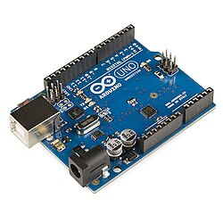

*An Arduino Uno R3 is a microcontroller development board. It provides digital pins, analog inputs, a USB connection and supporting circuitry. Image: Shoot stufz, [Wikimedia Commons](https://commons.wikimedia.org/wiki/File:Arduino_Uno_R3_development_board_03.jpg), [CC BY-SA 4.0](https://creativecommons.org/licenses/by-sa/4.0/).*

<a id="9-photo-light-sensor"></a>
#### Photo: light sensor

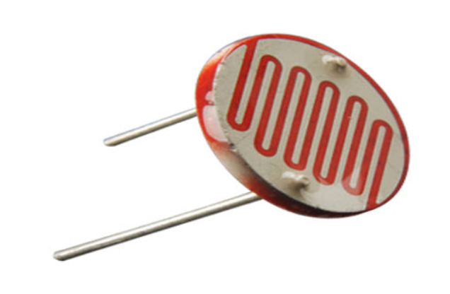

*A light-dependent resistor (LDR), also called a photoresistor, changes its resistance with light level. Image: Suyash Dwivedi, [Wikimedia Commons](https://commons.wikimedia.org/wiki/File:25mm_light-dependent_resistor_(LDR)_(2).jpg), [CC BY-SA 4.0](https://creativecommons.org/licenses/by-sa/4.0/).*

<a id="9-92-the-electrical-terms-used-in-the-circuit"></a>
### 9.2 The electrical terms used in the circuit

- **Voltage ($V$):** electrical "push" — the potential difference between two points, measured in volts (V).
- **Current ($I$):** the rate of flow of electric charge, measured in amperes (A). 1 mA (milliamp) = 0.001 A.
- **Resistance ($R$):** opposition to current, measured in ohms (Ω). 1 kΩ = 1000 Ω.
- **Power ($P$):** rate of energy transfer, measured in watts (W).
- **Ground (GND):** the reference point (0 V) of the circuit, usually the supply's negative terminal.
- **Analog signal:** a signal that can take any value within a range.
- **Digital signal:** a signal that is either LOW (about 0 V) or HIGH (about the supply voltage, here 5 V).

**Ohm's law** links voltage, current and resistance:

$$
V = IR
$$

Rearranged:

$$
I = \frac{V}{R} \qquad R = \frac{V}{I}
$$

**Electrical power:**

$$
P = VI = I^2R
$$

<a id="9-93-series-and-parallel-circuits"></a>
### 9.3 Series and parallel circuits

- **Series:** components in one line, one after another. The **same current** flows through each. Resistances **add**: $R_{total} = R_1 + R_2$. The supply voltage is **shared** between them.
- **Parallel:** components side by side across the same two points. Each has the **same voltage**. The total current is the sum of the branch currents, and the total resistance is **smaller** than either resistor:

$$
\frac{1}{R_{total}} = \frac{1}{R_1} + \frac{1}{R_2} \qquad\text{or, for two resistors,}\qquad R_{total} = \frac{R_1 R_2}{R_1 + R_2}
$$

[SparkFun, Series and Parallel Circuits]

<a id="9-worked-example"></a>
#### Worked example

A 5 V supply with $R_1 = 1\ \text{k}\Omega$ and $R_2 = 2\ \text{k}\Omega$.

**Series:**

$$
R_{total} = 1 + 2 = 3\ \text{k}\Omega \qquad I = \frac{5}{3000} \approx 1.67\ \text{mA}
$$

$V_1 = 1.67\ \text{mA} \times 1\ \text{k}\Omega \approx 1.67\ \text{V}$ and $V_2 \approx 3.33\ \text{V}$. Check: $1.67 + 3.33 = 5\ \text{V}$.

**Parallel:**

$$
R_{total} = \frac{1 \times 2}{1 + 2} \approx 0.667\ \text{k}\Omega = 667\ \Omega \qquad I = \frac{5}{667} \approx 7.5\ \text{mA}
$$

Check: $5/1000 + 5/2000 = 5\ \text{mA} + 2.5\ \text{mA} = 7.5\ \text{mA}$.

The voltage divider in B6 is just a series circuit where we measure the voltage at the middle.

<a id="9-94-basic-electrical-safety"></a>
### 9.4 Basic electrical safety

This unit uses only **low-voltage DC** (5 V from USB, or small batteries). **Mains electricity (220 V AC) is out of scope and must not be connected to any circuit in this module.**

Even at low voltage:

1. **Disconnect power before changing wiring.** Reconnect only after checking.
2. **Avoid short circuits** — a wire directly from 5 V to GND can overheat wires, damage the board, or trip the USB fuse.
3. **Check polarity** of LEDs, diodes, electrolytic capacitors and batteries before powering up.
4. **Hot parts mean a fault.** If anything gets hot, smells or smokes, disconnect immediately.
5. **Lithium batteries (LiPo / Li-ion)** can catch fire if punctured, short-circuited, over-charged or over-discharged. Use a proper charger and protected packs only.
6. Follow the lab's own safety rules

[UIUC ECE 110 lab safety; Adafruit, Li-ion and LiPoly batteries]

<a id="9-95-choose-components-using-measurable-criteria"></a>
### 9.5 Choose components using measurable criteria

| Criterion | What to ask | Why it matters |
|---|---|---|
| Operating voltage | What supply voltage does the part need? | A wrong voltage can stop it working or damage it. |
| Input/output compatibility | Can the controller safely read the sensor's signal, and can its outputs drive the load? | Boards have different logic voltages and pin limits. |
| Current and power | How much current will the part draw or carry? Can it handle the power? | Pins, wires and supplies all have limits. |
| Function and performance | Is the range, response time, accuracy or speed good enough? | It must do the actual job, not just connect. |
| Interface | Analog voltage, digital pin, I²C, SPI, UART…? | The controller must support it. |
| Environment | Temperature, moisture, vibration, light? | Conditions affect readings and reliability. |
| Cost and availability | Affordable? Well documented? | Undocumented parts are hard to use and maintain. |

A **datasheet** is the manufacturer's technical document describing a component's pins, electrical characteristics, operating conditions and limits. Read it before choosing a part. Do not confuse **recommended operating conditions** with **absolute maximum ratings**: an absolute maximum is a damage limit to stay well away from, not a target.

<a id="9-key-facts-for-the-arduino-uno-r3"></a>
#### Key facts for the Arduino Uno R3

From Arduino's official documentation: [Arduino Uno R3 docs; Arduino Store]

| Property | Value |
|---|---|
| Operating voltage | 5 V |
| Input voltage (barrel jack) | 7–12 V recommended (6–20 V limit) |
| DC current per I/O pin | **20 mA** (the absolute maximum on the chip is 40 mA *(secondary source)* — never design for it) |
| Total current through the chip | about 200 mA *(secondary source)* |
| 3.3 V pin | 50 mA |
| USB protection | resettable fuse trips above 500 mA |
| Analog inputs | 6 (A0–A5), 10-bit ADC |
| PWM pins | 3, 5, 6, 9, 10, 11 |

These figures are for the Uno R3. They must not be assumed for every Arduino-compatible board.

<a id="9-logic-levels-why-5-v-vs-33-v-matters"></a>
#### Logic levels: why "5 V" vs "3.3 V" matters

A board's **logic level** is the voltage its pins use for HIGH. A classic Uno R3 uses 5 V. Many modern boards — **Raspberry Pi** and **ESP32** — use **3.3 V and are not 5 V tolerant**: connecting a 5 V signal to their inputs can damage them. Use a level shifter or a divider when mixing them. [Raspberry Pi documentation]

The newer **Arduino Uno R4** also runs at 5 V, but each pin is only rated for about **8 mA**, so the 330 Ω LED resistor used below (≈9 mA) should be raised to 470 Ω–1 kΩ on an R4. [Arduino Store, Uno R4 Minima]

<a id="9-bill-of-materials-bom"></a>
#### Bill of Materials (BOM)

A **Bill of Materials** lists the physical components needed to build a system: what, how many, which specification and why.

| Component | Qty | Specification | Purpose |
|---|---:|---|---|
| Arduino Uno R3 | 1 | 5 V board with analog inputs | Reads the sensor and runs the program |
| Light-dependent resistor (LDR) | 1 | e.g. GL5528 (≈10–20 kΩ at 10 lux, ≥1 MΩ dark) | Detects brightness |
| Fixed resistor | 1 | 10 kΩ, ¼ W | Forms a voltage divider with the LDR |
| LED | 1 | 5 mm red, forward voltage ≈2 V, 20 mA max | Indicates the result |
| LED resistor | 1 | 330 Ω, ¼ W | Limits LED current |
| USB cable and power source | 1 | 5 V USB, able to supply the board | Powers the board and sensing circuit |
| Breadboard | 1 | Standard solderless | Prototyping without soldering |
| Jumper wires | as needed | Male–male | Connections |

**Selection rationale:**

- **Microcontroller:** the Uno R3 has analog inputs and digital outputs, runs at 5 V, and is well documented — a good teaching platform.
- **Sensor:** an LDR is cheap and easy; its resistance changes with light.
- **Fixed resistor:** 10 kΩ is close to the LDR's resistance in normal room light, which puts the divider output near the middle of the ADC range, where changes are easiest to see.
- **LED and resistor:** visible output; 330 Ω keeps the current around 9 mA (B8), under the 20 mA pin rating.
- **Power:** USB is enough — the whole circuit draws well under 500 mA (B10).
- **Prototyping parts:** a breadboard and jumper wires make the circuit easy to change and test.

**Verification before assembly:**

1. Check the board's voltage and pin specifications.
2. Confirm the LDR's resistance range from its datasheet or by measuring with a multimeter.
3. Calculate the divider output at several light levels (B6).
4. Check the LED's forward voltage and current and the resistor's power rating (B8).
5. Confirm the power supply can provide enough current (B10).
6. Build, test, and only then mark the BOM as checked.

**Development status:** BOM drafted; specifications still need to be confirmed against the parts the team actually buys.

<a id="9-96-circuit-design-an-ldr-in-a-voltage-divider"></a>
### 9.6 Circuit design: an LDR in a voltage divider

An LDR's resistance **falls as light increases**. But a microcontroller cannot measure resistance directly — it measures **voltage**. To turn the resistance change into a voltage change, connect the LDR and a fixed resistor in series as a **voltage divider**.

A voltage divider is two resistors in series across a supply; the output is the voltage at the junction between them. If the output is measured across the lower resistor $R_2$ (the one connected to ground), the ideal equation is:

$$
V_{out} = V_{in} \times \frac{R_2}{R_1 + R_2}
$$

$V_{in}$ is the supply voltage, $R_1$ is the top resistor and $R_2$ the bottom one. The formula assumes the input measuring the voltage draws almost no current — true for the Uno's analog inputs.

<a id="9-wiring-diagram"></a>
#### Wiring diagram

A 10 kΩ fixed resistor on top, the LDR on the bottom, the midpoint to analog input A0:

```text
          +5 V (Uno R3)
               |
         [ R1 = 10 kΩ ]
               |
               +---------- A0 (analog input)
               |
         [ LDR = R2 ]
               |
              GND
```

With this arrangement, **more light → lower LDR resistance → lower voltage at A0**. **Darker → higher voltage.** Beginners often expect the opposite, so point this out. Swapping the two parts would reverse the direction.

**Important:** a voltage divider is for *sensing* only. Do not use one to power a load; use a proper voltage regulator instead.

<a id="9-worked-example-estimate-the-sensor-voltage"></a>
#### Worked example: estimate the sensor voltage

Assume a 5 V supply, $R_1 = 10\ \text{k}\Omega$, and two illustrative LDR readings:

- **Dim room:** $R_2 = 100\ \text{k}\Omega$
- **Bright room:** $R_2 = 2\ \text{k}\Omega$ (roughly a well-lit room, a few hundred lux, for a GL5528-type LDR)

These are teaching values. Real LDRs vary between models, so measure your own part or check its datasheet. In **true darkness** a GL5528 can exceed 1 MΩ. [GL55 series datasheet]

**Case A — dim:**

$$
V_{out} = 5 \times \frac{100}{10 + 100} = 5 \times \frac{100}{110} \approx 4.55\ \text{V}
$$

**Case B — bright:**

$$
V_{out} = 5 \times \frac{2}{10 + 2} = 5 \times \frac{2}{12} \approx 0.83\ \text{V}
$$

**Interpretation:** the dim example gives a much higher voltage than the bright one, so the controller can tell them apart.

<a id="9-97-from-voltage-to-a-number-the-adc"></a>
### 9.7 From voltage to a number: the ADC

An **ADC (analog-to-digital converter)** turns an input voltage into a whole number that a program can use. The Uno R3's ADC is **10-bit**: it gives $2^{10} = 1024$ possible codes, numbered **0 to 1023**. With the default 5 V reference, `analogRead()` returns:

$$
\text{ADC code} = \left\lfloor \frac{V_{in}}{5\ \text{V}} \times 1024 \right\rfloor \quad (\text{maximum } 1023)
$$

Each step is $5\ \text{V} / 1024 \approx 4.9\ \text{mV}$. A reading of 1023 means "5 V minus one step or more". Many tutorials use $\times 1023$ instead; the difference is under 0.1 % — smaller than the variation in a USB 5 V supply — so either is fine for estimates. [Arduino analogRead reference; ATmega328P datasheet]

Using the worked example:

- Dim: $4.55 / 5 \times 1024 \approx 931$
- Bright: $0.83 / 5 \times 1024 \approx 170$
- True darkness (≈1 MΩ LDR): $4.95 / 5 \times 1024 \approx 1013$

These are ideal estimates. Real readings differ because of the actual LDR, the real supply voltage, resistor tolerance and electrical noise.

<a id="9-resolution-accuracy-and-precision"></a>
#### Resolution, accuracy and precision

- **Resolution:** the smallest change the ADC can show — here ≈4.9 mV, one step.
- **Accuracy:** how close the reading is to the true value. It depends on the reference voltage, component tolerances and ADC errors — *not* just on resolution.
- **Precision (repeatability):** how much repeated readings of the same thing agree.

A 10-bit ADC has fine resolution, but if the 5 V USB supply is really 4.8 V, every reading is about 4 % off. **High resolution does not guarantee high accuracy.**

<a id="9-sampling"></a>
#### Sampling

Each `analogRead()` takes about **100 µs**, so the Uno can take roughly 10,000 readings per second — far faster than room light changes. A delay of 50–100 ms between readings is plenty for this project. [Arduino analogRead reference]

<a id="9-smoothing-calibration-and-hysteresis"></a>
#### Smoothing, calibration and hysteresis

- **Smoothing:** average several readings to reduce noise. Arduino's *Smoothing* example averages the last 10 readings. [Arduino Smoothing example]
- **Calibration:** measure the real minimum and maximum in *your* room, then set the threshold between them. Arduino's *Calibration* example records min and max during the first 5 seconds, then uses `map()` to rescale. [Arduino Calibration example]
- **Hysteresis:** if the light level sits right at the threshold, noise makes the LED flicker on and off. Use **two thresholds** — for example turn ON above 550 but only turn OFF below 450. The gap between them stops the flicker. This is a standard control technique; see the second code example in B11.

<a id="9-98-add-an-output-an-led-indicator"></a>
### 9.8 Add an output: an LED indicator

An **LED (light-emitting diode)** converts electrical energy into light. It only conducts one way: current flows from the **anode** (+, longer leg) to the **cathode** (−, shorter leg, flat edge on the case).

An LED **must** have a series resistor to limit its current. A typical red LED has a forward voltage of about 2 V (range 1.8–2.2 V) and a maximum of 20 mA. [SparkFun, basic red LED]

For a 5 V output, a 2 V LED and a target of 10 mA, the resistor must drop:

$$
V_R = 5 - 2 = 3\ \text{V}
$$

$$
R = \frac{V_R}{I} = \frac{3}{0.010} = 300\ \Omega
$$

The nearest common value above that is **330 Ω**:

$$
I = \frac{3}{330} \approx 0.0091\ \text{A} = 9.1\ \text{mA}
$$

That is below the Uno R3's 20 mA pin rating. **Resistor power check:**

$$
P = I^2 R = 0.0091^2 \times 330 \approx 0.027\ \text{W} = 27\ \text{mW}
$$

That is far under a standard ¼ W (250 mW) resistor's rating.

Wiring: **digital pin 9 → 330 Ω resistor → LED anode → LED cathode → GND.**

<a id="9-99-actuators-when-a-pin-is-not-enough"></a>
### 9.9 Actuators: when a pin is not enough

A microcontroller pin is a **signal**, not a power supply. Rated at 20 mA, it can light an LED but **cannot** run most motors, relays or large buzzers.

| Load | Typical current | Drive directly from a pin? |
|---|---|---|
| Small LED + resistor | 5–15 mA | Yes |
| Active buzzer (small) | ~10–30 mA | Sometimes — check its datasheet |
| Relay coil (5 V) | ~70–100 mA | **No** — needs a transistor driver |
| Small DC motor | 100 mA – several A | **No** — needs a transistor/MOSFET or motor driver |
| Hobby servo | up to ~1 A while moving | Signal yes, **power no** — use a separate supply |

**Active vs passive buzzer:** an *active* buzzer has its own oscillator and beeps when given DC power; a *passive* buzzer needs the microcontroller to generate a tone (for example with `tone()`).

<a id="9-why-motors-and-relays-are-special-inductive-loads-and-flyback-diodes"></a>
#### Why motors and relays are special: inductive loads and flyback diodes

Motors and relay coils are **inductive loads** — they store energy in a magnetic field. When switched off suddenly, they produce a **voltage spike** that can destroy the transistor driving them. A **flyback diode** (for example a 1N4001) placed **across the load, pointing toward the positive supply** (cathode to +) gives that energy a safe path. [Wikipedia, flyback diode]

<a id="9-a-transistor-as-a-switch"></a>
#### A transistor as a switch

A **transistor** lets a small current (from the pin) control a much bigger current (through the load). In a **low-side switch** the transistor sits between the load and ground:

```text
  Motor supply (+6 V, separate)
          |
          +--------+
          |        |
       [Motor]   [Diode 1N4001]   (cathode/stripe toward +6 V)
          |        |
          +--------+
          |
          C
  Pin 9 --[ R_B ]-- B   NPN (e.g. 2N2222)
          E
          |
         GND  <---- shared with Arduino GND
```

**Common ground:** the motor supply's negative and the Arduino's GND **must be connected**, or the transistor has no reference and will not switch.

<a id="9-worked-example-choose-the-base-resistor"></a>
#### Worked example: choose the base resistor

A small motor draws 150 mA. For an NPN transistor to be **fully on** (saturated), a common rule of thumb is to give the base about **one tenth** of the load current ("forced beta" of 10):

$$
I_B = \frac{150\ \text{mA}}{10} = 15\ \text{mA}
$$

The base–emitter junction drops about 0.7 V, so:

$$
R_B = \frac{5 - 0.7}{0.015} \approx 287\ \Omega
$$

Use **270 Ω or 330 Ω**. With 330 Ω, $I_B = 4.3 / 330 \approx 13\ \text{mA}$ — enough to switch the motor, and safely under the 20 mA pin rating.

A common mistake is using 1 kΩ: that gives only ≈4.3 mA, which may not fully turn the transistor on at 150 mA. It is fine for a 70 mA relay coil, though. [SparkFun, Transistors; Adafruit, DC motors lesson]

For loads above about **200 mA**, the base current would exceed the pin limit. Use a **logic-level N-channel MOSFET** instead (for example IRLB8721, which fully switches with 5 V on its gate), with a small gate resistor (≈100–220 Ω) and a 10 kΩ pull-down from gate to GND so it stays off at power-up. [Adafruit, IRLB8721]

<a id="9-motor-driver-modules"></a>
#### Motor-driver modules

To run a motor **forwards and backwards**, use an **H-bridge** driver module rather than building one:

| Driver | Motor voltage | Current per channel | Notes |
|---|---|---|---|
| L298N | up to 46 V | 2 A (4 A total) | Old design; wastes ~1.4–3 V as heat |
| TB6612FNG | 4.5–13.5 V | 1.2 A (3 A peak) | Efficient; protection diodes built in |
| DRV8833 | 2.7–10.8 V | 1.5 A (2 A peak) | Efficient; good for small robots |

[ST L298; Adafruit TB6612; TI DRV8833]

<a id="9-pwm-controlling-brightness-and-speed"></a>
#### PWM: controlling brightness and speed

Digital pins are only ON or OFF. **PWM (pulse-width modulation)** switches a pin on and off very quickly. The **duty cycle** is the percentage of time it is ON:

$$
\text{duty cycle} = \frac{t_{on}}{t_{on} + t_{off}} \times 100\%
$$

On average, a 5 V pin at 50 % duty cycle behaves like about 2.5 V, so an LED looks dimmer or a motor turns slower.

On the Uno R3, `analogWrite(pin, value)` takes a value from **0 to 255**: 0 = always off, 128 ≈ 50 %, 255 = always on. It works only on pins **3, 5, 6, 9, 10, 11**, at about 490 Hz (980 Hz on pins 5 and 6). [Arduino analogWrite reference; SparkFun, PWM]

<a id="9-servos"></a>
#### Servos

A **hobby servo** turns to a commanded angle. It reads a pulse every 20 ms (50 Hz): about 1 ms ≈ one end, 1.5 ms ≈ centre, 2 ms ≈ the other end. The Arduino `Servo` library generates these pulses. Power anything bigger than a micro-servo from a **separate 5–6 V supply** (allow about 1 A per servo) with a **shared ground**. On the Uno, using the `Servo` library disables `analogWrite()` on pins 9 and 10, so move a PWM LED to another PWM pin (for example 5 or 6) if you add a servo. [SparkFun, Hobby Servo Tutorial; Arduino Servo library]

<a id="9-910-power-budget"></a>
### 9.10 Power budget

A **power budget** adds up the current every part needs and checks it against what the supply can give.

| Item | Current (approx.) |
|---|---|
| Arduino Uno R3 board itself | ~50 mA *(estimate — measure to confirm)* |
| LED via 330 Ω | 9 mA |
| LDR divider (worst case, bright: $5\ \text{V}/12\ \text{k}\Omega$) | 0.4 mA |
| **Total** | **≈60 mA** |

USB can supply up to 500 mA, so the light indicator has a large safety margin. A motor or servo would change that: **power motors from their own supply**, never from the Uno's 5 V pin.

<a id="9-911-connect-the-sensor-reading-to-the-output"></a>
### 9.11 Connect the sensor reading to the output

This Arduino sketch reads the divider and turns the LED on when it is dark. The threshold `500` is only a starting point; **calibrate it** using the Serial Monitor readings in your own room.

```cpp
const int sensorPin = A0;
const int ledPin = 9;
const int darkThreshold = 500;

void setup() {
  pinMode(ledPin, OUTPUT);
  Serial.begin(9600);
}

void loop() {
  int lightValue = analogRead(sensorPin);
  Serial.println(lightValue);

  // With the LDR as the lower divider resistor,
  // darker conditions produce a higher reading.
  if (lightValue > darkThreshold) {
    digitalWrite(ledPin, HIGH);
  } else {
    digitalWrite(ledPin, LOW);
  }

  delay(100);
}
```

<a id="9-improved-version-smoothing-and-hysteresis"></a>
#### Improved version: smoothing and hysteresis

```cpp
const int sensorPin = A0;
const int ledPin = 9;
const int onThreshold = 550;   // turn LED on when reading rises above this
const int offThreshold = 450;  // turn LED off only when reading falls below this
const int samples = 10;

bool ledOn = false;

void setup() {
  pinMode(ledPin, OUTPUT);
  Serial.begin(9600);
}

void loop() {
  // Smoothing: average several readings to reduce noise.
  long total = 0;
  for (int i = 0; i < samples; i++) {
    total += analogRead(sensorPin);
    delay(5);
  }
  int lightValue = total / samples;
  Serial.println(lightValue);

  // Hysteresis: two thresholds stop flicker near the boundary.
  if (!ledOn && lightValue > onThreshold) {
    ledOn = true;
  } else if (ledOn && lightValue < offThreshold) {
    ledOn = false;
  }
  digitalWrite(ledPin, ledOn ? HIGH : LOW);

  delay(50);
}
```

Both sketches are written for the circuit in B6 and B8 on an Uno R3. They have **not yet been tested** by the team on real hardware. Check the pinout of your exact board before building.

Ready-to-open copies of both sketches, plus a calibration sketch and two extensions (PWM dimming, push-button mode switch), are in [arduino/](Hardware/arduino). Uploading steps are in [beginner-lab-skills.md, L4](#8-84-uploading-code-with-the-arduino-ide).

<a id="9-912-overall-system-diagram"></a>
### 9.12 Overall system diagram

```text
Room light
    |
    v
LDR + 10 kΩ resistor        (physical input -> voltage)
    |
    v
Analog input A0 / ADC        (voltage -> number 0–1023)
    |
    v
Microcontroller program      (fetch–decode–execute: compare with threshold)
    |
    v
Digital output pin 9         (number -> HIGH/LOW voltage)
    |
    v
330 Ω resistor + LED         (electrical output -> light)
```

The parts form a **chain**: wrong wiring changes the measurement, a wrong threshold causes wrong decisions, and a missing LED resistor can damage the LED or the pin. Notice how Part A appears in the middle — the microcontroller's CPU fetches, decodes and executes the `if` statement thousands of times a second.

<a id="9-913-learner-activity"></a>
### 9.13 Learner activity

Try the questions before reading the answers. Show your calculations for Questions B and E.

**Question A — Component selection.** You need to build the automatic light indicator. Name four pieces of information you would check before choosing the board, LDR, fixed resistor and LED, and say why each matters.

**Question B — Voltage divider.** The input is 5 V, the fixed resistor is 10 kΩ and the LDR is 10 kΩ. Calculate the output voltage at the midpoint.

**Question C — Interpret a measurement.** On the Uno R3 circuit in B6, one condition reads about 900 and another about 180. Which is more consistent with darkness, and why?

**Question D — Actuator safety.** A teammate proposes connecting a small DC motor directly to a GPIO pin. Explain why this is unsuitable and name the kind of interface to use instead.

**Question E — Series and parallel.** Two 2 kΩ resistors are connected to 5 V. Find the total resistance and total current (i) in series and (ii) in parallel.

**Question F — PWM.** What duty cycle does `analogWrite(9, 64)` give, and roughly what average voltage?

**Question G — Paper CPU.** Using the paper CPU in A5, change address 5 to `9`. What value ends up in address 6, and how many fetch–decode–execute cycles run?

<a id="9-914-answers-and-expected-outcomes"></a>
### 9.14 Answers and expected outcomes

**Answer A.** Possible answers: operating and logic voltage; current and power limits; sensor resistance range; ADC/interface compatibility; LED forward voltage and current; environment; cost and availability; the datasheets. A good answer explains *why* each matters, not just lists terms.

**Answer B.**

$$
V_{out} = 5 \times \frac{10}{10 + 10} = 2.5\ \text{V}
$$

Equal resistances split the supply in half.

**Answer C.** About 900. In this wiring, darkness raises the LDR resistance, which raises the midpoint voltage and therefore the ADC code. Real thresholds depend on your components and room — calibrate rather than treating 900 as universal.

**Answer D.** A GPIO pin is rated for about 20 mA and is meant for signals; a motor may need hundreds of milliamps, and as an inductive load it creates voltage spikes when switched. Use a transistor or logic-level MOSFET switch with a flyback diode, or a motor-driver module, powered from a separate supply with a shared ground.

**Answer E.**
(i) Series: $R = 4\ \text{k}\Omega$, $I = 5/4000 = 1.25\ \text{mA}$.
(ii) Parallel: $R = (2 \times 2)/(2 + 2) = 1\ \text{k}\Omega$, $I = 5/1000 = 5\ \text{mA}$.

**Answer F.** $64/255 \approx 25\%$ duty cycle, so about $0.25 \times 5 \approx 1.25\ \text{V}$ on average.

**Answer G.** $7 + 9 = 16$ is stored in address 6. Four cycles run (`LOAD`, `ADD`, `STORE`, `HALT`) — changing data does not change the number of instructions.

<a id="9-915-troubleshooting-checklist"></a>
### 9.15 Troubleshooting checklist

Change one thing at a time:

1. Check the board pinout and supply voltage against the official documentation.
2. Confirm the fixed resistor and LDR are in series and A0 connects to their junction.
3. Check all grounds are connected together.
4. Print readings to the Serial Monitor and test bright and dark conditions.
5. Adjust the threshold only after seeing real readings.
6. Check the LED's orientation (long leg to the resistor/pin side) and that it has a series resistor.
7. If the LED flickers near the threshold, add smoothing and hysteresis (B11).
8. If adapting to another board, check its logic voltage and pin current limits first (B5).

---

---

<a id="chapter-10"></a>
## Chapter 10 — Interfaces, datasheets and sustainability

Part B built one complete circuit. Part C extends it in four directions: how a microcontroller talks to *digital* sensors and other computers (C1–C2), the one common component Part B did not use (C3), how to read a real datasheet line by line (C4), and what happens to the parts afterwards (C5).

<a id="10-101-serial-communication-uart-i²c-and-spi"></a>
### 10.1 Serial communication: UART, I²C and SPI

B5 lists "I²C, SPI, UART" as interface types. All three are **serial** interfaces: they send data **one bit at a time** over a few wires, instead of using one wire per bit. They differ in how many wires they need, how many devices can share them, and how fast they go.

<a id="10-uart--two-devices-no-clock-wire"></a>
#### UART — two devices, no clock wire

**UART** (universal asynchronous receiver-transmitter) links **exactly two devices**. Each has a **TX** (transmit) and an **RX** (receive) pin, and the wires **cross**: TX of one goes to RX of the other. There is no clock wire, so both ends must agree on the speed in advance — the **baud rate**, in bits per second (9600 and 115200 are common). [SparkFun, Serial Communication]

Each byte is sent as a **frame**: a start bit, 8 data bits, and a stop bit. This common setting is called **8N1** (8 data bits, no parity bit, 1 stop bit), and it is Arduino's default for `Serial.begin()`. Because of the start and stop bits, **every byte costs 10 bits on the wire**, so 9600 baud carries about 960 bytes per second. [SparkFun, Serial Communication; Arduino, Serial.begin()]

On the Uno R3 the hardware UART is on **pins 0 (RX) and 1 (TX)**, and the same pins also go to the board's USB-to-serial chip (an ATmega16U2 *(secondary source)*). That is why the Serial Monitor and anything wired to pins 0/1 interfere with each other. **Never** connect these pins to an old RS-232 serial port, which uses about ±12 V. On the Uno R4, pins 0/1 are a separate port (`Serial1`), so the clash goes away. [SparkFun, Serial Communication; Arduino, Serial reference]

<a id="10-i²c--many-addressed-devices-on-two-shared-wires"></a>
#### I²C — many addressed devices on two shared wires

**I²C** (inter-integrated circuit, said "I-squared-C") uses two wires shared by every device on the bus: **SDA** (data) and **SCL** (clock). Each device has its own **7-bit address**, written in hex, so the controller can talk to one at a time. On the Uno R3, SDA is **A4** and SCL is **A5** (also on the SDA/SCL header pins). Arduino's library is `Wire`. [SparkFun, I2C; Arduino, Wire reference]

- **Pull-up resistors are required.** Devices can only pull the lines *low*; a resistor from each line to the supply pulls them *high* again. SparkFun suggests starting at 4.7 kΩ. Many breakout boards already include them — check before adding more. [SparkFun, I2C]
- **Speed:** 100 kHz (standard) or 400 kHz (fast), set with `Wire.setClock()`. [Arduino, Wire.setClock()]
- **Distance:** short runs only, about 2–3 m. [SparkFun, I2C]
- **How many devices?** 112 addresses are usable in theory; in practice, around seven on one bus is a sensible limit. [SparkFun, I2C]
- **Example addresses:** a **BH1750 light sensor** is `0x23` (or `0x5C` if its ADDR pin is high) *(secondary source — from driver code, check the ROHM datasheet)*; an Adafruit **BME280** temperature/pressure/humidity breakout is `0x77` (or `0x76`). [Adafruit, BME280 guide] Because the addresses differ, both can share the same two wires.

**Link to the project:** a BH1750 is a *digital* light sensor that reports brightness directly as a number over I²C, instead of needing a voltage divider and the ADC. Comparing it with the LDR is a good component-selection discussion (B5): more accurate and calibrated, but more expensive and more complex to use.

<a id="10-spi--more-wires-more-speed"></a>
#### SPI — more wires, more speed

**SPI** (serial peripheral interface) uses three shared wires plus **one chip-select (CS) wire for each device**:

| Signal | Job | Uno R3 pin |
|---|---|---|
| **SCK** | Clock from the controller | 13 |
| **COPI** (older name MOSI) | Controller out, peripheral in | 11 |
| **CIPO** (older name MISO) | Controller in, peripheral out | 12 |
| **CS** (older name SS) | Selects one device: **LOW = selected** | 10 (or any spare pin, one per device) |

The same signals also appear on the 6-pin ICSP header. Data can flow both ways at once (full duplex). On the Uno the SPI clock can run from 125 kHz up to 8 MHz — much faster than I²C — but only over short distances (a few feet). Arduino's library is `SPI`. *Naming note:* Arduino uses COPI/CIPO, SparkFun uses PICO/POCI, and many older modules still print MOSI/MISO — they are the same lines. [SparkFun, SPI; Arduino, SPI reference]

The Adafruit BME280 breakout can be wired as **either** I²C or SPI — the bus is a choice made by the designer, not a property of the measurement. [Adafruit, BME280 guide]

<a id="10-comparing-the-three"></a>
#### Comparing the three

| | UART | I²C | SPI |
|---|---|---|---|
| Signal wires (plus GND) | 2 (TX/RX, crossed) | 2 (SDA/SCL, shared) | 3 shared + 1 CS per device |
| Clock wire? | No — agree a baud rate | Yes (SCL) | Yes (SCK) |
| How a device is chosen | Only two devices | By address | By its CS wire |
| Typical speed on Uno | 9600–115 200 baud | 100 / 400 kHz | 125 kHz – 8 MHz |
| Uno R3 pins | 0 (RX), 1 (TX) | A4 (SDA), A5 (SCL) | 10–13 + ICSP |
| Arduino library | `Serial` | `Wire` | `SPI` |
| Typical use | PC link, GPS, Bluetooth modules | Several slow sensors, small displays | Fast devices: SD cards, displays |

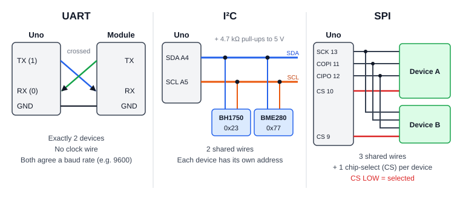

<a id="10-logic-levels-33-v-modules-on-a-5-v-uno"></a>
#### Logic levels: 3.3 V modules on a 5 V Uno

B5 warns about 3.3 V *boards*. The more common beginner case is a 3.3 V **sensor module** on a 5 V Uno. For example, the bare BME280 chip runs at 1.71–3.6 V and is **not** 5 V-tolerant *(secondary source)*, while Adafruit's breakout adds a regulator and level shifting so it is safe on 5 V. [Adafruit, BME280 guide] Before connecting any module, check:

1. Does its power pin (VIN) have a **regulator**, or must it get 3.3 V?
2. Are its data pins **level-shifted**, or 3.3 V only?
3. For I²C, which voltage do the **pull-up resistors** connect to?

If the answer is unclear, use a **logic-level converter** between the Uno and the module. [SparkFun, I2C]

<a id="10-102-sending-readings-to-another-device-csv-over-serial"></a>
### 10.2 Sending readings to another device: CSV over serial

The sketches already print one value per line. Printing several values separated by commas makes a **CSV** (comma-separated values) line:

```cpp
Serial.print(lightValue);
Serial.print(',');
Serial.println(ledOn ? 1 : 0);   // e.g. "734,1" then a new line
```

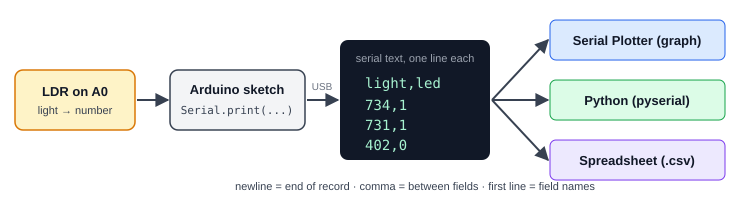

The same stream can then be read in three ways:

1. **Arduino Serial Plotter** — draws one line on the graph for each comma-separated column; values can also be labelled as `name:value` (sketch 02 does this). *(Format rule from secondary sources.)*
2. **A Python program** on the computer, using the `pyserial` library: `serial.Serial('COM3', 9600, timeout=1)` then `readline()` returns one line up to the newline. Set a **timeout**, or `readline()` can wait forever. [pyserial documentation] `println()` ends each line with `\r\n`, so strip it off (`line.strip()`) before splitting on commas.
3. **A spreadsheet**, once the lines are saved to a `.csv` file.

**Bridge to the Networks unit:** this tiny format already has the ideas a network protocol needs — a **newline marks where each record ends** (framing), a **comma separates the fields**, and an optional first line can name the fields. Packets, addresses and data formats in the Networks unit build on exactly these ideas.

<a id="10-103-capacitors"></a>
### 10.3 Capacitors

A **capacitor** stores electric charge, a little like a tiny rechargeable reservoir that fills and empties very quickly. Capacitance is measured in **farads (F)**; real parts are usually in **pF** (picofarads, $10^{-12}$ F), **nF** ($10^{-9}$ F) or **µF** ($10^{-6}$ F). Every capacitor also has a **voltage rating**; exceeding it will usually destroy the part. [SparkFun, Capacitors]

| Type | Typical values | Polarity | Typical use |
|---|---|---|---|
| **Ceramic** | pF to a few µF | None — either way round | Decoupling, filtering |
| **Aluminium electrolytic** | 1 µF – 1 mF and more | **Polarised:** stripe marks −, longer leg is + | Bulk storage near motors/servos |

An electrolytic capacitor connected the wrong way round can "fail spectacularly (making a pop and bursting open)". Always check the stripe before powering up (B4). [SparkFun, Capacitors]

**Reading the 3-digit code** on small ceramic capacitors: the first two digits are the value and the third is how many zeros to add, in **picofarads**. So **104** = 10 followed by 4 zeros = 100 000 pF = **100 nF = 0.1 µF** (not 104 pF). A letter after it gives the tolerance: J = ±5 %, K = ±10 %, M = ±20 %. *(secondary source)* This works like the resistor colour code in [beginner-lab-skills.md L3](#8-83-reading-resistor-values).

<a id="10-decoupling-and-bulk-capacitors"></a>
#### Decoupling and bulk capacitors

- **Decoupling capacitor:** a **0.1 µF ceramic** placed **as close as possible** to a chip's power pin. When the chip suddenly draws current, this small local store supplies it, keeping the supply voltage steady. Manufacturers (Microchip, Texas Instruments) consistently recommend this. [Microchip, decoupling capacitors; TI THS4281 datasheet]
- **Bulk capacitor:** a larger electrolytic (tens to hundreds of µF) that smooths bigger, slower dips. This matters as soon as a **servo** is added (B9): a servo starting up can pull the supply down far enough to **reset the Arduino**. Adafruit's fix is a capacitor of **470 µF or more** between 5 V and GND, longer (+) leg to 5 V. [Adafruit, Arduino Lesson 14 — servo motors]

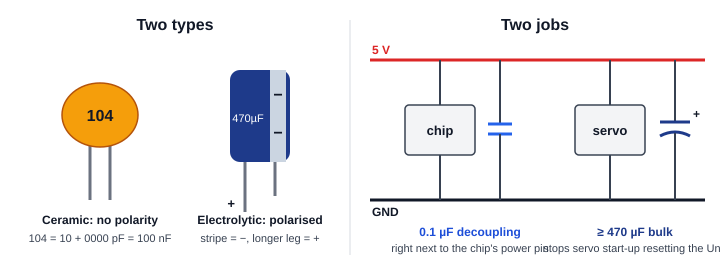

<a id="10-a-capacitor-on-the-sensor-input-optional"></a>
#### A capacitor on the sensor input (optional)

A 100 nF ceramic from A0 to GND forms an **RC filter** with the divider. Its **time constant** is

$$
\tau = RC = 10\ \text{k}\Omega \times 100\ \text{nF} = 10\,000 \times 0.000\,000\,1 = 0.001\ \text{s} = 1\ \text{ms}
$$

It is harmless and can reduce fast electrical noise. It is **not needed**: Microchip says the AVR ADC works best with a source resistance of about 10 kΩ or less, and this divider is always below that. [Microchip, AVR analog input circuitry (secondary — generic AVR page)] It also **cannot** remove the 100/120 Hz flicker of mains lighting, because it only filters changes faster than about 160 Hz — so the software averaging in B7/B11 is still the main smoothing method. A much bigger capacitor (100 µF, τ ≈ 1 s) would make the readings sluggish.

<a id="10-104-reading-a-real-datasheet-the-gl5528-ldr-and-a-red-led"></a>
### 10.4 Reading a real datasheet: the GL5528 LDR and a red LED

B5 says "read the datasheet". Here is what that looks like for the two parts in this project. Simple parts' datasheets usually contain: a description, dimensions, **absolute maximum ratings**, **electrical/optical characteristics** (with *min*, *typ* and *max* columns and the *test conditions*), and **graphs**.

| Datasheet line | GL5528 LDR | Kingbright WP7113ID red LED | In our circuit | Safe? |
|---|---|---|---|---|
| Voltage limit | 150 V max | 5 V **reverse** max | ≤ 5 V across the LDR | Yes, far below |
| Power limit | 100 mW | 75 mW | LDR ≤ 0.63 mW; LED ≈ 18 mW | Yes |
| Current limit | — | 30 mA continuous; 160 mA brief pulses only | ≈ 8–9 mA | Yes, about ⅓ of max |
| Key characteristic | 10–20 kΩ at 10 lux; ≥ 1 MΩ dark; γ = 0.6 | Forward voltage 1.9 V typ, 2.3 V max (at 10 mA); 30° viewing angle | — | — |
| Timing / temperature | 20 ms rise, 30 ms decay; −30 to +70 °C | −40 to +85 °C, with a derating curve | Room temperature | Yes |

[GL5528 datasheet (Rapid Electronics / TruOpto); Kingbright WP7113ID datasheet] *The last two columns are our own calculations from those values.*

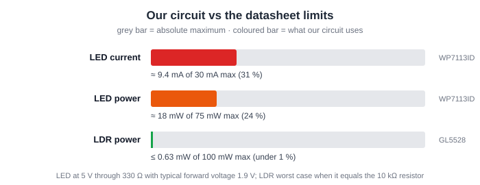

**Four lessons from this table:**

1. **Design to min/max, not "typ".** "Typ" is a typical part; yours may differ. With 330 Ω, the LED current is $(5 - 1.9)/330 \approx 9.4\ \text{mA}$ at typical forward voltage, but $(5 - 2.3)/330 \approx 8.2\ \text{mA}$ at the maximum. Both are safe. The LDR's 10–20 kΩ spread at the same light level — a factor of 2 between parts — is the datasheet's own reason why B7 tells you to **calibrate every build**.
2. **Read the graphs, not just the headline numbers.** The LED's 30 mA limit applies at about 25 °C; its derating curve falls to about 5 mA near 85 °C. A part in a hot enclosure has a lower limit.
3. **Gamma (γ) explains how much the reading changes.** γ = 0.6 means ten times more light divides the resistance by about $10^{0.6} \approx 4$. So at 100 lux the LDR is roughly 2.5–5 kΩ — consistent with the "bright room" 2 kΩ value used in B6.
4. **Check the specific part you bought.** The BOM in B5 lists "20 mA max", which is from SparkFun's generic red LED; the WP7113ID is rated 30 mA. Neither is wrong — they are different parts. The BOM should name the exact part number bought and quote **its** datasheet.

Two smaller points: an LED connected backwards on a 5 V pin sits right at its 5 V reverse-voltage limit, so fix it rather than leaving it; and Kingbright warns not to bend the LED legs "more than twice". *(The GL5528 sheet used here is a distributor's copy; one other site gives γ = 0.7 — use the datasheet's 0.6.)*

<a id="10-105-sustainability-e-waste-and-responsible-parts"></a>
### 10.5 Sustainability: e-waste and responsible parts

**The scale of the problem.** The *Global E-waste Monitor 2024* reports **62 million tonnes** of electronic waste generated worldwide in 2022 — up 82 % since 2010 and heading for 82 million tonnes by 2030. Only **22.3 %** was documented as properly collected and recycled, and e-waste is growing **five times faster** than documented recycling. The metals in it were worth about US$91 billion. It defines e-waste as "any discarded product with a plug or battery". [UNITAR, Global E-waste Monitor 2024 press release]

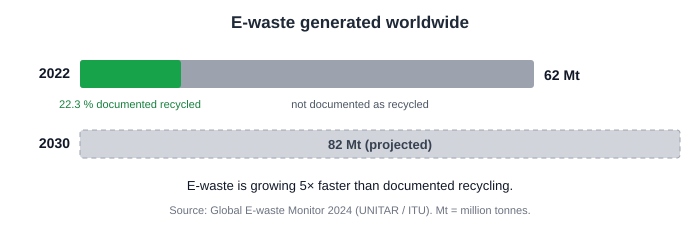

**RoHS links sustainability back to the datasheet.** The EU **RoHS** directive (2011/65/EU, extended by 2015/863) restricts ten hazardous substances in electronics, including **lead**, **cadmium** and **mercury**. [European Commission, RoHS directive] Look at this project's parts:

- The Kingbright LED is marked **RoHS compliant** and recommends **lead-free** (SAC 305) solder. [Kingbright WP7113ID datasheet]
- The GL5528's sensing layer is **CdS — cadmium sulphide**. [GL5528 datasheet] The LDR therefore contains cadmium and must go to **e-waste collection, never the normal bin**. Reuse it between projects instead of throwing it away.

**Lab habits:**

- **Reuse first.** C4 shows these parts run far below their ratings, so they can be reused many times. Keep a labelled parts-return tray, and prefer breadboard builds over soldering where possible.
- **Batteries never go in household rubbish or recycling bins.** Tape the terminals or bag each battery, and take them to a battery collection point. [US EPA, used household batteries] Follow your local authority's rules.
- **Dead boards, cables and modules** go to an e-waste collection point.
- **Buy from authorised distributors.** Counterfeit parts are often old or refurbished parts sold as new; they may not match their datasheet at all, which defeats C4. *(secondary source)*

<a id="10-106-practice-questions"></a>
### 10.6 Practice questions

**Question M — Hexadecimal.** Convert the I²C address `0x5C` to binary and to denary.

**Question N — Buses.** During the execute step of `STORE 6` in the paper CPU, what is on the address bus, what is on the data bus, and which control signal is sent?

**Question O — Choosing a bus.** You want to add both a BH1750 light sensor and a BME280 sensor to the Uno, using as few pins as possible. Which interface would you choose, how many signal wires are needed, and how does the Uno tell the two sensors apart?

**Question P — Capacitors.** A ceramic capacitor is marked `104`. What is its value in nF? What time constant does it give with a 10 kΩ resistor?

**Question Q — Datasheet.** Using the C4 table, a learner wants to replace the 330 Ω LED resistor with 100 Ω "to make it brighter". Using the maximum forward voltage (2.3 V) and the *typical* one (1.9 V), is this within the WP7113ID's absolute maximum?

**Question R — Harvard.** Give one difference between the paper CPU in A5 and the ATmega328P, and explain why it helps the ATmega328P run faster.

<a id="10-answers"></a>
#### Answers

**Answer M.** 5 = 0101, C = 1100, so `0x5C` = **0101 1100** = $5 \times 16 + 12 =$ **92**.

**Answer N.** Address bus: **6** (from the MAR). Data bus: **12** (from the ACC via the MDR, going *out* to memory). Control signal: **write**.

**Answer O.** **I²C**: only **2 signal wires** (SDA on A4, SCL on A5) plus power and GND, shared by both sensors. The Uno tells them apart by their **addresses** (BH1750 `0x23`, BME280 `0x77`).

**Answer P.** 10 + four zeros = 100 000 pF = **100 nF**. $\tau = 10\,000 \times 100 \times 10^{-9} = 0.001\ \text{s} =$ **1 ms**.

**Answer Q.** $(5 - 2.3)/100 = 27\ \text{mA}$; $(5 - 1.9)/100 = 31\ \text{mA}$. With a typical LED the current would be **above the 30 mA absolute maximum** — and above the Uno R3's 20 mA pin rating in either case. **No**: keep 330 Ω. (Absolute maximum is a damage limit, not a target — B5.)

**Answer R.** The paper CPU keeps program and data in **one shared memory** (von Neumann); the ATmega328P has **separate memories and buses** for program (flash) and data (SRAM) (Harvard). It can fetch the next instruction while executing the current one, so it completes about one instruction per clock tick.

---

---

<a id="chapter-11"></a>
## Chapter 11 — Networking diagrams and practice

### 11.1 Understanding Computer Networks

<a id="11-what-is-a-computer-network"></a>
#### What is a computer network?

A **computer network** is a group of two or more connected devices that communicate and share information or resources.

These devices may include laptops, smartphones, printers, servers, and other network-enabled equipment.

Think about your daily life: when you connect your phone to Wi-Fi, send a message, or watch a video online, you are using computer networking.

<a id="11-why-do-networks-matter"></a>
#### Why do networks matter?

| Purpose | Everyday Example |
|---|---|
| Communication | Sending messages and making video calls |
| Sharing | Accessing shared files and printers |
| Information | Browsing websites and searching online |
| Collaboration | Working on shared documents |
| Online services | Using cloud applications |

> **Remember:** A network is not simply a group of connected devices. It is a system that allows those devices to exchange data using agreed rules.

---

<a id="11-112-types-of-networks"></a>
### 11.2 Types of Networks


<a id="11-113-lan--local-area-network"></a>
### 11.3 LAN — Local Area Network

A LAN connects devices within a limited geographical area, such as a home, classroom, office, or computer laboratory.

**Example:** Computers connected within a university laboratory.

<a id="11-114-wan--wide-area-network"></a>
### 11.4 WAN — Wide Area Network

A WAN connects networks across larger geographical areas, potentially between cities or countries.

**Example:** A company connecting its offices in Beijing and Shanghai.

<a id="11-lan-vs-wan"></a>
#### LAN vs. WAN

| Feature | LAN | WAN |
|---|---|---|
| Coverage | Small, limited area | Large geographical area |
| Example | Home network | Network connecting distant offices |
| Purpose | Connect nearby devices | Connect separate networks |

<a id="11-wired-vs-wireless"></a>
#### Wired vs. Wireless

- **Wired:** Uses physical connections such as Ethernet cables.
- **Wireless:** Uses radio communication technologies such as Wi-Fi.

Wired and wireless describe connection methods, while LAN and WAN describe network scope. They are not opposing categories.

<a id="11-115-network-topologies-how-are-devices-arranged"></a>
### 11.5 Network Topologies: How are devices arranged?

A **topology** is the layout of a network. How the cables and devices are connected determines how reliable the network is.

<a id="11-star-topology-the-classroom-analogy"></a>
#### Star Topology (The Classroom Analogy)
All devices connect to a central device (like a Switch or Wi-Fi Router).
- **Everyday Analogy:** Imagine a classroom. All students (devices) only talk to the teacher (the central router). If a student is absent, the class continues. But if the teacher is absent, the whole class stops.
- **Where you see it:** Most home Wi-Fi networks and school computer labs.

<a id="11-mesh-topology-the-group-chat-analogy"></a>
#### Mesh Topology (The Group Chat Analogy)
Every device connects to multiple other devices.
- **Everyday Analogy:** Imagine a group of friends holding hands in a circle. If one person lets go, the others are still connected and can pass messages around.
- **Where you see it:** Large Wi-Fi Mesh systems in big houses or the wider Internet itself.

<a id="11-troubleshooting-activity-the-broken-network"></a>
#### Troubleshooting Activity: The Broken Network
Read the scenarios below and decide which topology they represent:
- **Scenario A:** You are in a school computer lab. Suddenly, the teacher's main switch loses power. Every single student loses internet at the same time.
  *(Answer: Star topology. You must fix the central device).*
- **Scenario B:** You are at home using a Wi-Fi Mesh system (3 nodes). One node in the kitchen breaks, but you can still watch YouTube in the living room without interruption.
  *(Answer: Mesh topology. The network rerouted your data through the other working nodes).*

<a id="11-116-meet-the-network-devices"></a>
### 11.6 Meet the Network Devices

<a id="11-network-interface-card-nic"></a>
#### Network Interface Card (NIC)

A NIC provides a network interface that allows a device to connect to a network.

**Think of it as:** The device's connection point to the network.

<a id="11-switch"></a>
#### Switch

A switch connects devices within a local network and forwards Ethernet frames toward the appropriate destination using MAC-address information.

**Think of it as:** A local traffic director for connected devices.

<a id="11-router"></a>
#### Router

A router connects different IP networks and forwards packets using destination IP addresses and routing information.

**Think of it as:** A guide that helps packets move between networks.

<a id="11-modem"></a>
#### Modem

A modem adapts signals for communication over a particular access technology, depending on the type of internet connection.

**Think of it as:** Equipment that helps establish communication over a service provider's access medium.

<a id="11-quick-comparison"></a>
#### Quick Comparison

| Device | Main Function |
|---|---|
| NIC | Provides a network interface |
| Switch | Forwards frames within a local network |
| Router | Forwards packets between IP networks |
| Modem | Adapts signals for an access technology |

> **Common mistake:** A switch and a router are not the same. A switch primarily forwards frames within a local network, while a router forwards IP packets between networks.

---

<a id="11-117-ip-addresses-vs-mac-addresses"></a>
### 11.7 IP Addresses vs. MAC Addresses

Devices need addressing information to communicate.

<a id="11-ip-address"></a>
#### IP Address

An **IP address** is a logical address used at the Internet Protocol layer. Routers use destination IP addresses and routing information to forward packets.

Example: `192.168.1.10`

<a id="11-mac-address"></a>
#### MAC Address

A **MAC address** is a link-layer address used for local network communication, such as Ethernet frame delivery.

Example: `00:1A:2B:3C:4D:5E`

<a id="11-whats-the-difference"></a>
#### What's the Difference?

| IP Address | MAC Address |
|---|---|
| Used at the IP layer | Used at the link layer |
| Helps route packets between networks | Helps deliver frames on a local link |
| Example: `192.168.1.10` | Example: `00:1A:2B:3C:4D:5E` |

> **Key insight:** IP addresses and MAC addresses serve different purposes. They work together rather than replacing each other.

---

<a id="11-118-follow-the-data-"></a>
### 11.8 Follow the Data! 🚀

<a id="11-what-is-a-packet-the-postal-analogy"></a>
#### What is a packet? (The Postal Analogy)
Imagine you want to send a 100-page book to a friend. You do not put the whole book into one giant envelope. Instead, you tear the book into 100 pages, put each page into its own envelope, write the destination address and a page number (1 of 100) on each, and mail them.

In networking, a **packet** is like one of those small envelopes.
- Your large file is split into thousands of packets.
- Each packet has a **destination IP address**.
- Packets may take different paths, but they are reassembled at the destination.

<a id="11-how-does-your-laptop-open-a-website"></a>
#### How does your laptop open a website?


Let's follow a simplified journey.

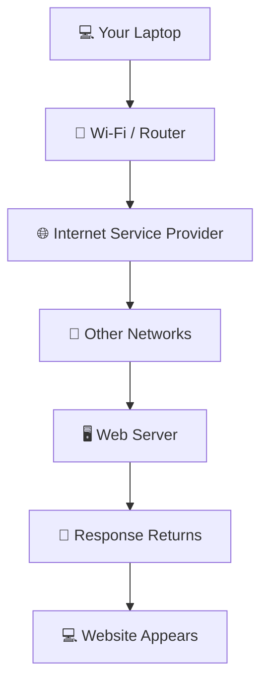

<a id="11-step-by-step"></a>
#### Step by Step

**1. You make a request.**

You enter a website address in your browser.

**2. Your device finds the destination.**

DNS can help resolve the domain name to an IP address.

**3. Your request leaves the local network.**

If the destination is outside your local IP network, your device typically sends the traffic to its default gateway.

**4. Routers forward the packets.**

Packets travel through networks toward the web server.

**5. The server responds.**

The server processes the request and sends the requested data back.

**6. Your browser displays the result.**

Your browser processes the received data and displays the website.

> **Did you know?** A website request may pass through several routers. The exact path depends on network conditions and routing decisions.

---

<a id="11-119-the-rules-behind-communication"></a>
### 11.9 The Rules Behind Communication

A **network protocol** is a set of rules that governs communication between devices.

| Protocol | Main Purpose |
|---|---|
| IP | Addressing and forwarding packets |
| TCP | Reliable, ordered byte-stream communication |
| UDP | Sending datagrams without built-in delivery guarantees |
| DNS | Retrieving domain-name information |
| HTTP | Communication between web clients and servers |
| HTTPS | HTTP communication protected using TLS |

<a id="11-everyday-example"></a>
#### Everyday Example

When you visit a website:

1. DNS may help your device find the server's IP address.
2. IP helps deliver packets across networks.
3. TCP or UDP may carry application traffic, depending on the protocol used.
4. HTTP defines the web request and response.
5. HTTPS protects HTTP traffic using TLS.

These protocols perform different jobs and work together to support communication.

---

<a id="11-1110-a-first-look-at-network-security-"></a>
### 11.10 A First Look at Network Security 🔒

Networks must protect connected devices and information.

Basic practices include:

- Use strong, unique passwords.
- Secure Wi-Fi with modern security settings.
- Keep devices and software updated.
- Avoid suspicious links and downloads.
- Use HTTPS when accessing websites.
- Restrict network access to authorized users.

Security is a broad topic. This guide introduces basic awareness rather than advanced configuration.

---

<a id="11-1111-knowledge-check-"></a>
### 11.11 Knowledge Check 🧠

Test your understanding before moving on.

**Question 1:** Which device primarily forwards packets between IP networks?

A. Switch<br>
B. Router<br>
C. Keyboard<br>
D. Monitor

**Question 2:** Which network usually covers a home or classroom?

A. WAN<br>
B. Satellite<br>
C. LAN<br>
D. The entire Internet

**Question 3:** What does DNS help a device do?

A. Find records associated with a domain name<br>
B. Replace the router<br>
C. Increase CPU speed<br>
D. Connect a monitor

**Question 4:** What is the main role of a switch?

A. Display web pages<br>
B. Store passwords<br>
C. Replace every network protocol<br>
D. Forward frames within a local network

**Question 5:** Which statement is correct?

A. IP and MAC addresses are interchangeable.<br>
B. IP and MAC addresses have different roles.<br>
C. Only routers need addresses.<br>
D. DNS is a physical network device.

<a id="11-short-answer-challenge"></a>
#### Short-Answer Challenge

1. Explain the difference between a LAN and a WAN.
2. Describe one difference between a router and a switch.
3. Explain how a laptop can access a website through a home network.

<details>
<summary><strong>Show the answer key</strong></summary>

1. B — Router<br>
2. C — LAN<br>
3. A — Find records associated with a domain name<br>
4. D — Forward frames within a local network<br>
5. B — IP and MAC addresses have different roles

**Short-answer guidance**

- A LAN covers a limited area; a WAN connects networks over larger areas.
- A switch primarily forwards frames within a local network; a router forwards IP packets between networks.
- A laptop sends a request through its local network and router. The request travels toward a web server, and a response returns.

</details>

---

<a id="11-1112-key-takeaways"></a>
### 11.12 Key Takeaways

Before you finish, make sure you can explain these ideas:

- **Networks connect devices** so they can communicate and share resources.
- **LAN and WAN** describe the geographical scope of a network.
- **Switches and routers** perform different forwarding functions.
- **IP and MAC addresses** serve different addressing purposes.
- **Protocols** define how data is exchanged.
- **Network security** helps protect devices and information.
- **DHCP** assigns IP addresses dynamically; **NAT** allows devices to share one public IP.
- **OSI Model** divides networking into layers to make troubleshooting easier.
- **VPNs and Proxies** help protect privacy by routing traffic through middlemen.

The big picture: computer networking allows devices around the world to communicate through addressing, protocols, and interconnected networks.

---

---

<a id="chapter-12"></a>
## Chapter 12 — Network layers, performance and privacy

### 12.1 The OSI Model: The 7 Layers of Networking

When you send a message, it doesn't just teleport. It goes through **layers** of packaging, like Russian nesting dolls. The OSI (Open Systems Interconnection) model divides networking into 7 layers. Here are the most important ones for beginners:

| Layer | Name | What it does | Example |
|---|---|---|---|
| 7 | Application | Where you interact with the network. | Web Browsers (HTTP) |
| 4 | Transport | Breaks data into segments and ensures it arrives. | TCP, UDP |
| 3 | Network | Finds the best path across networks. | IP Addresses, Routers |
| 1 | Physical | The actual cables and radio waves. | Ethernet cables, Wi-Fi |

> **Analogy:** Imagine sending a letter. Layer 7 is writing the letter. Layer 3 is writing the address on the envelope. Layer 1 is the mail truck driving on the road.

---

<a id="12-122-dhcp-and-nat-the-magic-of-home-wi-fi"></a>
### 12.2 DHCP and NAT: The Magic of Home Wi-Fi

Have you ever wondered how your phone gets an IP address the second you connect to Wi-Fi? And how can 10 devices in your house share just *one* internet connection?

<a id="12-dhcp-dynamic-host-configuration-protocol"></a>
#### DHCP (Dynamic Host Configuration Protocol)
DHCP is the automated receptionist of the network. When your phone connects to Wi-Fi, it shouts, "I need an IP!" The DHCP server (usually your router) instantly assigns it a free, temporary IP address.
*   **Think of it as:** Checking into a hotel. You don't pick your room number; the receptionist (DHCP) gives you an available one.

<a id="12-nat-network-address-translation"></a>
#### NAT (Network Address Translation)
NAT is how your router allows 10 different devices to share one single public IP address.
*   **Think of it as:** A company mailroom. Your home devices have *Private IPs* (like `192.168.1.5`). When they send data to the internet, the router (the mailroom) changes the sender address to the home's *Public IP*. When the reply comes back, the router remembers which device sent it and forwards it correctly.

---

<a id="12-123-bandwidth-vs-latency-what-is-speed"></a>
### 12.3 Bandwidth vs. Latency: What is "Speed"?

When we say "the internet is slow," we are usually confusing two different metrics:

<a id="12-bandwidth-the-highway"></a>
#### Bandwidth (The Highway)
Bandwidth is the maximum amount of data that can travel through the network at one time.
*   **Think of it as:** The **number of lanes** on a highway. More lanes = more cars (data) can travel simultaneously.

<a id="12-latency-the-speed-limit"></a>
#### Latency (The Speed Limit)
Latency is the time it takes for a single packet of data to travel from source to destination and back. It is measured in milliseconds (ms). In games, this is called **Ping**.
*   **Think of it as:** The **speed limit** on the highway. A highway can have 10 lanes (high bandwidth), but if the speed limit is 10 mph (high latency), it still takes a long time to reach the end.

> **Did you know?** For streaming 4K video, you need high Bandwidth. For playing competitive online games, you need low Latency.

---

<a id="12-124-privacy-vpns-and-proxies-"></a>
### 12.4 Privacy: VPNs and Proxies 🛡️

When you browse the internet, your Internet Service Provider (ISP) can see every website you visit. To protect privacy, we use Proxies and VPNs.

<a id="12-proxy"></a>
#### Proxy
A proxy server acts as a middleman. Your request goes to the proxy, the proxy requests the website for you, and returns the answer.
*   **Pros:** Hides your IP from the website.
*   **Cons:** Usually **does not encrypt** your data. Your ISP still knows what you are doing.

<a id="12-vpn-virtual-private-network"></a>
#### VPN (Virtual Private Network)
A VPN creates a **secure, encrypted tunnel** between your computer and the VPN server.
*   **Pros:** High security. Your ISP only sees encrypted data. It hides both your IP and your traffic.
*   **Cons:** Can slow down your speed due to encryption.

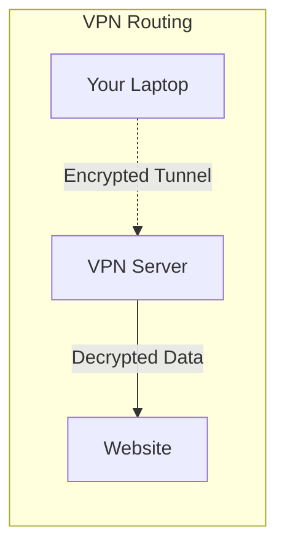

---

<a id="chapter-13"></a>
## Chapter 13 — Modelling an agent's decisions

A **Markov Decision Process**, or **MDP**, specifies states, actions, transition probabilities and rewards. It can also include terminal states and a discount factor. The **Markov property** means that the current state contains the information needed to predict the next outcome given the action; earlier history adds no further predictive information. This depends on how the state is defined. [S13](#appendix-I)

An MDP describes the problem. A learning algorithm describes how the agent learns to act in it. Known transitions and rewards can also support planning without learning them through trial and error. [S11](#appendix-I)

<a id="13-131-a-two-tile-vacuum-world"></a>
### 13.1 A two-tile vacuum world

This teaching model has no battery, dock or operating-mode variable, and the agent receives the complete dirt state.

```text
Initial world:   [ A: vacuum + dirt ] [ B: dirt ]
Goal for this episode: remove both patches of dirt
```

Everything in this example, including the rewards and initial conditions, is an **original teaching proposal**, not a reported experiment or a commercial robot specification. An **episode** is one run from the initial state until the task ends.

| Part | Exact specification |
| --- | --- |
| State | `(position, dirt_A, dirt_B)`, where position is A or B and each dirt flag is 0 or 1 |
| Initial state | `(A, 1, 1)` at the beginning of each episode |
| Observation | The complete current state, reported without error |
| Actions | LEFT, RIGHT, SUCK and WAIT in each nonterminal state |
| LEFT / RIGHT | Move to the neighbouring tile; a move beyond an end stays on the same tile |
| SUCK | Remove dirt on the current tile, if present |
| WAIT | Leave the state unchanged |
| Transitions | Deterministic: each action has one resulting state with probability 1 |
| Reward | Start at −1 per action; add 5 if the action removes new dirt; add 6 if that action makes both tiles clean |
| Terminal state | Either position with both dirt flags 0; the episode ends immediately on entry |
| Terminal convention | No further actions or rewards; future Q-value contribution is 0 |
| Reset | Restore the initial world for the next episode; retain the learned Q-table |
| Discount factor | `gamma = 0.9` |

There are eight possible state tuples, including two terminal states. Position and both dirt flags fully determine the next result, so this model satisfies the Markov assumption. A sensor that reports only local dirt would not reveal the other tile's condition. The fully observed model used here would then need additional assumptions or state estimation to describe the agent's information.

<a id="13-132-reward-and-return"></a>
### 13.2 Reward and return

Removing the first patch earns `−1 + 5 = 4`. Moving earns `−1`. Removing the last patch earns `−1 + 5 + 6 = 10`. Sucking an already clean tile earns only `−1`.

The **discounted return** weights later rewards by successive powers of `gamma`. [S13](#appendix-I) For SUCK, RIGHT, SUCK from the initial state, the rewards are 4, −1 and 10:

```text
Return = 4 + 0.9 × (−1) + 0.9² × 10
       = 4 − 0.9 + 8.1
       = 11.2
```

This is the return of one specified sequence. It is not a measured training result or proof that an agent has learned an optimal policy.

<a id="13-133-boundary-example"></a>
### 13.3 Boundary example

Start at `(A, 0, 1)` and choose LEFT, then RIGHT. LEFT attempts to move beyond the boundary, so the state remains `(A, 0, 1)` and the reward is −1. It is not terminal because tile B is dirty. RIGHT then produces `(B, 0, 1)` and reward −1. No dirt has been removed. This uses the action definitions, not a guess about how a real vacuum would turn.

This is a **deterministic** task: the same state and action always produce the same outcome. A more complex MDP could specify several possible next outcomes with probabilities adding to 1. We would need those probabilities before calculating an expected outcome; calling the task an MDP does not supply them automatically. [S13](#appendix-I)

---

<a id="chapter-14"></a>
## Chapter 14 — A worked Q-learning example

**Q-learning** revises action-value estimates from experience. Each sampled update combines the immediate reward with the highest current action estimate at the next state. The learning rate controls how far the old estimate moves toward that target. [S14](#appendix-I)

We chose Q-learning because a small table makes the update visible. The lecturer's overview lists algorithms and techniques but names no particular algorithm.

Read `Q(s, a)` as “the estimate for action a in state s.” It is a stored number, not a probability. `alpha` is the **learning rate**, and `gamma` is the **discount factor**. Taking the maximum means choosing the largest estimate at the next state, not adding all of its estimates together.

<a id="14-141-specify-the-learning-procedure"></a>
### 14.1 Specify the learning procedure

- Start with `Q(s, a) = 0` for every nonterminal state and action.
- Use learning rate `alpha = 0.5` and discount factor `gamma = 0.9`.
- After each transition, update only the entry for the state and action just experienced.
- For a terminal next state, use a future value of 0.
- A proposed policy is epsilon-greedy with `epsilon = 0.2`: with probability 0.2 choose uniformly among all four actions; otherwise choose the highest-Q action. Break equal-Q ties in the order SUCK, RIGHT, LEFT, WAIT.
- The table below uses a **scripted sequence of valid experiences** to make the arithmetic reproducible. It does not show a random training run under that policy.

The update is:

```text
target = reward + gamma × best_next_Q
new_Q = old_Q + alpha × (target − old_Q)
```

This expresses the standard sampled update, using the terminal convention above. [S14](#appendix-I)

<a id="14-142-follow-one-episode"></a>
### 14.2 Follow one episode

Name the nonterminal states in the sequence:

```text
s0 = (A, 1, 1)
s1 = (A, 0, 1)
s2 = (B, 0, 1)
```

| Step | State and action | Next state | Reward | Old Q | Best next Q at this update | New Q |
| --- | --- | --- | --- | --- | --- | --- |
| 1 | s0, SUCK | s1 | 4 | 0 | 0 | 2 |
| 2 | s1, RIGHT | s2 | −1 | 0 | 0 | −0.5 |
| 3 | s2, SUCK | Terminal | 10 | 0 | 0 | 5 |

For Step 1, `new_Q = 0 + 0.5 × (4 + 0.9 × 0 − 0) = 2`. An estimate has changed. That is different from moving into a mode chosen by fixed rules.

RIGHT initially gets a negative estimate because its immediate reward is −1 and the next state's estimates are still zero. Step 3 then raises the estimate for cleaning the final patch.

<a id="14-143-revisit-the-experience"></a>
### 14.3 Revisit the experience

Reset the environment, keep the Q-table, and replay SUCK, RIGHT, SUCK:

| Step | Entry updated | Old Q | Best next Q | Target | New Q |
| --- | --- | --- | --- | --- | --- |
| 4 | Q(s0, SUCK) | 2 | 0 | 4 | 3 |
| 5 | Q(s1, RIGHT) | −0.5 | 5 | 3.5 | 1.5 |
| 6 | Q(s2, SUCK) | 5 | 0, terminal | 10 | 7.5 |

At Step 4, the maximum at s1 is still 0: RIGHT has −0.5 and the untried actions have 0. At Step 5, the target is `−1 + 0.9 × 5 = 3.5`, so:

```text
Q(s1, RIGHT) = −0.5 + 0.5 × (3.5 − (−0.5))
             = 1.5
```

The positive estimate at s2 has now affected the earlier move. RIGHT's 1.5 at s1 exceeds the three untried actions' estimates of 0, so it becomes the greedy choice there. These six updates show how experience can affect earlier choices. They do not establish convergence, adequate exploration or optimal behaviour.

<a id="14-144-another-update"></a>
### 14.4 Another update

Consider a separate illustrative entry with `old_Q = 1`, `reward = 2`, `best_next_Q = 4`, `alpha = 0.5` and `gamma = 0.9`. The next state is nonterminal.

The target is `2 + 0.9 × 4 = 5.6`. The difference from the old estimate is `5.6 − 1 = 4.6`. Move halfway toward the target: `new_Q = 1 + 0.5 × 4.6 = 3.3`. If that next state were terminal instead, the future contribution would be zero: the target would be 2 and the new estimate 1.5. These illustrative values are not additional rows from the vacuum replay.

<a id="14-145-other-approaches"></a>
### 14.5 Other approaches

Learning methods differ in what they estimate and how they use experience. This comparison introduces those differences; only tabular Q-learning is worked through here.

| Approach | What it does | Difference to notice |
| --- | --- | --- |
| Planning with a known model | Uses given transition and reward rules to calculate choices | Computing a policy from supplied rules does not itself require learning from interaction [S11] |
| Model-based RL | Learns a model of outcomes and rewards, then uses it to plan | Experience updates the model; the model supports decisions [S15] |
| Tabular Q-learning | Updates a state–action estimate using reward and the largest next-state estimate | It need not learn an explicit transition table [S14] |
| SARSA | Uses the next action actually selected when forming its update target | Its target reflects the policy being followed, including exploration [S16] |
| Deep Q-network (DQN) | Uses a neural network to estimate action values | The representation differs from our small table; this requires additional machinery and is optional context [S17] |

Sources: [S11, S14–S17](#appendix-I). “Model-free” does not mean an agent has no memory: a Q-table is stored information. It means the method can learn values without explicitly learning the environment's transition and reward model.

For one comparison, suppose the next state's best estimate is 5, but the policy selects WAIT, whose estimate is 0. Q-learning uses 5 in its next-value term; SARSA uses 0 for that experience. This difference does not prove one algorithm is always better. It shows why the action-selection policy and the learning update need separate explanations. [S16](#appendix-I)

---

<a id="chapter-15"></a>
## Chapter 15 — Applications, review and limits

The overview explicitly includes robotics and games. These are proposed examples for teaching that connection, not claims about deployed products.

| Setting | Possible observation or state | Actions | Reward-design question |
| --- | --- | --- | --- |
| Cleaning robot | Position, dirt and energy | Move, clean, charge | Does the score reward newly cleaned floor or merely running suction? |
| Small grid game | Player position, goals and hazards | Move in allowed directions | Does a high score also require reaching the goal safely? |
| Simulated navigation | Position and nearby obstacles | Move or turn | Could a progress reward encourage shortcuts that cause collisions? |

In a game model, dirt can become collectibles and corridor boundaries can become walls. The ending condition and reward for each action still need explicit definitions. Changing the story is easy; specifying a sensible state and reward takes more care.

The fixed-rule comparison also shows that a robot can act autonomously without a learning algorithm. A learning component could be combined with programmed control, provided their responsibilities and conflict rules are defined. Neither form of local control inherently requires an Internet connection.

<a id="15-151-a-game-model"></a>
### 15.1 A game model

A simulated player starts at `(0, 0)` on a 2 × 2 grid. A collectible is at `(1, 1)`. This is a separate illustrative task with its own rewards.

Use `(x, y)` as the state, since the collectible stays at a fixed location until the episode ends. Actions are UP, DOWN, LEFT and RIGHT; UP increases y, DOWN decreases y, RIGHT increases x and LEFT decreases x. Both coordinates are limited to 0 or 1, and an attempted move outside the grid leaves the position unchanged. Each action costs 1 point. Add 6 points on first reaching `(1, 1)`, then end the episode. RIGHT followed by UP therefore earns −1 followed by 5. No further reward is available after termination. This model assumes exact movement and complete position information.

<a id="15-152-connect-the-system"></a>
### 15.2 Connect the system

| Responsibility | Example information flow |
| --- | --- |
| Hardware | Sensor reading → processor and memory → controller command → motor |
| AI control | Observation → action selection → new observation; during training, reward → update |
| Optional network | A status message reports progress, or a remote request asks the local controller to pause |

Suppose a pause request arrives late. An original design proposal is to attach a request identifier and expiry time, reject stale requests under a defined clock convention, and report the result. The local obstacle response still needs its own rule. This demonstrates why receiving a network packet is different from selecting and executing a valid action; it is not a specification of any commercial vacuum or a guarantee of reliable control.

<a id="15-153-review-questions"></a>
### 15.3 Review questions

These five introductory questions use simple reasoning. They are a small AI Behaviour contribution to the later test covering the whole module, not a complete test bank or official assessment. The numerical and algorithm details above remain reference explanations; they are not prerequisites for answering these questions.

1. **A vacuum detects dirt and starts cleaning. Which is the input: the dirt reading or the cleaning action?**

   The dirt reading is the input, or observation. Cleaning is the action selected in response.

2. **The rules say “return to the dock if the battery is low; otherwise clean.” The battery is low and the floor is dirty. What should the vacuum do first?**

   Return to the dock, because the low-battery rule has priority. It does not need to learn this rule to follow it.

3. **A controller receives a score after every action, but never changes its rules or action estimates. Does the score alone show that it learns?**

   No. Learning needs an update from experience that can affect later decisions. Displaying a score is not enough.

4. **In the two-tile world, is “the vacuum is at A, A is clean and B is dirty” a state description or an action? Is RIGHT a state or an action?**

   The first describes the state. RIGHT is an action. The state describes the situation, while the action describes a choice available to the agent.

5. **An agent can take a costly step now to reach dirt it can clean next. Should it always reject that step just because its immediate reward is negative?**

   No. Later rewards also matter. A small cost now may enable a better total result. It should consider the consequences, not only the next score.

<a id="15-154-limits"></a>
### 15.4 Limits

The two-tile model supplies accurate, complete information. A real vacuum has uncertain readings and imperfect movement, and may observe only part of a room. This model also omits batteries, moving obstacles and collision costs. Its small table does not show how to represent a large or continuous task.

An untried action may have a poor estimate because it has not been sampled, yet trying actions on hardware can be costly. Paper tasks and simulations make examples easier to inspect; they do not establish reliable transfer to a robot. Our fixed learning rate and six scripted updates are teaching choices, not a convergence argument.

Reward needs its own check. Removing dirt, reaching a game goal and avoiding damage are different objectives. A score captures only what its designer specified. Learners should be able to give a case where a score encourages an unwanted action and explain what would need to change.

Connect observations and actions to the Hardware chapter's sensors, processor, memory and motors. Use Networks to explain an optional status message or remote request, with explicit handling for missing or stale messages. The local decision loop remains a separate responsibility.

<a id="15-155-what-would-count-as-evidence"></a>
### 15.5 What would count as evidence?

Checking the scripted arithmetic answers “does this replay follow our equations?” Training asks whether experience leads to useful choices. Evaluation asks how those choices perform under stated conditions. These are separate questions. [S18](#appendix-I)

A proposed next evaluation would compare a fixed controller, a random policy and a trained policy on the **same** two-tile task. State the starting conditions, training budget, action-selection settings and step limit; hold the learned table fixed for a separate evaluation. Repeat random runs and report success rate, steps and return, including failures. Comparing controllers on different task definitions would not establish a learning benefit.

No such training comparison has been performed for this chapter. The included check script verifies the finite model and a specified replay. They do not evaluate generalisation to a new room, real sensor noise, privacy-sensitive deployments or a physical robot.

<a id="15-156-recap"></a>
### 15.6 Recap

Sensors provide observations; a controller chooses actions; actions change the environment. Fixed rules prescribe decisions. In RL, experience updates values or a policy that can affect later decisions. The MDP specifies the task, while Q-learning supplies one update method. A useful score, a correct calculation and a reliable deployed agent each need their own evidence.

Before submission, another member should check the definitions, rewards, traces, arithmetic and sources using the [review status and checks](AIBehaviour/Stage1Notes.md#review-status). The lecturer's overview confirms the topic list, but gives no required algorithm or depth. Further detailed lecturer guidance could still change the scope.

---

<a id="chapter-16"></a>
## Chapter 16 — Design a connected system

### 16.1 Follow one sensor reading

Imagine a proposed robot vacuum approaching a dirty tile. A sensor produces a reading. Hardware transfers that reading to the controller, whose instructions run on the processor using memory. The controller selects a cleaning command, and a driver and actuator carry it out. A later observation checks what happened. These are different jobs: receiving a reading does not guarantee a correct decision, and issuing a command does not guarantee successful movement.

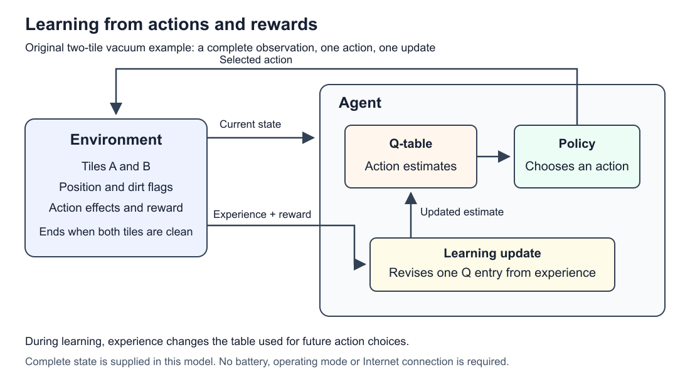

The diagram separates action selection from the reward-driven update used during learning. See Chapters 13–14 for the exact teaching model and Appendix I for its technical references.

The same chain appears in the light indicator: light changes the LDR resistance; the voltage divider supplies a voltage; the ADC returns a number; a threshold rule chooses an LED command. This rule is fixed unless an explicit mechanism changes it from experience.

### 16.2 Add an optional network message

A connected vacuum could report its status to a phone. Draw the vacuum's network interface, local access point, router and destination. State whether the destination is on the local network or reached through an Internet service. A local exchange need not use the Internet. The status packet reports information; the local control loop still decides what action is valid.

For this proposed design, define what happens when a pause request is delayed, duplicated or missing. One possible rule is to identify requests and reject expired requests under a stated clock convention. Describe an acknowledgement as evidence of receipt or acceptance only under the meaning you define; it does not prove that a motor physically stopped. This is a design exercise, not a description of a commercial vacuum.

### 16.3 Compare rules with learning

Write a fixed priority list for low battery, dirt and clear floor. Trace simultaneous low battery and dirt using that list. Then describe what a learning version would update, what reward it would receive, and how you would compare its later behaviour with the fixed controller. Keep the starting conditions and task definition the same. A changing score alone is insufficient evidence of learning.

### 16.4 Final activity

1. Draw and label the input, processor, RAM, storage, output and optional network path.
2. Trace a reading through a rule to a command and the next observation.
3. Explain what continues to work when the Internet connection is unavailable.
4. Give one hardware fault, one network fault and one unsuitable behaviour rule. Explain how you would tell them apart.
5. State what evidence would support a claim that learning improved the design.

### 16.5 Answer guide

A good diagram separates the sensing and actuation hardware from the controller and communication path. A valid trace applies the stated rule order and observes the result after acting. Offline operation depends on the stated design: the example's local sensing and rules can continue, while an Internet service cannot be assumed reachable. An incorrect sensor value suggests a hardware or measurement issue; a missing status message suggests a communication issue; a consistently unsuitable action despite correct input can expose a controller rule problem. Confirm each explanation with an appropriate measurement or trace. To assess learning, report comparable trials with stated conditions, success measures and failures; do not substitute the scripted Q-learning arithmetic for that evaluation.

---

---

<a id="appendix-A"></a>
## Appendix A — Hardware glossary

| Term | Meaning |
| --- | --- |
| Actuator | A part that acts on the world, such as a motor or speaker |
| Binary | A number system with only two digits, 0 and 1 |
| Bit | A single binary digit (0 or 1) |
| Byte | 8 bits |
| Cache | Small, very fast memory inside the CPU |
| Clock speed | How many ticks per second the CPU's clock makes (GHz) |
| Core | An independent processing unit inside a CPU |
| CPU | The chip that follows program instructions |
| Encoding | An agreed rule for what a pattern of bits means |
| Logic gate | A tiny circuit that combines bits using a rule such as AND, OR, NOT, XOR |
| Microcontroller | A small, low-power chip that combines a CPU, memory, and storage — common in appliances and robots |
| Non-volatile | Keeps data when power is off (e.g., SSD) |
| Operating system | The main program that manages the computer and runs other programs (Windows, macOS, Android) |
| Pixel | One coloured dot in an image |
| Program counter | CPU part that tracks the next instruction's address |
| RAM | Fast, temporary working memory |
| Register | A tiny storage slot inside the CPU for the number it is using right now |
| Sample | One measurement of a sound wave, stored as a number |
| Sensor | An input device that measures something in the environment |
| Storage | Long-term memory such as an SSD or hard drive |
| Transistor | A microscopic electronic switch — the basic building block of chips |
| Volatile | Loses data when power is off (e.g., RAM) |

---

<a id="appendix-B"></a>
## Appendix B — Networks glossary

| Term | Meaning |
| --- | --- |
| Access point | Device that lets Wi-Fi devices join a wired network |
| Bandwidth | How much data can be carried per second |
| DHCP | Automatically gives devices an IP address when they join a network |
| DNS | System that converts domain names into IP addresses |
| Ethernet | Standard for wired local networks |
| Header | The addressing and control part of a packet |
| HTTP / HTTPS | The protocol for requesting web pages; HTTPS is the encrypted version |
| Internet | The worldwide network of interconnected networks |
| IP address | A device's address on a network, used to route packets |
| ISP | Internet service provider — the company that connects you to the Internet |
| LAN | Local area network — one home, school, or office |
| Latency | How long data takes to travel from sender to receiver |
| MAC address | Hardware identifier of a network interface, used within a local network |
| NAT | Lets many devices with private addresses share one public address |
| Packet | A small piece of data with a header and payload |
| Payload | The actual data carried inside a packet |
| Port | Number identifying which program on a device a message is for |
| Protocol | An agreed set of rules for communicating |
| Router | Device that forwards packets between different networks |
| Switch | Device that forwards messages between devices within one local network |
| TCP | Reliable, ordered transport protocol |
| UDP | Simple, fast transport protocol without delivery guarantees |

---

<a id="appendix-C"></a>
## Appendix C — AI glossary

| Term | Meaning |
| --- | --- |
| Actuator | A part that lets an agent act, such as a motor |
| Agent | Anything that senses its environment and acts on it |
| Behaviorism (AI) | The AI school that builds intelligence from perception–action behaviour and feedback |
| Condition–action rule | An IF–THEN rule linking a situation to an action |
| Cybernetics | The study of control and feedback in animals and machines |
| Emergent behaviour | Complex behaviour that arises from simple parts interacting |
| Environment | Everything outside the agent that it senses and acts on |
| Exploration / exploitation | Trying new actions vs using the best-known action |
| Feedback control | Measuring a result, comparing it with a goal, and correcting |
| Finite-state machine | A model where an agent is in one of a few modes and switches on events |
| Operant conditioning | Learning in animals where actions followed by rewards become more frequent |
| PEAS | Performance, Environment, Actuators, Sensors — a checklist for describing an agent |
| Policy | An agent's strategy for choosing actions |
| Reactive agent | An agent that responds to current sensor readings without a long-term plan |
| Reinforcement learning | Learning behaviour by trial and error from rewards |
| Reward | A number that signals how good an outcome was |
| Reward hacking | An agent maximising reward in a way the designer didn't intend |
| Sensor | A device that measures something in the environment |
| State | The current situation (for RL), or the current mode (for an FSM) |
| Subsumption architecture | Brooks's design where layered behaviours run together and higher layers override lower ones |

---

<a id="appendix-D"></a>
## Appendix D — Hardware lesson references

1. Peter Norvig, "Approximate timing for various operations," in [Teach Yourself Programming in Ten Years](https://norvig.com/21-days.html). Widely shared, updated versions are in [Jonas Bonér's gist](https://gist.github.com/jboner/2841832). These are order-of-magnitude estimates, not measurements of any particular computer.
2. ASCII: ANSI X3.4-1968. The table is reproduced in [RFC 20 — ASCII format for Network Interchange](https://www.rfc-editor.org/rfc/rfc20) (1969), where `A` = decimal 65.
3. The Unicode Consortium, [What is Unicode?](https://www.unicode.org/standard/WhatIsUnicode.html)
4. [RFC 3629 — UTF-8](https://www.rfc-editor.org/rfc/rfc3629). Characters from U+0800 to U+FFFF, including the common Chinese characters, use 3 bytes.
5. CD audio (the Red Book standard, IEC 60908) uses 44.1 kHz sampling at 16 bits. Summary: [Compact Disc Digital Audio](https://en.wikipedia.org/wiki/Compact_Disc_Digital_Audio).
6. Nisan and Schocken, [Nand to Tetris](https://www.nand2tetris.org/course). Projects 1–5 go from logic gates, through adders and memory, to a CPU.

<a id="D-d1-further-reading"></a>
### D.1 Further reading

- Charles Petzold, *Code: The Hidden Language of Computer Hardware and Software* (2nd ed., 2022). A beginner-friendly book on binary, logic gates, and how CPUs work.

---

<a id="appendix-E"></a>
## Appendix E — Networks lesson references

The RFCs ("Requests for Comments") are the official Internet standards documents. Learners don't need to read them; they are listed so every technical claim can be checked.

1. IEEE, [Guidelines for Use of Extended Unique Identifier (EUI), Organizationally Unique Identifier (OUI), and Company ID](https://standards.ieee.org/wp-content/uploads/import/documents/tutorials/eui.pdf). Explains how manufacturers are assigned MAC address blocks.
2. Android Open Source Project, [MAC randomization behavior](https://source.android.com/docs/core/connect/wifi-mac-randomization-behavior).
3. [RFC 894 — Transmission of IP Datagrams over Ethernet Networks](https://www.rfc-editor.org/rfc/rfc894). Gives the 1,500-byte maximum.
4. [RFC 2131 — Dynamic Host Configuration Protocol](https://www.rfc-editor.org/rfc/rfc2131).
5. [RFC 1918 — Address Allocation for Private Internets](https://www.rfc-editor.org/rfc/rfc1918).
6. [RFC 3022 — Traditional IP Network Address Translator](https://www.rfc-editor.org/rfc/rfc3022).
7. [RFC 791 — Internet Protocol](https://www.rfc-editor.org/rfc/rfc791). Defines IPv4 and its 32-bit addresses.
8. [RFC 8200 — IPv6 Specification](https://www.rfc-editor.org/rfc/rfc8200).
9. IANA, [Service Name and Transport Protocol Port Number Registry](https://www.iana.org/assignments/service-names-port-numbers/service-names-port-numbers.xhtml).
10. [RFC 1034 — Domain Names: Concepts and Facilities](https://www.rfc-editor.org/rfc/rfc1034). Covers the name hierarchy, resolvers, and caching.
11. Optical fibre core glass has a refractive index of roughly 1.46–1.48, so light travels at about c ÷ 1.47 ≈ 204,000 km/s. See [Optical fiber](https://en.wikipedia.org/wiki/Optical_fiber) and [Latency (engineering)](https://en.wikipedia.org/wiki/Latency_(engineering)).
12. [RFC 9293 — Transmission Control Protocol](https://www.rfc-editor.org/rfc/rfc9293). Covers reliable, ordered delivery and the three-way handshake.
13. [RFC 5737 — IPv4 Address Blocks Reserved for Documentation](https://www.rfc-editor.org/rfc/rfc5737) and [RFC 3849 — IPv6 Documentation Prefix](https://www.rfc-editor.org/rfc/rfc3849).
14. [RFC 768 — User Datagram Protocol](https://www.rfc-editor.org/rfc/rfc768).
15. [RFC 9000 — QUIC](https://www.rfc-editor.org/rfc/rfc9000) and [RFC 9114 — HTTP/3](https://www.rfc-editor.org/rfc/rfc9114).
16. [RFC 8446 — TLS 1.3](https://www.rfc-editor.org/rfc/rfc8446).
17. [RFC 9110 — HTTP Semantics](https://www.rfc-editor.org/rfc/rfc9110). Defines the `GET` request.
18. [RFC 1122 — Requirements for Internet Hosts: Communication Layers](https://www.rfc-editor.org/rfc/rfc1122). Defines the four-layer model in 3.5.

<a id="E-e1-further-reading"></a>
### E.1 Further reading

- Kurose and Ross, *Computer Networking: A Top-Down Approach*. A standard university textbook that starts from applications and works downward, like Section 4.6.

---

<a id="appendix-F"></a>
## Appendix F — AI lesson references

1. 蔡自兴 (Cai Zixing) et al., 《人工智能及其应用》 (*Artificial Intelligence and Its Applications*), Tsinghua University Press. A standard Chinese university AI textbook that presents the symbolism, connectionism and behaviorism schools; behaviorism is traced to cybernetics, with Brooks as its leading figure. *Team to-do: add the edition and page number from the library copy we use.*
2. J. B. Watson, ["Psychology as the behaviorist views it"](https://psychclassics.yorku.ca/Watson/views.htm), *Psychological Review* 20 (1913).
3. B. F. Skinner, *The Behavior of Organisms: An Experimental Analysis* (Appleton-Century, 1938).
4. N. Wiener, *Cybernetics: Or Control and Communication in the Animal and the Machine* (MIT Press, 1948).
5. R. A. Brooks, ["A robust layered control system for a mobile robot"](https://people.csail.mit.edu/brooks/papers/AIM-864.pdf), MIT AI Memo 864 (1985); published in *IEEE Journal of Robotics and Automation* 2(1), 1986. The original description of the subsumption architecture.
6. R. A. Brooks, ["Intelligence without representation"](https://people.csail.mit.edu/brooks/papers/representation.pdf), *Artificial Intelligence* 47 (1991).
7. R. A. Brooks, "A robot that walks: emergent behaviors from a carefully evolved network," *Neural Computation* 1(2), 253–262 (1989), [doi:10.1162/neco.1989.1.2.253](https://doi.org/10.1162/neco.1989.1.2.253). See also [Genghis (robot)](https://en.wikipedia.org/wiki/Genghis_(robot)).
8. [Rodney Brooks — MIT CSAIL](https://people.csail.mit.edu/brooks/). Lists him as a co-founder of iRobot.
9. S. Russell and P. Norvig, *Artificial Intelligence: A Modern Approach*, 4th ed. (Pearson, 2020), chapter 2. Covers agents, PEAS, and simple reflex agents.
10. iRobot, ["iRobot Introduces Roomba Intelligent FloorVac"](https://media.irobot.com/2002-09-18-iRobot-Introduces-Roomba-Intelligent-FloorVac-The-First-Automatic-Floor-Cleaner-In-The-U-S), press release, 18 September 2002. Describes the spiral and wall-following behaviour.
11. J. L. Jones, "Robots at the tipping point: the road to iRobot Roomba," *IEEE Robotics & Automation Magazine* 13(1), 2006. Explains the random-bounce and wall-following coverage strategy.
12. V. Braitenberg, *Vehicles: Experiments in Synthetic Psychology* (MIT Press, 1984). Vehicles 2a ("fear") and 2b ("aggression").
13. R. S. Sutton and A. G. Barto, [*Reinforcement Learning: An Introduction*, 2nd ed.](https://mitpress.ublish.com/book/reinforcement-learning-an-introduction-2) (MIT Press, 2018). Chapter 1 covers the agent–reward loop; chapter 2 covers the incremental average update and ε-greedy exploration.
14. J. Clark and D. Amodei, ["Faulty reward functions in the wild"](https://openai.com/index/faulty-reward-functions/), OpenAI, 21 December 2016.
15. D. Silver et al., ["Mastering the game of Go with deep neural networks and tree search"](https://www.nature.com/articles/nature16961), *Nature* 529 (2016).
16. J. Hwangbo et al., "Learning agile and dynamic motor skills for legged robots," *Science Robotics* 4(26) (2019), [doi:10.1126/scirobotics.aau5872](https://doi.org/10.1126/scirobotics.aau5872).

---

<a id="appendix-G"></a>
## Appendix G — Practical hardware references and image credits

<a id="G-g1-computer-hardware-part-a"></a>
### G.1 Computer hardware (Part A)

1. Arduino. "UNO R3" — specifications and documentation. <https://docs.arduino.cc/hardware/uno-rev3/>
2. Arduino Store. "Arduino Uno Rev3" — technical specifications. <https://store.arduino.cc/products/arduino-uno-rev3>
3. Microchip. *ATmega328P Datasheet*. <https://ww1.microchip.com/downloads/en/DeviceDoc/Atmel-7810-Automotive-Microcontrollers-ATmega328P_Datasheet.pdf>
4. Raspberry Pi Ltd. "Raspberry Pi 5" — product page. <https://www.raspberrypi.com/products/raspberry-pi-5/>
5. Nisan, N. and Schocken, S. *Nand to Tetris*. <https://www.nand2tetris.org/>
6. Save My Exams. "The Fetch-Decode-Execute Cycle" (IGCSE Computer Science revision notes). <https://www.savemyexams.com/igcse/computer-science/cie/23/revision-notes/3-hardware/computer-architecture/the-fetch-decode-execute-cycle>
7. Computer Science Wiki. "The machine instruction cycle." <https://computersciencewiki.org/index.php/The_machine_instruction_cycle>
8. Save My Exams. "Truth Tables" (GCSE Computer Science). <https://savemyexams.com/gcse/computer-science/aqa/20/revision-notes/5-boolean-logic/boolean-logic/truth-tables>
9. NIST. "Prefixes for binary multiples." <https://physics.nist.gov/cuu/Units/binary.html>
10. Corsair. "Volatile vs non-volatile memory: what's the difference?" (vendor explainer). <https://www.corsair.com/uk/fi/explorer/diy-builder/memory/volatile-vs-non-volatile-memory-whats-the-difference/>
11. Tom's Hardware. "What is clock speed?" <https://www.tomshardware.com/news/clock-speed-definition,37657.html>

<a id="G-g2-circuits-sensors-and-actuators-part-b"></a>
### G.2 Circuits, sensors and actuators (Part B)

12. Arduino. `analogRead()` reference. <https://docs.arduino.cc/language-reference/en/functions/analog-io/analogRead/>
13. Arduino. `analogWrite()` reference. <https://docs.arduino.cc/language-reference/en/functions/analog-io/analogWrite/>
14. Arduino. "Analog Input" example. <https://docs.arduino.cc/built-in-examples/analog/AnalogInput/>
15. Arduino. "Smoothing" example. <https://docs.arduino.cc/built-in-examples/analog/Smoothing/>
16. Arduino. "Calibration" example. <https://docs.arduino.cc/built-in-examples/analog/Calibration/>
17. Arduino. Servo library. <https://docs.arduino.cc/libraries/servo/>
18. Arduino Store. "UNO R4 Minima." <https://store-usa.arduino.cc/products/uno-r4-minima>
19. Raspberry Pi Ltd. Raspberry Pi hardware documentation (GPIO voltage). <https://www.raspberrypi.com/documentation/computers/raspberry-pi.html>
20. GL55 Series Photoresistor datasheet. <https://cdn.shopify.com/s/files/1/0699/1344/4452/files/GL55_Series_Photoresistor.pdf>
21. SparkFun Learn. "Voltage Dividers." <https://learn.sparkfun.com/tutorials/voltage-dividers/introduction>
22. SparkFun Learn. "Series and Parallel Circuits." <https://learn.sparkfun.com/tutorials/series-and-parallel-circuits/all>
23. SparkFun Learn. "Transistors." <https://learn.sparkfun.com/tutorials/transistors/all>
24. SparkFun Learn. "Pulse Width Modulation." <https://learn.sparkfun.com/tutorials/pulse-width-modulation/all>
25. SparkFun Learn. "Hobby Servo Tutorial." <https://learn.sparkfun.com/tutorials/hobby-servo-tutorial/all>
26. SparkFun. "LED – Basic Red 5mm." <https://www.sparkfun.com/led-basic-red-5mm.html>
27. Adafruit Learn. "Arduino Lesson 13: DC Motors — Transistors." <https://learn.adafruit.com/adafruit-arduino-lesson-13-dc-motors/transistors>
28. Adafruit. "N-channel power MOSFET — 30V / 60A (IRLB8721)." <https://www.adafruit.com/product/355>
29. Adafruit Learn. "TB6612 H-Bridge Motor Driver Breakout." <https://learn.adafruit.com/adafruit-tb6612-h-bridge-dc-stepper-motor-driver-breakout/overview>
30. Adafruit Learn. "Li-Ion and LiPoly Batteries." <https://learn.adafruit.com/li-ion-and-lipoly-batteries/conclusion>
31. STMicroelectronics. L298 dual full-bridge driver. <https://www.st.com/en/motor-drivers/l298.html>
32. Texas Instruments. DRV8833. <https://www.ti.com/product/DRV8833>
33. Wikipedia. "Flyback diode." <https://en.wikipedia.org/wiki/Flyback_diode>
34. University of Illinois ECE 110. "Electronics Lab Safety." <https://courses.engr.illinois.edu/ece110/content/labs/archive/Skill_Safety_ElectronicsLab.pdf>

<a id="G-g3-images"></a>
### G.3 Images

35. Shoot stufz. "Arduino Uno R3 development board 03." Wikimedia Commons, CC BY-SA 4.0. <https://commons.wikimedia.org/wiki/File:Arduino_Uno_R3_development_board_03.jpg>
36. Suyash Dwivedi. "25mm light-dependent resistor (LDR) (2)." Wikimedia Commons, CC BY-SA 4.0. <https://commons.wikimedia.org/wiki/File:25mm_light-dependent_resistor_(LDR)_(2).jpg>

<a id="G-g4-starter-references-for-the-other-units-moved-from-the-earlier-draft"></a>
### G.4 Starter references for the other units (moved from the earlier draft)

37. Cisco. "What Is Computer Networking?" <https://www.cisco.com/site/us/en/learn/topics/networking/what-is-computer-networking.html>
38. Brooks, R. A. "A robust layered control system for a mobile robot." *IEEE Journal of Robotics and Automation*, 2(1), 14–23 (1986). <https://ieeexplore.ieee.org/document/1087032>
39. Oikawa, K., Tsuchiya, T. and Okubo, S. "Object-Oriented Design of Subsumption Architecture." *Journal of the Robotics Society of Japan*, 23(6), 697–705 (2005). <https://www.jstage.jst.go.jp/article/jrsj1983/23/6/23_6_697/_article>

<a id="G-g5-hex-buses-clock-and-architecture-a3-a5-a6-additions"></a>
### G.5 Hex, buses, clock and architecture (A3, A5, A6 additions)

40. Arduino. Integer constants (`0x`, `0b`). <https://docs.arduino.cc/language-reference/en/variables/constants/integerConstants/>
41. Save My Exams. "Hexadecimal" and "Uses of hexadecimal" (Cambridge IGCSE). <https://www.savemyexams.com/igcse/computer-science/cie/23/revision-notes/1-data-representation/1-1-number-systems/hexadecimal> *(secondary source)*
42. Save My Exams. "Von Neumann Architecture" (Cambridge IGCSE). <https://savemyexams.com/igcse/computer-science/cie/23/revision-notes/3-hardware/computer-architecture/von-neumann-architecture> *(secondary source)*
43. Seneca Learning. "The fetch-decode-execute cycle" (Cambridge IGCSE). <https://senecalearning.com/en-GB/revision-notes/igcse/computer-science/cambridge-international/1-3-4-the-fetch-decode-execute-cycle> *(secondary source)*
44. Toshiba. "Types of bus lines" (microcontroller e-learning). <https://toshiba.semicon-storage.com/ap-en/semiconductor/knowledge/e-learning/micro-intro/chapter2/types-of-bus-lines.html>
45. University of Cambridge, Department of Engineering. Microprocessor notes — address bus. <https://www-mdp.eng.cam.ac.uk/web/library/enginfo/mdp_micro/lecture1/lecture1-3-4.html>
46. TutorChase. AQA A-level 16.1.4 "Buses." <https://www.tutorchase.com/notes/aqa-a-level/computer-science/16-1-4-buses> *(secondary source)*
47. Emory University CS255. Computer overview notes (clock speed). <https://cs.emory.edu/~cheung/Courses/255/Syllabus/HardCopy/01-overview-computer/03.pdf>
48. Microchip. AVR CPU core — overview and instruction execution timing (megaAVR online docs). <https://onlinedocs.microchip.com/oxy/GUID-74F8229E-4C43-4FA0-BE7D-1AA303C6F8A4-en-US-6/GUID-00885335-14FC-4AFF-9D60-0980181CAE0B.html>
49. Wikipedia. "ATmega328." <https://en.wikipedia.org/wiki/ATmega328> *(secondary source)*

<a id="G-g6-serial-communication-capacitors-datasheets-and-sustainability-part-c"></a>
### G.6 Serial communication, capacitors, datasheets and sustainability (Part C)

50. SparkFun Learn. "Serial Communication." <https://learn.sparkfun.com/tutorials/serial-communication/all>
51. SparkFun Learn. "I2C." <https://learn.sparkfun.com/tutorials/i2c/all>
52. SparkFun Learn. "Serial Peripheral Interface (SPI)." <https://learn.sparkfun.com/tutorials/serial-peripheral-interface-spi/all>
53. Arduino. `Serial`, `Serial.begin()`, `Wire`, `Wire.setClock()`, `SPI` and `SPISettings` references (source: <https://github.com/arduino/reference-en>). <https://docs.arduino.cc/language-reference/>
54. Adafruit Learn. "Adafruit BME280 Humidity + Barometric Pressure + Temperature Sensor Breakout — Pinouts." <https://learn.adafruit.com/adafruit-bme280-humidity-barometric-pressure-temperature-sensor-breakout/pinouts>
55. RIOT-OS. BH1750FVI driver documentation (I²C addresses). <https://doc.riot-os.org/group__drivers__bh1750fvi.html> *(secondary source)*
56. pySerial documentation. "Short introduction." <https://pyserial.readthedocs.io/en/latest/shortintro.html>
57. SparkFun Learn. "Capacitors." <https://learn.sparkfun.com/tutorials/capacitors/all>
58. Microchip. "Decoupling capacitors" (hardware design guidelines, online docs). <https://onlinedocs.microchip.com/oxy/GUID-D4CAD149-CB72-498B-B8E7-7E8255593463-en-US-7/GUID-832C2C5F-69CC-40FC-8C9B-C00BDCF7A081.html>
59. Texas Instruments. THS4281 datasheet — power supply recommendations. <https://ti.com/document-viewer/THS4281/datasheet/power_supply_recommendations>
60. Microchip. AVR analog input circuitry (ADC source impedance). <https://onlinedocs.microchip.com/oxy/GUID-6178B82B-1DE0-484B-ACA5-153F78A78E41-en-US-1/GUID-085B188C-E869-4105-8411-EB13F0E66D65.html>
61. Adafruit Learn. "Arduino Lesson 14: Servo Motors — If the servo misbehaves." <https://learn.adafruit.com/adafruit-arduino-lesson-14-servo-motors/if-the-servo-misbehaves>
62. Rapid Electronics / TruOpto. GL5528 photoresistor datasheet. <https://static.rapidonline.com/pdf/58-0134_v1.pdf>
63. Kingbright. WP7113ID 5 mm red LED datasheet. <https://www.kingbrightusa.com/images/catalog/SPEC/WP7113ID.pdf>
64. UNITAR. "Global E-waste Monitor 2024: Electronic waste rising five times faster than documented e-waste recycling" (press release). <https://www.unitar.org/about/news-stories/press/global-e-waste-monitor-2024-electronic-waste-rising-five-times-faster-documented-e-waste-recycling>
65. European Commission. "RoHS Directive." <https://environment.ec.europa.eu/topics/waste-and-recycling/rohs-directive_en>
66. US EPA. "Used household batteries." <https://www.epa.gov/recycle/used-household-batteries>

<a id="G-g7-status-note"></a>
### G.7 Status note

This file is **V1.1, a draft**. Part A and sections B3, B4, B7 (resolution/smoothing/hysteresis), B9 and B10 are new in V1.1. Sources were gathered with AI-assisted research (Claude, 22 Oct 2026); the research notes are in [research_notes/](Hardware/research_notes) and a summary report is in [reports/](Hardware/reports). The hexadecimal, buses/clock and von Neumann vs Harvard subsections (A3, A5, A6) and Part C were added on 23 Oct 2026, also from AI-assisted research; their notes are in [research_notes/Hardware unit gap topics/](Hardware/research_notes/Hardware%20unit%20gap%20topics) and the report, with a checklist of every secondary-source item, is [reports/Hardware unit gap topics.md](Hardware/reports/Hardware%20unit%20gap%20topics.md). The team still needs to check the content, build and test the circuit, and record this AI use in the project log before marking any section *Checked*.

---

<a id="appendix-H"></a>
## Appendix H — Laboratory references

1. Arduino. "Software" — Arduino IDE download. <https://www.arduino.cc/en/software>
2. Arduino. `pinMode()` reference (INPUT_PULLUP). <https://docs.arduino.cc/language-reference/en/functions/digital-io/pinMode/>
3. Arduino. "Debounce" example. <https://docs.arduino.cc/built-in-examples/digital/Debounce/>
4. Arduino. "Digital Pins" — pull-up resistors. <https://docs.arduino.cc/learn/microcontrollers/digital-pins/>
5. SparkFun Learn. "How to Use a Breadboard." <https://learn.sparkfun.com/tutorials/how-to-use-a-breadboard/all>
6. SparkFun Learn. "How to Use a Multimeter." <https://learn.sparkfun.com/tutorials/how-to-use-a-multimeter/all>
7. SparkFun Learn. "Resistors" (colour codes, standard values). <https://learn.sparkfun.com/tutorials/resistors/all>
8. SparkFun Learn. "Pull-up Resistors." <https://learn.sparkfun.com/tutorials/pull-up-resistors/all>
9. SparkFun Learn. "How to Read a Schematic." <https://learn.sparkfun.com/tutorials/how-to-read-a-schematic/all>
10. Wokwi — online Arduino simulator. <https://wokwi.com/>

---

<a id="appendix-I"></a>
## Appendix I — Detailed AI references and source limits

This source record supports [AIBehaviour.md](#chapter-13). S1-S18 identify the technical references cited in the book. Locators and access limits are retained so the team can verify the explanations before submission. Original worked examples and reward settings are teaching choices, not reported experiments.

<a id="I-i1-technical-sources"></a>
### I.1 Technical sources

Locators use section titles where available because PDF viewer numbers, draft pagination, and published-edition pages can differ. Sources support the concepts, not this lesson's invented thresholds, corridor, or teaching schedule.

| ID | Claim supported | Source and exact locator | Verification and limits |
| --- | --- | --- | --- |
| S1 | Agents perceive through sensors and affect their environment through actuators; simple reflex behaviour uses the current percept, while other agent designs retain internal state. | Russell & Norvig, *Artificial Intelligence: A Modern Approach*, author-hosted [Chapter 2 sample](https://aima.cs.berkeley.edu/4th-ed/pdfs/newchap02.pdf), §2.1 “Agents and Environments,” Fig. 2.1; §2.5 summary bullet beginning “Simple reflex agents.” | Relevant search-indexed text inspected. The sample's displayed p. 33 for §2.1 differs from the Global Edition's pagination; do not mix them. Not a review of the whole textbook. |
| S2 | A controller receives percepts and issues commands; sensors/actuators can be unreliable and actual action can differ from the command. | Poole & Mackworth, *Artificial Intelligence: Foundations of Computational Agents*, 3rd ed., author-hosted [§2.1](https://www.cs.ubc.ca/~poole/aibook/3e/html/ArtInt3e.Ch2.S1.html), opening paragraphs, Fig. 2.1, and §2.1.1 “Controllers.” | Relevant author-hosted indexed text inspected. Supports keeping the toy model's ideal sensors distinct from real hardware. |
| S3 | Behaviour-producing layers can connect sensing directly to action; Brooks proposed incrementally adding interacting layers. | Brooks (1991), [*Intelligence without representation*](https://people.csail.mit.edu/brooks/papers/representation.pdf), §4.2 “Decomposition by activity.” | Full text available through web extraction; relevant section inspected. A historical research approach, not a universal definition of AI. |
| S4 | Brooks's subsumption implementation uses asynchronous finite-state modules and suppression/inhibition connections, rather than merely one ordered conditional chain. | Same Brooks (1991) paper, §6.2 “An instantiation of the methodology,” paragraphs beginning “Each layer in the subsumption architecture” and “Layers are combined,” Fig. 2. | Relevant full-text passages inspected. For this host's PDF these appear around viewer pages 7–8. Use section and paragraph locators if comparing another layout. |
| S5 | The original layered architecture builds levels of competence from asynchronous communicating modules while lower layers continue operating. | Brooks (1985), [MIT AI Memo 864, *A Robust Layered Control System for a Mobile Robot*](https://dspace.mit.edu/entities/publication/362a32d0-a821-4a9d-a5ff-9e2b71c5539d), abstract; [author-hosted PDF](https://people.csail.mit.edu/brooks/papers/AIM-864.pdf). | MIT repository abstract inspected. PDF loaded but produced no extractable text; abstract supports only this limited claim. Memo dated September 1985; distinguish it from the 1986 journal publication. |
| S6 | Finite-state robot controllers have discrete modes, an initial mode, transition conditions, and tie-breaking when several transitions apply. | Hauser, author-hosted *Robotic Systems*, [Robot Control](https://motion.cs.illinois.edu/RoboticSystems/RobotControl.html), subsection “State machines,” Fig. 6. | Relevant author-hosted indexed text inspected. This chapter's transition-before-action convention is our explicit design choice, not a convention imposed by the source. |
| S7 | State machines can specify robot programs using sensor readings as inputs and control commands as outputs. | MIT 6.01, [Spring 2011 course textbook](https://ocw.mit.edu/courses/6-01sc-introduction-to-electrical-engineering-and-computer-science-i-spring-2011/b2d8cb0bb07414a21f5ec444fd00d608_MIT6_01SCS11_textbook.pdf), Chapter 4, printed p. 118, numbered item 1 “Synthetically.” | Relevant indexed textbook extract inspected. No claim that a robot lab was performed. |
| S8 | RL learns from interaction to improve accumulated reward, rather than simply executing an unchanged controller. | Poole & Mackworth, author-hosted [Chapter 13 “Reinforcement Learning”](https://www.cs.ubc.ca/~poole/aibook/3e/html/ArtInt3e.Ch13.html), introductory paragraph. | Relevant indexed introduction inspected. Its fully observable single-agent scope is narrower than all RL. |
| S9 | Exploration gathers experience; exploitation selects actions favoured by current estimates. | Poole & Mackworth, author-hosted [§13.5 “Exploration and Exploitation”](https://www.cs.ubc.ca/~poole/aibook/3e/html/ArtInt3e.Ch13.S5.html), opening two bullets and following discussion. | Relevant indexed section inspected. The chapter avoids convergence guarantees and advanced strategy equations. |
| S10 | Sutton and Barto discuss trial-and-error interaction and the exploration/exploitation tradeoff. | Sutton & Barto, [author-hosted March 2018 draft](https://www.incompleteideas.net/book/bookdraft2018mar21.pdf), §1.1 “Reinforcement Learning,” printed p. 3. §1.3 “Elements of Reinforcement Learning” begins on printed p. 6 in this draft's contents. | Author-hosted indexed §1.1 passage and contents inspected; direct full-file retrieval timed out. Do not claim §1.3 body was fully inspected. Use S8/S9 for this draft's main RL explanation. |
| S11 | An agent can explore transitions/rewards and use feedback to estimate a policy. | UC Berkeley CS188, official [§5.1 “Reinforcement Learning”](https://inst.eecs.berkeley.edu/~cs188/textbook/rl/rl.html), introductory contrast between offline planning and online learning. | Relevant indexed university text inspected. The no-prior-model setup in this introduction is an example setting, not a necessary property of every RL system. |
| S12 | The lecturer's overview explicitly includes RL basics, algorithms, MDPs, robotics and games, applications and limitations. | Supplied [Chapter 6 deck](AIBehaviour/source-materials/chap6%20Behaviorist%20AI.pptx), slide 2 “Overview”; slide 1 is the title. | Both slides inspected from the local PPTX package, including hidden-slide flags and linked notes/pictures. The deck contains no detailed teaching content. |
| S13 | An MDP specifies states, actions, transitions and rewards; the Markov assumption concerns the sufficiency of the current state; discounting weights later rewards. | UC Berkeley CS188, official [§4.1 Markov Decision Processes](https://inst.eecs.berkeley.edu/~cs188/textbook/mdp/markov-decision-processes.html), opening specification, §4.1.1 “Finite Horizons and Discounting,” §4.1.2 “Markovianess.” | Relevant university text and equations retrieved. The vacuum state, rewards and gamma are original design choices. |
| S14 | Sampled tabular Q-learning updates an action estimate toward reward plus discounted maximum next-state Q-value. | UC Berkeley CS188, official [§5.3.3 Q-Learning](https://inst.eecs.berkeley.edu/~cs188/textbook/rl/mfl.html), “sample” and moving-average equations. | Relevant university text/equations retrieved. The six updates are independently calculated for our invented task; no convergence claim. |
| S15 | Model-based learning can estimate transitions and rewards from experience and use the learned model to plan. | UC Berkeley CS188, official [§5.2 Model-Based Learning](https://inst.eecs.berkeley.edu/~cs188/textbook/rl/mbl.html), opening paragraph, transition-count example and final planning discussion. | Relevant page read on 2026-10-28. Supports the comparison, not a claim that our Python example learns a model. |
| S16 | SARSA uses the next selected action's estimate in its target, whereas Q-learning uses the largest next-state estimate. | Poole & Mackworth, author-hosted [§13.7 On-Policy Learning](https://www.cs.ubc.ca/~poole/aibook/3e/html/ArtInt3e.Ch13.S7.html), opening discussion and Fig. 13.5. | Relevant text and update read on 2026-10-28. The 5-versus-0 comparison is an original illustration; neither method is declared universally better. |
| S17 | A deep Q-network uses a neural network to represent action-value estimates. | David Silver, Google DeepMind, [Deep Reinforcement Learning](https://deepmind.google/blog/deep-reinforcement-learning/), 17 June 2016, paragraphs on the Q-network and deep neural networks. | Primary research-team explanation read on 2026-10-28. Historical context, not a claim that DQN is a new 2026 method; no DQN implementation or benchmark claim. |
| S18 | Evaluation can assess a learned policy or rewards received while learning; random runs can differ and require repetition. | Poole & Mackworth, author-hosted [§13.6 Evaluating RL Algorithms](https://www.cs.ubc.ca/~poole/aibook/3e/html/ArtInt3e.Ch13.S6.html), opening paragraphs and Fig. 13.4 discussion. | Relevant page read on 2026-10-28. Our suggested baselines, step limit and held-fixed evaluation are a proposed teaching design, not measured results. |

<a id="I-i2-background-reference-materials"></a>
### I.2 Background reference materials

The following course examples informed broad structure, coverage and information density. They are background references rather than templates to reproduce one-to-one or authorities for technical claims. The book's prose, questions, tables and numerical extensions are independently written. The vacuum example was already present before this comparison.

Paths are relative to the downloaded `Intro to AI & CS` collection. They identify the references without adding third-party documents to the public source folder.

| ID | Document and location | Relevant locators inspected | Use and limit |
| --- | --- | --- | --- |
| Y24-A | `2024 - Intro to AI and CS/09、study guide v3.0/Team MHz Behaviorism and Hardware(fun to read).pdf` | PDF pp. 5–6, 87–92, 97–104; pp. 90–92 introduce a vacuum and grid | Useful progression from an everyday explanation to agent, environment and a decision problem. Keep a recurring example, but specify transitions and numerical updates explicitly rather than implying that a policy automatically improves |
| Y24-B | `2024 - Intro to AI and CS/09、study guide v3.0/Technova Hardware and Behavioral AI.pdf` | PDF pp. 3–4, 80–86 | Useful chapter hierarchy and end-of-chapter questions. Its behavioural-analysis framing differs from action-policy learning; the new introduction explains this distinction rather than combining the definitions |
| Y24-C | `2024 - Intro to AI and CS/09、study guide v3.0/MindWare Hardware and Behaviorism.pdf` | PDF pp. 113, 116–117, 122, 124, 130; printed pages differ, e.g. PDF p. 130 is printed p. 116 | Shows an algorithms overview and a stochastic grid case. Our chapter separates planning, model-based learning and model-free learning. Its two-tile example remains deterministic; we do not import an incompletely specified stochastic example |
| Y25-A | `2025-intro to AI and CS/PPT & Videos V3.0/Power Bank Video Tutorial Script PPT Improvement.zip` → `Power Bank Video Tutorial Script PPT Improvement/ppt/Chapter 13 Definition of Behaviorist.pdf`, `Chapter 15 Behaviorist Learning Method.pdf`, `Chapter 16 Behaviorist Limitations.pdf`, `Chapter 17 Behaviorist Techniques.pdf`, `Chapter 18 Key Concepts of Behaviorist AI.pdf`, `Chapter 19 Application of Behaviorist AI.pdf` | Chapter 13 pp. 1–8; Chapter 15 pp. 1–10, especially p. 4; Chapter 16 pp. 1–9, especially pp. 4–5; Chapter 17 pp. 1–10; Chapter 18 pp. 1–8; Chapter 19 pp. 1–7 | Coverage prompts: terminology, learning methods, hardware limitations and applications. Keep the AI mechanisms precise; avoid importing psychological terminology as if it were a complete definition of RL, or treating every application as a deployed learning system |
| Y25-B | `2025-intro to AI and CS/PPT & Videos V3.0/Paper T-Rex Ppt & video tutorial v3.0.zip` → `Script - Paper T-Rex (1).pdf` | PDF p. 41 and opening continuation on p. 42 | Introduces perception/action and several learning approaches. Add a short, sourced methods comparison rather than a long list of unexplained algorithms. Do not adopt a claim that all agents continuously learn or that learning guarantees optimal behaviour |
| Y24-A, Team MHz | `4a79bdc4ce3545c59290f8f76d8137a9b7ef6130dcb2de97e5c6ada767dcc5cd` |
| Y24-B, Technova | `571672d9a2477392f067147d71c86c2cfe8d09af4a555f0e85538fb534fddd46` |
| Y24-C, MindWare | `15c7ffc2cf1a19dedb1479fed430691454f6446519332f5c4853faf8285a9ae5` |
| Y25-A, Chapter 13 | `0fa8ca9afd848888b70b28ea9bc7dc3c9c60de833ff3656b55df88c8098f22a2` |
| Y25-A, Chapter 15 | `42d6b26297a2a152868616d4987acec3e9878459c624549c584a46b055f77b44` |
| Y25-A, Chapter 16 | `f0931352348c68651fe5b857a649689d1f91495ae4d63faa795c219c5a8c36cf` |
| Y25-A, Chapter 17 | `07b7b7d69e64c919859b78097544d8883ea6fd5c18bae069be621bf276eabee1` |
| Y25-A, Chapter 18 | `c41ea692b5fa4b9e03daab5c443f396969511f31764247b9bbde1b91b504a673` |
| Y25-A, Chapter 19 | `434e1afcdc399dfe70301de9bd236bac57800ea1a0322ff13646d22f7411c5b7` |
| Y25-B, Paper T-Rex script | `04e27853c3af19ae7f1d3842371f8e83928b098eee5fb7bd96bd84d4a64a8895` |

Selected completed PDFs were inspected on 28 October 2026; files still marked `.downloading` and videos were excluded. Five source pages were rendered for visual inspection. Detailed working extracts remain in ignored local staging. This was a selective content comparison, not a review of the whole collection or an independent teammate review.

<a id="I-i3-attribution-and-limits"></a>
### I.3 Attribution and limits

The primary sources support definitions and mechanisms. The two-tile world, chosen action costs and rewards, six scripted updates, additional worked calculation, game model and proposed evaluation are original teaching examples. Diagram assets are original. Keep remaining indexed-excerpt or access limitations visible; do not turn a source listing into a claim of full-text verification.

S11 and S14 were revisited and S15-S18 were read directly on 28 October 2026. Other entries retain their recorded access limits. Personal logs and complete private AI-use evidence are maintained separately.

---

<a id="appendix-J"></a>
## Appendix J — Networking companion references

Use these resources to verify and deepen your understanding:

1. [Cisco Networking Academy](https://www.netacad.com/)
2. [Cloudflare Learning Center — Computer Networks](https://www.cloudflare.com/learning/network-layer/what-is-a-computer-network/)
3. [Cloudflare Learning Center — DNS](https://www.cloudflare.com/learning/dns/what-is-dns/)
4. [MDN Web Docs — An Overview of HTTP](https://developer.mozilla.org/en-US/docs/Web/HTTP/Overview)

Record the sources you actually consult and verify before submitting the final version.
