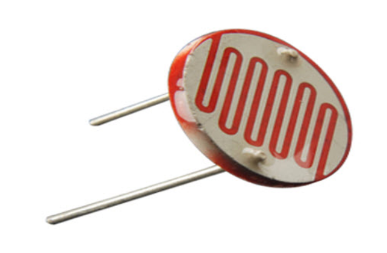

# Hardware — Learning Content V1.1

*Part of the module **Hardware, Networks & Behaviorist AI**. The Networks and Behaviorist AI units are developed on their own branches/folders; this file covers the Hardware unit only.*

## How to use this file

The Hardware unit answers two beginner questions:

1. **What is inside a computer, and how does it follow instructions?** (Part A — matches Lessons 1–2 in [study-overview.md](../study-overview.md))
2. **How does a computer-based system sense and affect the physical world?** (Part B — a worked project: an automatic light indicator)

Part A explains the computer as a general idea. Part B uses a small computer (a microcontroller) to build something real. Section A6 is the bridge between the two.

Two companion files support Part B:

- [beginner-lab-skills.md](beginner-lab-skills.md) — breadboards, multimeters, resistor colour codes, uploading code, schematic symbols, digital inputs, glossary and Questions H–L. Read it before the first lab session.
- [arduino/](arduino/) — the B11 sketches as ready-to-open Arduino files, plus calibration, PWM-dimming and push-button extensions.

A unifying example for the whole module is a **smart-room system**: a sensor measures brightness, a controller reads the measurement, a network may share the reading, an agent or control rule decides what should happen, and an output device switches a light. This file covers the sensor, controller and output parts.

## Prerequisites

Beginners do not need previous electronics or programming experience. They should be prepared to learn these ideas as they go:

- Basic arithmetic, fractions, and rearranging a simple equation.
- The difference between physical hardware and software instructions.
- Basic programming ideas such as variables, conditions (`if` statements), and repetition (`loop`).

Every technical term is defined the first time it is used.

## Intended learning outcomes

By the end of the Hardware unit, a beginner should be able to:

1. **Identify** input devices, the CPU, RAM, storage and output devices, and describe their roles.
2. **Explain** bits and bytes with a small example and **trace** a simplified fetch–decode–execute cycle.
3. **Describe** how a microcontroller relates to a full computer, and when each is a better choice.
4. **Explain and calculate** simple circuits using Ohm's law, series/parallel rules and the voltage-divider equation.
5. **Select and justify** components using voltage, current, power, interface, performance, environment, cost and availability.
6. **Trace** the path from a physical measurement through a sensor and controller to an actuator.
7. **Explain** why motors, relays and other heavy loads need driver circuits, and how PWM controls brightness or speed.
8. **Evaluate** a small hardware design for compatibility, power budget, safety and testing.

## Unit structure and development status

Status meanings:

- **Outline only:** the plan exists, but teaching material still needs to be written.
- **Drafted:** a first version exists; it has not yet passed peer or instructor review.
- **Checked:** another person or a documented test has checked the material. Use this label only after that check has happened.
- **Needs revision:** a known gap or uncertainty remains.

| Section | Topics | Learners can… | Example / activity | Status |
|---|---|---|---|---|
| A1–A2 | Computer components; RAM vs storage | Name each part's job | Follow a photo from storage to screen | **Drafted — needs peer review** |
| A3–A4 | Bits, bytes, logic gates | Convert 4-bit binary; read a truth table | Bit cards 0–15 | **Drafted — needs peer review** |
| A5 | Fetch–decode–execute cycle | Trace a 3-instruction program | Paper CPU trace (Question G) | **Drafted — needs peer review** |
| A6 | Microcontroller vs computer vs single-board computer | Choose a platform for a task | Arduino Uno vs Raspberry Pi | **Drafted — needs peer review** |
| B1–B4 | Electrical quantities, Ohm's law, series/parallel, safety | Do a one-step circuit calculation | Series/parallel worked example | **Drafted — needs technical review** |
| B5 | Component selection, datasheets, BOM | Justify a part choice | BOM for the light indicator | **Drafted — needs technical review** |
| B6–B7 | Voltage divider, ADC, resolution/accuracy, smoothing, calibration, hysteresis | Explain how light becomes a number | LDR on A0 | **Drafted — needs technical review** |
| B8–B10 | LED output, actuators, transistor/MOSFET drivers, PWM, servos, power budget | Explain why a motor needs a driver | Transistor base-resistor calculation | **Drafted — needs circuit/peer review** |
| B11–B15 | Code, system diagram, activity, answers, troubleshooting | Build, test and debug the circuit | Questions A–G | **Drafted — not yet tested on real hardware** |
| L1–L8 ([beginner-lab-skills.md](beginner-lab-skills.md)) | Breadboard, multimeter, resistor codes, Arduino IDE, schematic symbols, digital inputs, glossary | Build and measure a circuit safely | Measure the LDR; Questions H–L | **Drafted — needs technical review** |

### Where this fits in the full module

Rows 2–6 are developed in this file; rows 7–10 belong to the Networks and Behaviorist AI units.*

| Order | Topic and subtopics | What learners should be able to do | Planned example or activity | Current status |
|---|---|---|---|---|
| 1 | Module overview: hardware, networks, and agent behaviour | Describe how the parts of a connected system work together | Trace a smart-room system from sensor reading to light output | **Drafted; needs team review** |
| 2 | Hardware foundations: voltage, current, resistance, power, series and parallel circuits, basic safety | Define the main electrical quantities and use Ohm's law | Calculate current through a resistor | **Drafted; needs technical review** (B2–B4) |
| 3 | Physical component selection: microcontrollers, single-board computers, sensors, resistors, drivers, power supplies, datasheets, trade-offs | Choose components and justify the choices | Choose a controller and light sensor for an automatic lamp | **Drafted; needs technical review** (A6, B5) |
| 4 | Circuit design: schematics, voltage dividers, current-limiting resistors, logic levels, power budget, grounding, protection | Explain and check a simple circuit | Calculate a voltage-divider output and an LED resistor | **Drafted; needs circuit review** (B5–B6, B8, B10) |
| 5 | Sensor integration: analog and digital sensors, ADC, accuracy, resolution, signal conditioning, sampling, calibration | Explain how a measurement becomes a value that software can use | Read an LDR through an analog input | **Drafted; needs technical review** (B6–B7) |
| 6 | Actuator integration: LEDs, buzzers, relays, motors, GPIO limits, transistor/MOSFET drivers, PWM, protection | Explain when a load needs a driver circuit | Compare an LED output with a motor output | **Drafted; needs circuit review** (B8–B9) |
| 7 | Network foundations: links, packets, addresses, Ethernet, Wi-Fi, switches, routers, access points, latency, reliability | Describe a basic device-to-device communication path | Draw how a sensor sends a reading to a computer | **Outline only; coordinate with Networks contributor** |
| 8 | Networked and IoT systems: device communication, data formats, connectivity, privacy, security | Identify what a connected device needs beyond a sensor and controller | Plan how a room sensor could share readings with another device | **Outline only; content still needed** |
| 9 | Behaviorist AI or behaviour-based agents: inputs, state or feedback, rules, action selection | Explain the approach used in this course and trace an input-to-action example | Describe how a robot might respond to an obstacle | **Outline only; clarify the course meaning of “Behaviorist AI”** |
| 10 | Integration and evaluation: hardware, networks, agent behaviour, reliability, testing, trade-offs, documentation | Explain how the pieces work together and identify likely failure points | Review a connected smart-room design | **Outline only; depends on agreement across sections** |
| 11 | Glossary, questions, and references | Use terms consistently and check understanding | Answer short questions with explanations | **Hardware terms drafted; full-module glossary incomplete** |

### Known gaps and uncertainties

- Circuit values are **illustrative**. A real build must use the chosen parts' datasheets and the exact board's specifications.
- The examples assume a classic **5 V Arduino Uno R3**. Other boards differ (see B5 *Logic levels*).
- Some exact figures could not be read from the primary Microchip ATmega328P datasheet during research and come from secondary sources; these are marked *(secondary source)*.
- The circuit has **not yet been built and tested** by the team. Do not mark it *Checked* until it has.

---

# Part A — Inside a computer

## A1. The main parts and their jobs

A **computer** is a machine that takes in data, processes it by following instructions, and produces results. Every computer — laptop, phone, games console, or the small board in Part B — has the same basic jobs:

| Part | Job | Everyday example |
|---|---|---|
| **Input device** | Brings data in from the outside world | Keyboard, mouse, camera, microphone, light sensor |
| **CPU (central processing unit)** | Follows instructions: does calculations and makes decisions | The "brain" chip in a laptop |
| **RAM (random-access memory)** | Holds the programs and data being used *right now* | Your open documents and browser tabs |
| **Storage** | Keeps programs and files when the power is off | SSD, hard disk, USB drive, memory card |
| **Output device** | Sends results back to the outside world | Screen, speaker, printer, LED, motor |

```text
 Input  --->  CPU  <--->  RAM
                ^
                |
             Storage
                |
                v
             Output
```

**Demonstration — opening a photo:** the photo file sits in *storage*. When you open it, a copy is loaded into *RAM*. The *CPU* runs the photo-viewer program's instructions to decode the image, and the result is sent to the *screen* (output). The mouse click that started it all was an *input*.

## A2. RAM vs storage — a common confusion

- **RAM is volatile:** it needs power to keep its contents. When the power goes off, everything in RAM is lost. RAM is fast, so the CPU works from it.
- **Storage is non-volatile:** it keeps data without power. It is slower than RAM but holds much more.

So unsaved work (only in RAM) is lost in a power cut; a saved file (in storage) is not. A laptop with "16 GB RAM, 512 GB SSD" has 16 GB of working space and 512 GB of long-term space — the two numbers describe different jobs. [Corsair, volatile vs non-volatile memory]

## A3. Bits and bytes

A **bit** (binary digit) is the smallest unit of data: it is either **0** or **1**. Hardware stores a bit as one of two physical states, such as low or high voltage.

A **byte** is a group of **8 bits**.

Groups of bits can represent numbers. Each position is worth double the one to its right:

| Position value | 8 | 4 | 2 | 1 |
|---|---|---|---|---|
| Bits | 1 | 0 | 1 | 1 |

$1011 = 8 + 0 + 2 + 1 = 11$

- 4 bits can show $2^4 = 16$ values: 0 to 15.
- 8 bits (one byte) can show $2^8 = 256$ values: 0 to 255.

**Misconception:** binary is a way of *representing* information. It does not mean the computer *understands* the information as a person does.

**Units note:** officially, 1 kB (kilobyte) = 1000 bytes and 1 KiB (kibibyte) = 1024 bytes. Many product pages use "KB" loosely for 1024. Also watch the letter case: **b** = bit, **B** = byte. [NIST, prefixes for binary multiples]

## A4. Logic gates

A **logic gate** is a tiny circuit that takes one or more bits in and gives one bit out according to a fixed rule. CPUs are built from millions or billions of them. A **truth table** lists every input combination and the output.

| A | B | A AND B | A OR B | NOT A |
|---|---|---|---|---|
| 0 | 0 | 0 | 0 | 1 |
| 0 | 1 | 0 | 1 | 1 |
| 1 | 0 | 0 | 1 | 0 |
| 1 | 1 | 1 | 1 | 0 |

- **AND** outputs 1 only if *both* inputs are 1. ("The door opens if you have a key AND you know the code.")
- **OR** outputs 1 if *at least one* input is 1.
- **NOT** flips its single input.

## A5. How the CPU follows instructions: fetch–decode–execute

A **program** is a list of instructions stored in memory, alongside the data it uses. The CPU repeats the same three-step cycle for every instruction, billions of times a second in a laptop.

Key parts inside the CPU:

- **Program counter (PC):** holds the memory address of the *next* instruction.
- **Instruction register (IR, sometimes CIR):** holds the instruction currently being worked on.
- **Control unit (CU):** decodes the instruction and sends signals to the other parts.
- **ALU (arithmetic logic unit):** does the arithmetic (add, subtract) and logic (AND, OR, compare).
- **Accumulator (ACC):** a small working register that holds a result.

The cycle:

1. **Fetch:** the address in the PC is sent to memory; the instruction at that address is copied into the IR. The PC is then increased so it points to the next instruction.
2. **Decode:** the control unit works out what the instruction means — the *operation* (for example ADD) and the *operand* (what to use, for example memory address 5).
3. **Execute:** the control unit makes it happen — for example the ALU adds a number to the accumulator. A "jump" instruction can change the PC, which is how programs repeat and make decisions.

Some syllabuses list a fourth step, **store** (writing a result back), which this guide treats as part of *execute*. [Save My Exams; Computer Science Wiki]

### Worked example: a paper CPU

This is a **made-up teaching machine**, not a real processor, but the idea is the same.

| Address | Contents | Meaning |
|---|---|---|
| 0 | `LOAD 4` | Copy the value at address 4 into ACC |
| 1 | `ADD 5` | Add the value at address 5 to ACC |
| 2 | `STORE 6` | Copy ACC into address 6 |
| 3 | `HALT` | Stop |
| 4 | `7` | data |
| 5 | `5` | data |
| 6 | `0` | data (result goes here) |

| Cycle | PC at fetch | IR after fetch | Execute | ACC after | Address 6 after |
|---|---|---|---|---|---|
| 1 | 0 | `LOAD 4` | ACC ← 7 | 7 | 0 |
| 2 | 1 | `ADD 5` | ACC ← 7 + 5 | 12 | 0 |
| 3 | 2 | `STORE 6` | address 6 ← 12 | 12 | 12 |
| 4 | 3 | `HALT` | stop | 12 | 12 |

Notice that **instructions and data sit in the same memory** — only the PC decides which addresses are treated as instructions.

**Classroom activity:** one learner is the CPU (holding PC, IR and ACC cards), one is memory (holding the address cards). The CPU must ask memory for each address — it cannot "see" ahead.

**Speed misconception:** a higher clock speed (GHz) does not automatically mean a faster computer. Speed also depends on how much work the CPU does per clock tick, how many cores the program can use, and whether the chip slows down when hot. [Tom's Hardware; Wikipedia, instructions per cycle]

## A6. The bridge to Part B: a microcontroller is a small computer on one chip

A **microcontroller** is an integrated circuit that contains a CPU, program memory, RAM and input/output pins on a *single chip*. It runs one program, starts instantly, and is designed to interact directly with sensors and outputs.

The Arduino Uno R3 uses the **ATmega328P** microcontroller: [Arduino Uno R3 docs; Arduino Store]

| Computer idea (Part A) | On the ATmega328P |
|---|---|
| CPU | 8-bit processor, 16 MHz clock on the Uno |
| Storage (program kept without power) | 32 KB flash memory (0.5 KB used by the bootloader) |
| RAM (working memory, lost without power) | 2 KB SRAM |
| Extra non-volatile data | 1 KB EEPROM |
| Input/output | 14 digital pins (6 can do PWM), 6 analog inputs |

Compare a laptop with gigabytes of RAM: a microcontroller is tiny but enough to read a sensor and switch a light.

### Microcontroller or single-board computer?

A **single-board computer** such as a Raspberry Pi 5 is a full computer on one board: a multi-core processor at about 2.4 GHz, gigabytes of RAM, a full operating system, and a memory card or SSD for storage. [Raspberry Pi 5 product page]

| Need | Usually better choice |
|---|---|
| Read sensors and switch outputs, low power, instant start | Microcontroller (e.g. Arduino Uno) |
| Run an operating system, a web server, a camera with image processing, or heavy computation | Single-board computer (e.g. Raspberry Pi) |

Neither is "better" in general — the requirement decides. For the light indicator below, a microcontroller is the simpler fit.

---

# Part B — Physical computing: an automatic light indicator

## B1. Start with the system requirement, not the parts list

**Physical component selection** means choosing hardware that fits the task and the system's constraints. An engineer first defines what the system must do, then checks whether each candidate part can meet those requirements — not just picking what is popular or cheap.

Our requirement:

> Switch an indicator light on when a room becomes dark, and switch it off again when the room is bright.

The design needs at least:

- a **sensor** — a device that measures a physical quantity and provides a usable signal (here, brightness);
- a **controller** — here a microcontroller (A6) that reads the sensor and makes a decision;
- an **output device** — here an LED that shows the result;
- suitable resistors, wiring and a power source.

An **actuator** converts a control signal and energy into a physical effect, such as motion. In this beginner circuit the LED is treated as a simple output device; in larger systems actuators include motors, relays and solenoids (B9).

### Photo: microcontroller board


*An Arduino Uno R3 is a microcontroller development board. It provides digital pins, analog inputs, a USB connection and supporting circuitry. Image: Shoot stufz, [Wikimedia Commons](https://commons.wikimedia.org/wiki/File:Arduino_Uno_R3_development_board_03.jpg), [CC BY-SA 4.0](https://creativecommons.org/licenses/by-sa/4.0/).*

### Photo: light sensor



*A light-dependent resistor (LDR), also called a photoresistor, changes its resistance with light level. Image: Suyash Dwivedi, [Wikimedia Commons](https://commons.wikimedia.org/wiki/File:25mm_light-dependent_resistor_(LDR)_(2).jpg), [CC BY-SA 4.0](https://creativecommons.org/licenses/by-sa/4.0/).*

## B2. The electrical terms used in the circuit

- **Voltage ($V$):** electrical "push" — the potential difference between two points, measured in volts (V).
- **Current ($I$):** the rate of flow of electric charge, measured in amperes (A). 1 mA (milliamp) = 0.001 A.
- **Resistance ($R$):** opposition to current, measured in ohms (Ω). 1 kΩ = 1000 Ω.
- **Power ($P$):** rate of energy transfer, measured in watts (W).
- **Ground (GND):** the reference point (0 V) of the circuit, usually the supply's negative terminal.
- **Analog signal:** a signal that can take any value within a range.
- **Digital signal:** a signal that is either LOW (about 0 V) or HIGH (about the supply voltage, here 5 V).

**Ohm's law** links voltage, current and resistance:

$$
V = IR
$$

Rearranged:

$$
I = \frac{V}{R} \qquad R = \frac{V}{I}
$$

**Electrical power:**

$$
P = VI = I^2R
$$

## B3. Series and parallel circuits

- **Series:** components in one line, one after another. The **same current** flows through each. Resistances **add**: $R_{total} = R_1 + R_2$. The supply voltage is **shared** between them.
- **Parallel:** components side by side across the same two points. Each has the **same voltage**. The total current is the sum of the branch currents, and the total resistance is **smaller** than either resistor:

$$
\frac{1}{R_{total}} = \frac{1}{R_1} + \frac{1}{R_2} \qquad\text{or, for two resistors,}\qquad R_{total} = \frac{R_1 R_2}{R_1 + R_2}
$$

[SparkFun, Series and Parallel Circuits]

### Worked example

A 5 V supply with $R_1 = 1\ \text{k}\Omega$ and $R_2 = 2\ \text{k}\Omega$.

**Series:**

$$
R_{total} = 1 + 2 = 3\ \text{k}\Omega \qquad I = \frac{5}{3000} \approx 1.67\ \text{mA}
$$

$V_1 = 1.67\ \text{mA} \times 1\ \text{k}\Omega \approx 1.67\ \text{V}$ and $V_2 \approx 3.33\ \text{V}$. Check: $1.67 + 3.33 = 5\ \text{V}$.

**Parallel:**

$$
R_{total} = \frac{1 \times 2}{1 + 2} \approx 0.667\ \text{k}\Omega = 667\ \Omega \qquad I = \frac{5}{667} \approx 7.5\ \text{mA}
$$

Check: $5/1000 + 5/2000 = 5\ \text{mA} + 2.5\ \text{mA} = 7.5\ \text{mA}$.

The voltage divider in B6 is just a series circuit where we measure the voltage at the middle.

## B4. Basic electrical safety

This unit uses only **low-voltage DC** (5 V from USB, or small batteries). **Mains electricity (220 V AC) is out of scope and must not be connected to any circuit in this module.**

Even at low voltage:

1. **Disconnect power before changing wiring.** Reconnect only after checking.
2. **Avoid short circuits** — a wire directly from 5 V to GND can overheat wires, damage the board, or trip the USB fuse.
3. **Check polarity** of LEDs, diodes, electrolytic capacitors and batteries before powering up.
4. **Hot parts mean a fault.** If anything gets hot, smells or smokes, disconnect immediately.
5. **Lithium batteries (LiPo / Li-ion)** can catch fire if punctured, short-circuited, over-charged or over-discharged. Use a proper charger and protected packs only.
6. Follow the lab's own safety rules

[UIUC ECE 110 lab safety; Adafruit, Li-ion and LiPoly batteries]

## B5. Choose components using measurable criteria

| Criterion | What to ask | Why it matters |
|---|---|---|
| Operating voltage | What supply voltage does the part need? | A wrong voltage can stop it working or damage it. |
| Input/output compatibility | Can the controller safely read the sensor's signal, and can its outputs drive the load? | Boards have different logic voltages and pin limits. |
| Current and power | How much current will the part draw or carry? Can it handle the power? | Pins, wires and supplies all have limits. |
| Function and performance | Is the range, response time, accuracy or speed good enough? | It must do the actual job, not just connect. |
| Interface | Analog voltage, digital pin, I²C, SPI, UART…? | The controller must support it. |
| Environment | Temperature, moisture, vibration, light? | Conditions affect readings and reliability. |
| Cost and availability | Affordable? Well documented? | Undocumented parts are hard to use and maintain. |

A **datasheet** is the manufacturer's technical document describing a component's pins, electrical characteristics, operating conditions and limits. Read it before choosing a part. Do not confuse **recommended operating conditions** with **absolute maximum ratings**: an absolute maximum is a damage limit to stay well away from, not a target.

### Key facts for the Arduino Uno R3

From Arduino's official documentation: [Arduino Uno R3 docs; Arduino Store]

| Property | Value |
|---|---|
| Operating voltage | 5 V |
| Input voltage (barrel jack) | 7–12 V recommended (6–20 V limit) |
| DC current per I/O pin | **20 mA** (the absolute maximum on the chip is 40 mA *(secondary source)* — never design for it) |
| Total current through the chip | about 200 mA *(secondary source)* |
| 3.3 V pin | 50 mA |
| USB protection | resettable fuse trips above 500 mA |
| Analog inputs | 6 (A0–A5), 10-bit ADC |
| PWM pins | 3, 5, 6, 9, 10, 11 |

These figures are for the Uno R3. They must not be assumed for every Arduino-compatible board.

### Logic levels: why "5 V" vs "3.3 V" matters

A board's **logic level** is the voltage its pins use for HIGH. A classic Uno R3 uses 5 V. Many modern boards — **Raspberry Pi** and **ESP32** — use **3.3 V and are not 5 V tolerant**: connecting a 5 V signal to their inputs can damage them. Use a level shifter or a divider when mixing them. [Raspberry Pi documentation]

The newer **Arduino Uno R4** also runs at 5 V, but each pin is only rated for about **8 mA**, so the 330 Ω LED resistor used below (≈9 mA) should be raised to 470 Ω–1 kΩ on an R4. [Arduino Store, Uno R4 Minima]

### Bill of Materials (BOM)

A **Bill of Materials** lists the physical components needed to build a system: what, how many, which specification and why.

| Component | Qty | Specification | Purpose |
|---|---:|---|---|
| Arduino Uno R3 | 1 | 5 V board with analog inputs | Reads the sensor and runs the program |
| Light-dependent resistor (LDR) | 1 | e.g. GL5528 (≈10–20 kΩ at 10 lux, ≥1 MΩ dark) | Detects brightness |
| Fixed resistor | 1 | 10 kΩ, ¼ W | Forms a voltage divider with the LDR |
| LED | 1 | 5 mm red, forward voltage ≈2 V, 20 mA max | Indicates the result |
| LED resistor | 1 | 330 Ω, ¼ W | Limits LED current |
| USB cable and power source | 1 | 5 V USB, able to supply the board | Powers the board and sensing circuit |
| Breadboard | 1 | Standard solderless | Prototyping without soldering |
| Jumper wires | as needed | Male–male | Connections |

**Selection rationale:**

- **Microcontroller:** the Uno R3 has analog inputs and digital outputs, runs at 5 V, and is well documented — a good teaching platform.
- **Sensor:** an LDR is cheap and easy; its resistance changes with light.
- **Fixed resistor:** 10 kΩ is close to the LDR's resistance in normal room light, which puts the divider output near the middle of the ADC range, where changes are easiest to see.
- **LED and resistor:** visible output; 330 Ω keeps the current around 9 mA (B8), under the 20 mA pin rating.
- **Power:** USB is enough — the whole circuit draws well under 500 mA (B10).
- **Prototyping parts:** a breadboard and jumper wires make the circuit easy to change and test.

**Verification before assembly:**

1. Check the board's voltage and pin specifications.
2. Confirm the LDR's resistance range from its datasheet or by measuring with a multimeter.
3. Calculate the divider output at several light levels (B6).
4. Check the LED's forward voltage and current and the resistor's power rating (B8).
5. Confirm the power supply can provide enough current (B10).
6. Build, test, and only then mark the BOM as checked.

**Development status:** BOM drafted; specifications still need to be confirmed against the parts the team actually buys.

## B6. Circuit design: an LDR in a voltage divider

An LDR's resistance **falls as light increases**. But a microcontroller cannot measure resistance directly — it measures **voltage**. To turn the resistance change into a voltage change, connect the LDR and a fixed resistor in series as a **voltage divider**.

A voltage divider is two resistors in series across a supply; the output is the voltage at the junction between them. If the output is measured across the lower resistor $R_2$ (the one connected to ground), the ideal equation is:

$$
V_{out} = V_{in} \times \frac{R_2}{R_1 + R_2}
$$

$V_{in}$ is the supply voltage, $R_1$ is the top resistor and $R_2$ the bottom one. The formula assumes the input measuring the voltage draws almost no current — true for the Uno's analog inputs.

### Wiring diagram

A 10 kΩ fixed resistor on top, the LDR on the bottom, the midpoint to analog input A0:

```text
          +5 V (Uno R3)
               |
         [ R1 = 10 kΩ ]
               |
               +---------- A0 (analog input)
               |
         [ LDR = R2 ]
               |
              GND
```

With this arrangement, **more light → lower LDR resistance → lower voltage at A0**. **Darker → higher voltage.** Beginners often expect the opposite, so point this out. Swapping the two parts would reverse the direction.

**Important:** a voltage divider is for *sensing* only. Do not use one to power a load; use a proper voltage regulator instead.

### Worked example: estimate the sensor voltage

Assume a 5 V supply, $R_1 = 10\ \text{k}\Omega$, and two illustrative LDR readings:

- **Dim room:** $R_2 = 100\ \text{k}\Omega$
- **Bright room:** $R_2 = 2\ \text{k}\Omega$ (roughly a well-lit room, a few hundred lux, for a GL5528-type LDR)

These are teaching values. Real LDRs vary between models, so measure your own part or check its datasheet. In **true darkness** a GL5528 can exceed 1 MΩ. [GL55 series datasheet]

**Case A — dim:**

$$
V_{out} = 5 \times \frac{100}{10 + 100} = 5 \times \frac{100}{110} \approx 4.55\ \text{V}
$$

**Case B — bright:**

$$
V_{out} = 5 \times \frac{2}{10 + 2} = 5 \times \frac{2}{12} \approx 0.83\ \text{V}
$$

**Interpretation:** the dim example gives a much higher voltage than the bright one, so the controller can tell them apart.

## B7. From voltage to a number: the ADC

An **ADC (analog-to-digital converter)** turns an input voltage into a whole number that a program can use. The Uno R3's ADC is **10-bit**: it gives $2^{10} = 1024$ possible codes, numbered **0 to 1023**. With the default 5 V reference, `analogRead()` returns:

$$
\text{ADC code} = \left\lfloor \frac{V_{in}}{5\ \text{V}} \times 1024 \right\rfloor \quad (\text{maximum } 1023)
$$

Each step is $5\ \text{V} / 1024 \approx 4.9\ \text{mV}$. A reading of 1023 means "5 V minus one step or more". Many tutorials use $\times 1023$ instead; the difference is under 0.1 % — smaller than the variation in a USB 5 V supply — so either is fine for estimates. [Arduino analogRead reference; ATmega328P datasheet]

Using the worked example:

- Dim: $4.55 / 5 \times 1024 \approx 931$
- Bright: $0.83 / 5 \times 1024 \approx 170$
- True darkness (≈1 MΩ LDR): $4.95 / 5 \times 1024 \approx 1013$

These are ideal estimates. Real readings differ because of the actual LDR, the real supply voltage, resistor tolerance and electrical noise.

### Resolution, accuracy and precision

- **Resolution:** the smallest change the ADC can show — here ≈4.9 mV, one step.
- **Accuracy:** how close the reading is to the true value. It depends on the reference voltage, component tolerances and ADC errors — *not* just on resolution.
- **Precision (repeatability):** how much repeated readings of the same thing agree.

A 10-bit ADC has fine resolution, but if the 5 V USB supply is really 4.8 V, every reading is about 4 % off. **High resolution does not guarantee high accuracy.**

### Sampling

Each `analogRead()` takes about **100 µs**, so the Uno can take roughly 10,000 readings per second — far faster than room light changes. A delay of 50–100 ms between readings is plenty for this project. [Arduino analogRead reference]

### Smoothing, calibration and hysteresis

- **Smoothing:** average several readings to reduce noise. Arduino's *Smoothing* example averages the last 10 readings. [Arduino Smoothing example]
- **Calibration:** measure the real minimum and maximum in *your* room, then set the threshold between them. Arduino's *Calibration* example records min and max during the first 5 seconds, then uses `map()` to rescale. [Arduino Calibration example]
- **Hysteresis:** if the light level sits right at the threshold, noise makes the LED flicker on and off. Use **two thresholds** — for example turn ON above 550 but only turn OFF below 450. The gap between them stops the flicker. This is a standard control technique; see the second code example in B11.

## B8. Add an output: an LED indicator

An **LED (light-emitting diode)** converts electrical energy into light. It only conducts one way: current flows from the **anode** (+, longer leg) to the **cathode** (−, shorter leg, flat edge on the case).

An LED **must** have a series resistor to limit its current. A typical red LED has a forward voltage of about 2 V (range 1.8–2.2 V) and a maximum of 20 mA. [SparkFun, basic red LED]

For a 5 V output, a 2 V LED and a target of 10 mA, the resistor must drop:

$$
V_R = 5 - 2 = 3\ \text{V}
$$

$$
R = \frac{V_R}{I} = \frac{3}{0.010} = 300\ \Omega
$$

The nearest common value above that is **330 Ω**:

$$
I = \frac{3}{330} \approx 0.0091\ \text{A} = 9.1\ \text{mA}
$$

That is below the Uno R3's 20 mA pin rating. **Resistor power check:**

$$
P = I^2 R = 0.0091^2 \times 330 \approx 0.027\ \text{W} = 27\ \text{mW}
$$

That is far under a standard ¼ W (250 mW) resistor's rating.

Wiring: **digital pin 9 → 330 Ω resistor → LED anode → LED cathode → GND.**

## B9. Actuators: when a pin is not enough

A microcontroller pin is a **signal**, not a power supply. Rated at 20 mA, it can light an LED but **cannot** run most motors, relays or large buzzers.

| Load | Typical current | Drive directly from a pin? |
|---|---|---|
| Small LED + resistor | 5–15 mA | Yes |
| Active buzzer (small) | ~10–30 mA | Sometimes — check its datasheet |
| Relay coil (5 V) | ~70–100 mA | **No** — needs a transistor driver |
| Small DC motor | 100 mA – several A | **No** — needs a transistor/MOSFET or motor driver |
| Hobby servo | up to ~1 A while moving | Signal yes, **power no** — use a separate supply |

**Active vs passive buzzer:** an *active* buzzer has its own oscillator and beeps when given DC power; a *passive* buzzer needs the microcontroller to generate a tone (for example with `tone()`).

### Why motors and relays are special: inductive loads and flyback diodes

Motors and relay coils are **inductive loads** — they store energy in a magnetic field. When switched off suddenly, they produce a **voltage spike** that can destroy the transistor driving them. A **flyback diode** (for example a 1N4001) placed **across the load, pointing toward the positive supply** (cathode to +) gives that energy a safe path. [Wikipedia, flyback diode]

### A transistor as a switch

A **transistor** lets a small current (from the pin) control a much bigger current (through the load). In a **low-side switch** the transistor sits between the load and ground:

```text
  Motor supply (+6 V, separate)
          |
          +--------+
          |        |
       [Motor]   [Diode 1N4001]   (cathode/stripe toward +6 V)
          |        |
          +--------+
          |
          C
  Pin 9 --[ R_B ]-- B   NPN (e.g. 2N2222)
          E
          |
         GND  <---- shared with Arduino GND
```

**Common ground:** the motor supply's negative and the Arduino's GND **must be connected**, or the transistor has no reference and will not switch.

### Worked example: choose the base resistor

A small motor draws 150 mA. For an NPN transistor to be **fully on** (saturated), a common rule of thumb is to give the base about **one tenth** of the load current ("forced beta" of 10):

$$
I_B = \frac{150\ \text{mA}}{10} = 15\ \text{mA}
$$

The base–emitter junction drops about 0.7 V, so:

$$
R_B = \frac{5 - 0.7}{0.015} \approx 287\ \Omega
$$

Use **270 Ω or 330 Ω**. With 330 Ω, $I_B = 4.3 / 330 \approx 13\ \text{mA}$ — enough to switch the motor, and safely under the 20 mA pin rating.

A common mistake is using 1 kΩ: that gives only ≈4.3 mA, which may not fully turn the transistor on at 150 mA. It is fine for a 70 mA relay coil, though. [SparkFun, Transistors; Adafruit, DC motors lesson]

For loads above about **200 mA**, the base current would exceed the pin limit. Use a **logic-level N-channel MOSFET** instead (for example IRLB8721, which fully switches with 5 V on its gate), with a small gate resistor (≈100–220 Ω) and a 10 kΩ pull-down from gate to GND so it stays off at power-up. [Adafruit, IRLB8721]

### Motor-driver modules

To run a motor **forwards and backwards**, use an **H-bridge** driver module rather than building one:

| Driver | Motor voltage | Current per channel | Notes |
|---|---|---|---|
| L298N | up to 46 V | 2 A (4 A total) | Old design; wastes ~1.4–3 V as heat |
| TB6612FNG | 4.5–13.5 V | 1.2 A (3 A peak) | Efficient; protection diodes built in |
| DRV8833 | 2.7–10.8 V | 1.5 A (2 A peak) | Efficient; good for small robots |

[ST L298; Adafruit TB6612; TI DRV8833]

### PWM: controlling brightness and speed

Digital pins are only ON or OFF. **PWM (pulse-width modulation)** switches a pin on and off very quickly. The **duty cycle** is the percentage of time it is ON:

$$
\text{duty cycle} = \frac{t_{on}}{t_{on} + t_{off}} \times 100\%
$$

On average, a 5 V pin at 50 % duty cycle behaves like about 2.5 V, so an LED looks dimmer or a motor turns slower.

On the Uno R3, `analogWrite(pin, value)` takes a value from **0 to 255**: 0 = always off, 128 ≈ 50 %, 255 = always on. It works only on pins **3, 5, 6, 9, 10, 11**, at about 490 Hz (980 Hz on pins 5 and 6). [Arduino analogWrite reference; SparkFun, PWM]

### Servos

A **hobby servo** turns to a commanded angle. It reads a pulse every 20 ms (50 Hz): about 1 ms ≈ one end, 1.5 ms ≈ centre, 2 ms ≈ the other end. The Arduino `Servo` library generates these pulses. Power anything bigger than a micro-servo from a **separate 5–6 V supply** (allow about 1 A per servo) with a **shared ground**. On the Uno, using the `Servo` library disables `analogWrite()` on pins 9 and 10, so move a PWM LED to another PWM pin (for example 5 or 6) if you add a servo. [SparkFun, Hobby Servo Tutorial; Arduino Servo library]

## B10. Power budget

A **power budget** adds up the current every part needs and checks it against what the supply can give.

| Item | Current (approx.) |
|---|---|
| Arduino Uno R3 board itself | ~50 mA *(estimate — measure to confirm)* |
| LED via 330 Ω | 9 mA |
| LDR divider (worst case, bright: $5\ \text{V}/12\ \text{k}\Omega$) | 0.4 mA |
| **Total** | **≈60 mA** |

USB can supply up to 500 mA, so the light indicator has a large safety margin. A motor or servo would change that: **power motors from their own supply**, never from the Uno's 5 V pin.

## B11. Connect the sensor reading to the output

This Arduino sketch reads the divider and turns the LED on when it is dark. The threshold `500` is only a starting point; **calibrate it** using the Serial Monitor readings in your own room.

```cpp
const int sensorPin = A0;
const int ledPin = 9;
const int darkThreshold = 500;

void setup() {
  pinMode(ledPin, OUTPUT);
  Serial.begin(9600);
}

void loop() {
  int lightValue = analogRead(sensorPin);
  Serial.println(lightValue);

  // With the LDR as the lower divider resistor,
  // darker conditions produce a higher reading.
  if (lightValue > darkThreshold) {
    digitalWrite(ledPin, HIGH);
  } else {
    digitalWrite(ledPin, LOW);
  }

  delay(100);
}
```

### Improved version: smoothing and hysteresis

```cpp
const int sensorPin = A0;
const int ledPin = 9;
const int onThreshold = 550;   // turn LED on when reading rises above this
const int offThreshold = 450;  // turn LED off only when reading falls below this
const int samples = 10;

bool ledOn = false;

void setup() {
  pinMode(ledPin, OUTPUT);
  Serial.begin(9600);
}

void loop() {
  // Smoothing: average several readings to reduce noise.
  long total = 0;
  for (int i = 0; i < samples; i++) {
    total += analogRead(sensorPin);
    delay(5);
  }
  int lightValue = total / samples;
  Serial.println(lightValue);

  // Hysteresis: two thresholds stop flicker near the boundary.
  if (!ledOn && lightValue > onThreshold) {
    ledOn = true;
  } else if (ledOn && lightValue < offThreshold) {
    ledOn = false;
  }
  digitalWrite(ledPin, ledOn ? HIGH : LOW);

  delay(50);
}
```

Both sketches are written for the circuit in B6 and B8 on an Uno R3. They have **not yet been tested** by the team on real hardware. Check the pinout of your exact board before building.

Ready-to-open copies of both sketches, plus a calibration sketch and two extensions (PWM dimming, push-button mode switch), are in [arduino/](arduino/). Uploading steps are in [beginner-lab-skills.md, L4](beginner-lab-skills.md#l4-uploading-code-with-the-arduino-ide).

## B12. Overall system diagram

```text
Room light
    |
    v
LDR + 10 kΩ resistor        (physical input -> voltage)
    |
    v
Analog input A0 / ADC        (voltage -> number 0–1023)
    |
    v
Microcontroller program      (fetch–decode–execute: compare with threshold)
    |
    v
Digital output pin 9         (number -> HIGH/LOW voltage)
    |
    v
330 Ω resistor + LED         (electrical output -> light)
```

The parts form a **chain**: wrong wiring changes the measurement, a wrong threshold causes wrong decisions, and a missing LED resistor can damage the LED or the pin. Notice how Part A appears in the middle — the microcontroller's CPU fetches, decodes and executes the `if` statement thousands of times a second.

## B13. Learner activity

Try the questions before reading the answers. Show your calculations for Questions B and E.

**Question A — Component selection.** You need to build the automatic light indicator. Name four pieces of information you would check before choosing the board, LDR, fixed resistor and LED, and say why each matters.

**Question B — Voltage divider.** The input is 5 V, the fixed resistor is 10 kΩ and the LDR is 10 kΩ. Calculate the output voltage at the midpoint.

**Question C — Interpret a measurement.** On the Uno R3 circuit in B6, one condition reads about 900 and another about 180. Which is more consistent with darkness, and why?

**Question D — Actuator safety.** A teammate proposes connecting a small DC motor directly to a GPIO pin. Explain why this is unsuitable and name the kind of interface to use instead.

**Question E — Series and parallel.** Two 2 kΩ resistors are connected to 5 V. Find the total resistance and total current (i) in series and (ii) in parallel.

**Question F — PWM.** What duty cycle does `analogWrite(9, 64)` give, and roughly what average voltage?

**Question G — Paper CPU.** Using the paper CPU in A5, change address 5 to `9`. What value ends up in address 6, and how many fetch–decode–execute cycles run?

## B14. Answers and expected outcomes

**Answer A.** Possible answers: operating and logic voltage; current and power limits; sensor resistance range; ADC/interface compatibility; LED forward voltage and current; environment; cost and availability; the datasheets. A good answer explains *why* each matters, not just lists terms.

**Answer B.**

$$
V_{out} = 5 \times \frac{10}{10 + 10} = 2.5\ \text{V}
$$

Equal resistances split the supply in half.

**Answer C.** About 900. In this wiring, darkness raises the LDR resistance, which raises the midpoint voltage and therefore the ADC code. Real thresholds depend on your components and room — calibrate rather than treating 900 as universal.

**Answer D.** A GPIO pin is rated for about 20 mA and is meant for signals; a motor may need hundreds of milliamps, and as an inductive load it creates voltage spikes when switched. Use a transistor or logic-level MOSFET switch with a flyback diode, or a motor-driver module, powered from a separate supply with a shared ground.

**Answer E.**
(i) Series: $R = 4\ \text{k}\Omega$, $I = 5/4000 = 1.25\ \text{mA}$.
(ii) Parallel: $R = (2 \times 2)/(2 + 2) = 1\ \text{k}\Omega$, $I = 5/1000 = 5\ \text{mA}$.

**Answer F.** $64/255 \approx 25\%$ duty cycle, so about $0.25 \times 5 \approx 1.25\ \text{V}$ on average.

**Answer G.** $7 + 9 = 16$ is stored in address 6. Four cycles run (`LOAD`, `ADD`, `STORE`, `HALT`) — changing data does not change the number of instructions.

## B15. Troubleshooting checklist

Change one thing at a time:

1. Check the board pinout and supply voltage against the official documentation.
2. Confirm the fixed resistor and LDR are in series and A0 connects to their junction.
3. Check all grounds are connected together.
4. Print readings to the Serial Monitor and test bright and dark conditions.
5. Adjust the threshold only after seeing real readings.
6. Check the LED's orientation (long leg to the resistor/pin side) and that it has a series resistor.
7. If the LED flickers near the threshold, add smoothing and hysteresis (B11).
8. If adapting to another board, check its logic voltage and pin current limits first (B5).

---

# How this content becomes the three resources

| Content | Study Guide + Test Bank | PPT slide visual | Video segment |
|---|---|---|---|
| A1–A2 components | Component table + matching questions | Labelled computer diagram | "Follow a photo from storage to screen" |
| A5 fetch–decode–execute | Paper-CPU trace + Question G | Animated cycle diagram (PC → IR → CU → ALU) | Learners acting as CPU and memory |
| B6–B7 divider and ADC | Worked example + Questions B, C | Wiring diagram with voltage labels | Live build reading values on the Serial Monitor |
| B9 actuators | Base-resistor example + Question D | "Pin vs motor" current comparison chart | Why a motor needs a driver (safe demo) |

Use the same terms, values and diagrams in all three, so a correction made here is copied into every resource.

# Further development plan

- [ ] Peer-review Part A against the course lecture definitions (team member to be assigned).
- [ ] Peer-check every calculation in B3–B10 and record the outcome in the project log.
- [ ] Build and test the B6/B8 circuit and both sketches in the lab; record real readings and update thresholds.
- [ ] Confirm the 40 mA / 200 mA chip limits and ADC accuracy against the Microchip ATmega328P datasheet.
- [ ] Measure the Uno's own current draw to replace the ~50 mA estimate.
- [ ] Draw original diagrams for the slides (component diagram, fetch–decode–execute cycle, wiring diagram).
- [ ] Coordinate with the Networks and Behaviorist AI owners on the shared smart-room example.
- [ ] Update the status table honestly after each review.

# References

## Computer hardware (Part A)

1. Arduino. "UNO R3" — specifications and documentation. <https://docs.arduino.cc/hardware/uno-rev3/>
2. Arduino Store. "Arduino Uno Rev3" — technical specifications. <https://store.arduino.cc/products/arduino-uno-rev3>
3. Microchip. *ATmega328P Datasheet*. <https://ww1.microchip.com/downloads/en/DeviceDoc/Atmel-7810-Automotive-Microcontrollers-ATmega328P_Datasheet.pdf>
4. Raspberry Pi Ltd. "Raspberry Pi 5" — product page. <https://www.raspberrypi.com/products/raspberry-pi-5/>
5. Nisan, N. and Schocken, S. *Nand to Tetris*. <https://www.nand2tetris.org/>
6. Save My Exams. "The Fetch-Decode-Execute Cycle" (IGCSE Computer Science revision notes). <https://www.savemyexams.com/igcse/computer-science/cie/23/revision-notes/3-hardware/computer-architecture/the-fetch-decode-execute-cycle>
7. Computer Science Wiki. "The machine instruction cycle." <https://computersciencewiki.org/index.php/The_machine_instruction_cycle>
8. Save My Exams. "Truth Tables" (GCSE Computer Science). <https://savemyexams.com/gcse/computer-science/aqa/20/revision-notes/5-boolean-logic/boolean-logic/truth-tables>
9. NIST. "Prefixes for binary multiples." <https://physics.nist.gov/cuu/Units/binary.html>
10. Corsair. "Volatile vs non-volatile memory: what's the difference?" (vendor explainer). <https://www.corsair.com/uk/fi/explorer/diy-builder/memory/volatile-vs-non-volatile-memory-whats-the-difference/>
11. Tom's Hardware. "What is clock speed?" <https://www.tomshardware.com/news/clock-speed-definition,37657.html>

## Circuits, sensors and actuators (Part B)

12. Arduino. `analogRead()` reference. <https://docs.arduino.cc/language-reference/en/functions/analog-io/analogRead/>
13. Arduino. `analogWrite()` reference. <https://docs.arduino.cc/language-reference/en/functions/analog-io/analogWrite/>
14. Arduino. "Analog Input" example. <https://docs.arduino.cc/built-in-examples/analog/AnalogInput/>
15. Arduino. "Smoothing" example. <https://docs.arduino.cc/built-in-examples/analog/Smoothing/>
16. Arduino. "Calibration" example. <https://docs.arduino.cc/built-in-examples/analog/Calibration/>
17. Arduino. Servo library. <https://docs.arduino.cc/libraries/servo/>
18. Arduino Store. "UNO R4 Minima." <https://store-usa.arduino.cc/products/uno-r4-minima>
19. Raspberry Pi Ltd. Raspberry Pi hardware documentation (GPIO voltage). <https://www.raspberrypi.com/documentation/computers/raspberry-pi.html>
20. GL55 Series Photoresistor datasheet. <https://cdn.shopify.com/s/files/1/0699/1344/4452/files/GL55_Series_Photoresistor.pdf>
21. SparkFun Learn. "Voltage Dividers." <https://learn.sparkfun.com/tutorials/voltage-dividers/introduction>
22. SparkFun Learn. "Series and Parallel Circuits." <https://learn.sparkfun.com/tutorials/series-and-parallel-circuits/all>
23. SparkFun Learn. "Transistors." <https://learn.sparkfun.com/tutorials/transistors/all>
24. SparkFun Learn. "Pulse Width Modulation." <https://learn.sparkfun.com/tutorials/pulse-width-modulation/all>
25. SparkFun Learn. "Hobby Servo Tutorial." <https://learn.sparkfun.com/tutorials/hobby-servo-tutorial/all>
26. SparkFun. "LED – Basic Red 5mm." <https://www.sparkfun.com/led-basic-red-5mm.html>
27. Adafruit Learn. "Arduino Lesson 13: DC Motors — Transistors." <https://learn.adafruit.com/adafruit-arduino-lesson-13-dc-motors/transistors>
28. Adafruit. "N-channel power MOSFET — 30V / 60A (IRLB8721)." <https://www.adafruit.com/product/355>
29. Adafruit Learn. "TB6612 H-Bridge Motor Driver Breakout." <https://learn.adafruit.com/adafruit-tb6612-h-bridge-dc-stepper-motor-driver-breakout/overview>
30. Adafruit Learn. "Li-Ion and LiPoly Batteries." <https://learn.adafruit.com/li-ion-and-lipoly-batteries/conclusion>
31. STMicroelectronics. L298 dual full-bridge driver. <https://www.st.com/en/motor-drivers/l298.html>
32. Texas Instruments. DRV8833. <https://www.ti.com/product/DRV8833>
33. Wikipedia. "Flyback diode." <https://en.wikipedia.org/wiki/Flyback_diode>
34. University of Illinois ECE 110. "Electronics Lab Safety." <https://courses.engr.illinois.edu/ece110/content/labs/archive/Skill_Safety_ElectronicsLab.pdf>

## Images

35. Shoot stufz. "Arduino Uno R3 development board 03." Wikimedia Commons, CC BY-SA 4.0. <https://commons.wikimedia.org/wiki/File:Arduino_Uno_R3_development_board_03.jpg>
36. Suyash Dwivedi. "25mm light-dependent resistor (LDR) (2)." Wikimedia Commons, CC BY-SA 4.0. <https://commons.wikimedia.org/wiki/File:25mm_light-dependent_resistor_(LDR)_(2).jpg>

## Starter references for the other units (moved from the earlier draft)

37. Cisco. "What Is Computer Networking?" <https://www.cisco.com/site/us/en/learn/topics/networking/what-is-computer-networking.html>
38. Brooks, R. A. "A robust layered control system for a mobile robot." *IEEE Journal of Robotics and Automation*, 2(1), 14–23 (1986). <https://ieeexplore.ieee.org/document/1087032>
39. Oikawa, K., Tsuchiya, T. and Okubo, S. "Object-Oriented Design of Subsumption Architecture." *Journal of the Robotics Society of Japan*, 23(6), 697–705 (2005). <https://www.jstage.jst.go.jp/article/jrsj1983/23/6/23_6_697/_article>

## Status note

This file is **V1.1, a draft**. Part A and sections B3, B4, B7 (resolution/smoothing/hysteresis), B9 and B10 are new in V1.1. Sources were gathered with AI-assisted research (Claude, 22 Oct 2026); the research notes are in [research_notes/](research_notes/) and a summary report is in [reports/](reports/). The team still needs to check the content, build and test the circuit, and record this AI use in the project log before marking any section *Checked*.
